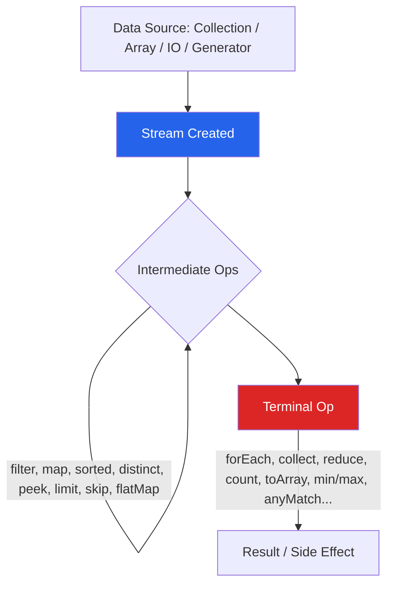

# 🌊 Java Stream API — Master Notebook

> A single, self-contained Obsidian vault to learn, revise, and crack interviews on the Java Stream API.
> Open this file as your **Map of Content (MOC)**. Every topic links out and links back here.

## How to use this vault
- Read topics 1 → 19 once, in order, for deep understanding.
- Use [[20-Interview-Questions]] and [[21-Coding-Problems]] for active recall.
- Use [[23-Cheat-Sheet]] the night before an interview.
- Use [[24-Revision-Notes]] for a 15-minute final skim.
- All code is Java 17-compatible unless noted (Java 8 baseline features are marked).

## 📚 Table of Contents

### Foundations
1. [[01-Introduction]]
2. [[02-Why-Streams]]
3. [[03-Internal-Architecture]]
4. [[04-Stream-Pipeline]]
5. [[05-Lazy-Evaluation]]

### Operations
6. [[06-Intermediate-Operations]]
7. [[07-Terminal-Operations]]
8. [[08-Collectors]]
9. [[09-Reduce]]
10. [[10-FlatMap]]

### Advanced
11. [[11-Parallel-Streams]]
12. [[12-Spliterator]]
13. [[13-Primitive-Streams]]
14. [[14-Optional-with-Streams]]
15. [[15-Performance]]

### Comparisons & Craft
16. [[16-Stream-vs-Collection]]
17. [[17-Stream-vs-Loop]]
18. [[18-Common-Bugs]]
19. [[19-Best-Practices]]

### Interview Prep
20. [[20-Interview-Questions]] — 50 Q&A
21. [[21-Coding-Problems]] — 30 problems with solutions
22. [[22-Real-World-Examples]]
23. [[23-Cheat-Sheet]]
24. [[24-Revision-Notes]]

## 🗺️ Big Picture Diagram

## Tag Index
`#java` `#streams` `#interview-prep` `#collectors` `#parallel` `#performance`
