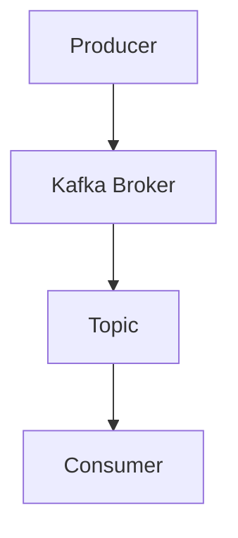
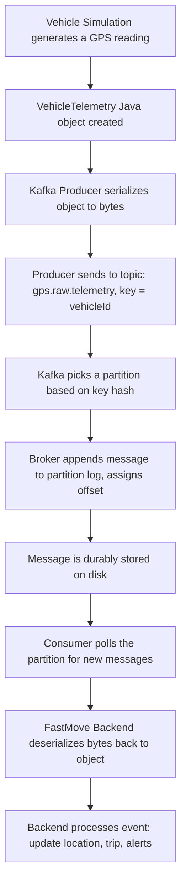
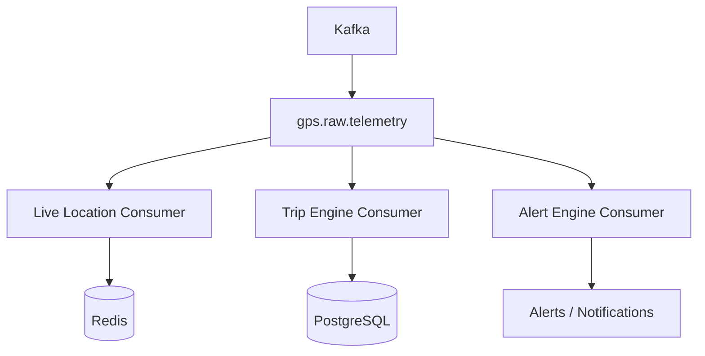
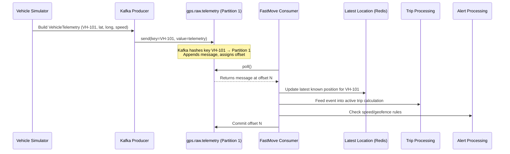
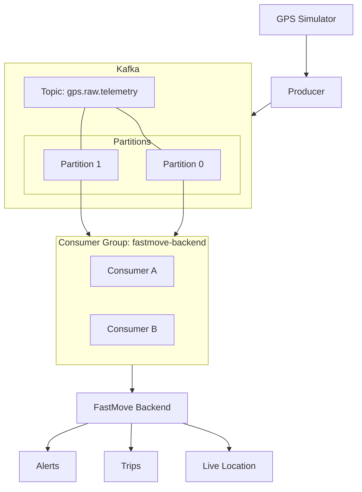

# Apache Kafka — From the Ground Up (FastMove Edition)

> **Goal of this note:** By the end, you should be able to answer —
> *"What happens inside Kafka when my FastMove Scheduler sends a GPS event, and how does my FastMove Backend receive and process it?"*

Your project, FastMove, is a vehicle/fleet-management system:

```text
Vehicle/GPS Simulator
        ↓
     Kafka
        ↓
FastMove Backend
        ↓
Trips / Live Location / Alerts / History
```

We'll build the mental model piece by piece, using FastMove examples the whole way. No jargon dumps, no memorizing definitions — just "what is actually happening."

---

## 1. What problem does Kafka solve?

Imagine you build FastMove **without** Kafka. Your GPS Simulator (or Scheduler) has to talk directly to every service that cares about location data:

```text
Scheduler → REST API → Live Location Service
Scheduler → REST API → Trip Engine
Scheduler → REST API → Alert Engine
Scheduler → REST API → History Service
```

This works... until it doesn't. A few problems show up fast:

- **Tight coupling** — the Scheduler needs to know the address of every single service it must call. Add a new service (say, a Fuel Analytics service)? You must now go edit the Scheduler.
- **Fragility** — if the Alert Engine is down or slow, does the Scheduler wait? Retry? Drop the GPS event? Every direct call is a new failure point.
- **No buffering** — if 10,000 vehicles send GPS pings every second, and one downstream service can't keep up, that service either falls over or starts dropping data.
- **No replay** — once an HTTP request is handled, it's gone. If Trip Engine had a bug last night and mis-processed everything, there's no way to "replay" the last 6 hours of GPS data through it.

Now compare with Kafka in the middle:

```text
Scheduler → Kafka → Backend(s)
```

The Scheduler no longer needs to know *who* is listening. It just publishes a GPS event to Kafka and moves on. Kafka's job is to durably hold onto that event and let any number of services read it, at their own pace, independently.

**What Kafka actually provides:**
- A durable, ordered log to write events into
- The ability for many independent consumers to read the same event stream
- Buffering when producers are faster than consumers
- The ability to replay historical events

**When Kafka is useful:**
- You have multiple independent things that need to react to the same event (FastMove: Live Location, Trip Engine, Alert Engine — all reacting to the same GPS ping)
- High-throughput streams of events (GPS pings from thousands of vehicles)
- You want producers and consumers to be decoupled in time (consumer can be down for a bit without losing data)

**When Kafka may be unnecessary:**
- A simple request/response where you need an immediate answer (e.g., "log in this user and return a token") — that's a REST call, not an event
- Low-volume, single-consumer scenarios where a REST call or even a simple database write is enough
- You don't yet have more than one thing that needs the data — adding Kafka "just in case" adds operational complexity (a whole cluster to run, monitor, and reason about) for no real benefit yet

> **In simple words:** Kafka is a middleman that durably stores events so producers and consumers don't have to talk to each other directly or be online at the same time.

---

## 2. The basic Kafka mental model

**Analogy first:** Think of Kafka like a **newspaper publisher with subscriptions**.

- A **reporter** (producer) writes an article and hands it to the **publisher** (Kafka).
- The publisher doesn't read or care what's in the article — it just organizes it into the right **section** (topic), like "Sports" or "Politics," and prints it in order.
- **Subscribers** (consumers) pick up whichever sections they're interested in and read the articles at their own pace. Multiple people can subscribe to the same section without interfering with each other.
- Old newspapers aren't shredded immediately — they're kept around for a while, so a subscriber can go back and read yesterday's edition if needed.

Now map that analogy onto real Kafka terms:

| Analogy | Kafka Term |
|---|---|
| The publishing company/press | Kafka Cluster |
| One printing press location | Broker |
| A newspaper section ("Sports") | Topic |
| The reporter | Producer |
| The subscriber | Consumer |
| One article | Message / Event |

Visually:



**What each piece actually does:**

- **Kafka Cluster** — a group of machines (brokers) working together to store and serve topics reliably. If one machine dies, others still have the data.
- **Broker** — a single Kafka server. It stores some of the data and handles read/write requests for it. A cluster is usually multiple brokers.
- **Topic** — a named stream of events, like `gps.raw.telemetry`. It's the "category" producers write to and consumers read from.
- **Producer** — any application (your Scheduler / GPS Simulator) that sends events into a topic.
- **Consumer** — any application (your FastMove Backend) that reads events from a topic.
- **Message/Event** — one unit of data, e.g., one GPS ping from one vehicle at one moment in time.

> **In simple words:** Producers write events into topics. Brokers (machines in the cluster) store those events. Consumers read events out of topics. Kafka itself doesn't process or understand your data — it just moves and stores it reliably.

---

## 3. What is a Kafka message?

Here's a real FastMove GPS event, as your Scheduler might produce it:

```json
{
  "vehicleId": "VH-101",
  "deviceId": "GPS-501",
  "latitude": 22.5726,
  "longitude": 88.3639,
  "speed": 42.5,
  "gpsTimestamp": "2026-09-23T10:00:00Z"
}
```

**Important realization: Kafka does not understand this JSON at all.**

To Kafka, a message is just a **key** (optional) and a **value** — both are just bytes. Kafka doesn't parse the JSON, doesn't know there's a field called `vehicleId`, and doesn't validate anything about the structure. It treats the value as an opaque blob.

- **What the producer sends:** your Java object (`VehicleTelemetry`), serialized into bytes — usually via a `Serializer` (e.g., `StringSerializer`, `JsonSerializer`, or Avro/Protobuf if you get fancier later). Spring Kafka handles this serialization step for you if configured.
- **What Kafka stores:** the raw bytes, plus some metadata it adds itself (below). It just appends them to a log file on disk, in order.
- **What the consumer receives:** the same raw bytes, which it must **deserialize** back into a `VehicleTelemetry` object using a matching `Deserializer`. If your producer serializes as JSON and your consumer tries to deserialize as Avro, you'll get errors — Kafka won't catch this mismatch for you.

**Metadata Kafka adds to every message**, beyond your JSON payload:

- **Offset** — a sequential ID for the message's position within its partition (explained in Section 9)
- **Timestamp** — when the message was produced (or appended, depending on config)
- **Partition** — which partition (subsection of the topic) it landed in
- **Key** (if you set one, e.g., `vehicleId`) — used to decide which partition the message goes to

> **In simple words:** Kafka stores bytes, not JSON. Your app (producer and consumer) is responsible for turning objects into bytes and back — Kafka just moves and stores whatever bytes you give it, in order, and stamps each one with an offset, timestamp, and partition.

---

## 4. What is a Topic?

For FastMove, GPS events go into a topic named:

```text
gps.raw.telemetry
```

Think of a topic as a named, ever-growing log file (well — really a set of log files, see Partitions next) that categorizes related events.

**Why topics exist:** so producers and consumers can agree on a "channel" for a specific kind of data, without knowing anything else about each other. The Scheduler just says "I'm writing to `gps.raw.telemetry`." The Trip Engine just says "I'm reading from `gps.raw.telemetry`." Neither needs to know the other exists.

**Can multiple producers write to one topic?** Yes. In FastMove, you might eventually have multiple Scheduler instances (for scaling), or even different services producing GPS-like events — they can all write into the same `gps.raw.telemetry` topic.

**Can multiple consumers read from one topic?** Yes, and this is one of Kafka's most powerful features. In FastMove:

```text
                    gps.raw.telemetry
                           │
        ┌──────────────────┼──────────────────┐
        ↓                  ↓                   ↓
  Live Location       Trip Engine         Alert Engine
```

Each of these can independently read the *same* events, at its own pace, without affecting the others. Reading a message doesn't delete it or "use it up" — unlike, say, a traditional message queue where one consumer taking a message means others don't see it.

Visually, GPS events flowing in:

```text
Scheduler
   │
   ├── GPS event
   ├── GPS event
   └── GPS event
          ↓
   gps.raw.telemetry
```

> **In simple words:** A topic is a named stream/category of events. Many producers can write to it, and many independent consumers can read from it — reading doesn't remove the data for others.

---

## 5. What is a Partition?

This is the concept that unlocks *why* Kafka can scale, so let's go slow.

A topic isn't really one single log — it's split into multiple **partitions**, each of which *is* an ordered, append-only log:

```text
Topic: gps.raw.telemetry
  ↓
Partition 0   [msg, msg, msg, msg, ...]
Partition 1   [msg, msg, msg, msg, ...]
Partition 2   [msg, msg, msg, msg, ...]
```

**Why split into partitions?**

1. **Parallelism** — each partition can be read by a different consumer at the same time. If you had only one partition, only one consumer could ever be actively reading from it at once (within a consumer group — see Section 8), no matter how many machines you throw at the problem.
2. **Throughput/scale** — different partitions can live on different brokers, spreading load across your cluster.

**What does "ordering" mean here, and why only within a partition?**

Kafka guarantees that messages **within a single partition** stay in the exact order they were written. It does **not** guarantee any ordering *across* partitions. So if `VH-101`'s events go to Partition 0 and `VH-205`'s events go to Partition 1, you know VH-101's own events arrive in order relative to each other — but you can't say anything about how VH-101's events interleave in time with VH-205's events from Kafka's perspective.

For FastMove, this matters a lot: you want VH-101's GPS pings to always be processed in the order they occurred (you don't want to compute "current location" using an older ping that arrived late and overwrote a newer one). But you don't care about ordering *between different vehicles* — VH-101 and VH-205 are independent.

Example partition assignment:

```text
VH-101 → Partition 0
VH-205 → Partition 1
VH-301 → Partition 2
```

**Why use `vehicleId` as the Kafka message key?**

Kafka decides which partition a message goes to based on its **key** (using a hash of the key, by default). If you set the message key to `vehicleId`:

- Every event for `VH-101` will *always* hash to the same partition (say, Partition 0), every single time.
- This guarantees all of VH-101's GPS events stay in order relative to each other, because they all land in the same ordered log.
- Meanwhile, different vehicles get spread across different partitions, so you still get parallelism.

If you didn't set a key (or used a random/round-robin key), events for the same vehicle could land in different partitions, and you'd lose per-vehicle ordering guarantees — bad news if a "vehicle moved backward in time" bug creeps into your Trip Engine.

> **In simple words:** A topic is split into partitions so multiple consumers can work in parallel. Kafka only guarantees order *within* a partition, so we use `vehicleId` as the key to make sure each vehicle's events always land in the same partition and stay in order.

---

## 6. What happens when Scheduler sends a GPS event? (The core flow)

This is the most important section — let's trace one GPS event from birth to processing, step by step.



**Step by step, in words:**

1. **Vehicle Simulation generates a reading.** Your GPS Simulator (playing the role of a real vehicle) produces a raw reading: lat, long, speed, timestamp.
2. **A `VehicleTelemetry` object is built.** In your Java/Spring Boot code, this is just a POJO holding the fields you saw in Section 3.
3. **The Kafka Producer serializes it.** Spring Kafka's `KafkaTemplate` (wrapping the underlying Kafka Producer client) turns your object into bytes using whatever serializer you configured (commonly JSON for a learning project).
4. **The producer sends it to the topic**, specifying `vehicleId` as the key. This is a call like `kafkaTemplate.send("gps.raw.telemetry", vehicleId, telemetry)`.
5. **Kafka determines the partition.** Using the key's hash, Kafka decides: "this goes to Partition 1," for example. If VH-101 always hashes to Partition 0, that's guaranteed and consistent.
6. **The broker appends the message to that partition's log** on disk, and assigns it the next available **offset** in that partition (e.g., offset 47).
7. **The message is now durably stored.** Depending on your producer's `acks` setting, the producer receives confirmation once the message is safely written (and possibly replicated to other brokers, in a multi-broker setup).
8. **A consumer polls for new messages.** Your FastMove Backend's Kafka Consumer isn't sitting idle waiting for a push — it actively asks Kafka, "anything new for me?" (This is explained more in Section 7.)
9. **The backend deserializes the bytes** back into a `VehicleTelemetry` object.
10. **The backend processes the event** — e.g., updates the vehicle's latest location in Redis, feeds the Trip Engine, checks Alert rules (speeding, geofence, etc.).

> **In simple words:** The Scheduler doesn't call the Backend directly. It drops the event into Kafka, Kafka stores it durably in the right partition, and the Backend independently pulls it out whenever it's ready to process it.

---

## 7. What is a Consumer?

A consumer is any application that reads messages from a topic — in FastMove, this is your Backend's Kafka listener code.

**Push or pull?** This trips a lot of beginners up: **Kafka does not push messages to consumers.** Consumers **pull (fetch)** messages from Kafka by continuously **polling**.

```text
Kafka
  ↓
Consumer  (calls poll() repeatedly)
  ↓
Telemetry Processing
```

**What does "polling" mean?** Your consumer runs a loop (Spring Kafka mostly hides this loop from you with `@KafkaListener`, but it's happening underneath) that repeatedly asks the broker: "give me the next batch of messages from the partition(s) I'm assigned." If there's nothing new, it just gets an empty response and asks again shortly after. This gives the consumer full control over its own pace — it fetches only when it's ready for more.

**What happens after a consumer reads a message?**

1. It processes the message (your business logic — update location, trigger trip logic, etc.)
2. It (eventually) **commits the offset** of that message, telling Kafka "I've handled everything up to and including this offset." This is how Kafka knows what's already been processed if the consumer restarts (see Section 9).

> **In simple words:** Kafka is "pull-based" — your FastMove Backend actively asks for messages rather than Kafka pushing them. This gives the consumer control over how fast it processes data.

---

## 8. What is a Consumer Group?

This is one of the most important — and most confusing at first — Kafka ideas. Let's build it up slowly.

**Start with just one consumer:**

```text
Topic (3 partitions)
  ↓
Consumer A
```

If there's only one consumer, it reads from *all* partitions of the topic by itself. Fine for a single instance, but it can't scale — one consumer, no matter how many partitions exist, is doing all the work alone.

**Now add a consumer group:**

```text
Topic (3 partitions: P0, P1, P2)
  ↓
Consumer Group "fastmove-backend"
   ├── Consumer A
   ├── Consumer B
   └── Consumer C
```

A **consumer group** is just a named set of consumers that coordinate to divide up the work of reading a topic. Kafka automatically assigns each partition to exactly **one** consumer within the group:

```text
Partition 0 → Consumer A
Partition 1 → Consumer B
Partition 2 → Consumer C
```

**Why do consumer groups exist?** So you can scale out consumption horizontally. If you run 3 instances of your FastMove Backend (all using the same `group.id`), Kafka splits the 3 partitions across them — each instance handles roughly a third of the vehicles, in parallel, without any of them needing custom coordination code. You just start more instances.

**Why don't two consumers in the same group process the same partition simultaneously?** Because that would break your ordering guarantee. If both Consumer A and Consumer B read from Partition 0 at the same time, you could process VH-101's events out of order, or twice, with no coordination. Kafka's rule — *at most one consumer per partition, per group* — keeps per-partition processing serialized and predictable.

**What happens when a consumer dies?** Say Consumer B (handling Partition 1) crashes. Kafka detects this (it stops receiving heartbeats) and triggers a **rebalance**: Partition 1 gets reassigned to one of the remaining consumers (A or C) in the group. No data is lost — the new owner just resumes reading from the last committed offset for that partition.

**What happens when a new consumer joins?** Say you scale FastMove Backend from 2 instances to 4. Kafka triggers another rebalance and redistributes partitions so the new instance(s) also get a fair share. Note: if you have 3 partitions and 4 consumer instances in the same group, one instance will simply sit idle — you can't have more *active* consumers-per-group than partitions.

> **In simple words:** A consumer group is a team of consumers sharing the work of reading a topic. Kafka makes sure each partition is read by only one team member at a time, and automatically reshuffles partition ownership when members join or leave.

---

## 9. What is an Offset?

Within a single partition, every message gets a sequential position number called an **offset**, starting from 0:

```text
Partition 0

Offset
  0 → GPS event (VH-101, 10:00:00)
  1 → GPS event (VH-101, 10:00:05)
  2 → GPS event (VH-101, 10:00:10)
  3 → GPS event (VH-101, 10:00:15)
  4 → GPS event (VH-101, 10:00:20)
```

**What does an offset represent?** It's simply "this message's position in this partition's log" — like a line number in a file. It has no meaning across partitions; Partition 1 has its own offset 0, 1, 2, ... completely independent of Partition 0's numbering.

**Why do consumers need offsets?** Because a consumer needs to remember "how far have I already read?" so that:
- It doesn't reprocess the same message forever
- If it restarts, it knows exactly where to resume

**How does Kafka know what a consumer has processed?** The consumer periodically **commits** its offset — telling Kafka (which stores this in a special internal topic called `__consumer_offsets`), "for partition 0, I've fully processed up through offset X." This commit is separate from the actual reading/processing step — you control when it happens (auto-commit on a timer, or manually after your business logic succeeds, which is safer).

**What happens when a consumer restarts?** It looks up the last *committed* offset for each partition it owns, and resumes polling from right after that point. It does **not** start from offset 0 again, and it does **not** need to remember anything itself — Kafka tracks this for it.

**Example:** Suppose your FastMove Backend consumer crashes right after fully processing offset 10 in Partition 0, but *before* it committed that offset (the last commit was at offset 8). When it restarts, Kafka gives it messages starting from offset 9 again — meaning offsets 9 and 10 get **reprocessed**, even though offset 10 was technically already handled once. This is intentional and safe *if* your processing logic can tolerate handling the same event twice (see the next section).

> **In simple words:** An offset is just "how far into this partition's log we are." Consumers track (via commits) how far they've processed, so a restart resumes from the right place instead of starting over or randomly skipping ahead.

---

## 10. What happens if the consumer crashes?

```text
Kafka
  ↓
Consumer
  ↓
Processing
  X CRASH
```

Let's say your FastMove Backend consumer is halfway through updating the Trip Engine for a GPS event when the JVM crashes, or the pod gets killed.

**When it restarts:**

1. It rejoins its consumer group (possibly triggering a rebalance if it was gone long enough to be considered "dead").
2. It resumes from its **last committed offset** — not from where it "felt like it got to" internally, since Kafka has no idea what your app-level logic actually finished.
3. Any messages between the last committed offset and where it crashed get **redelivered and reprocessed**.

This introduces the idea of **at-least-once processing**: with typical configurations, Kafka guarantees a consumer will see every message *at least* once — but possibly more than once, if a crash happens between processing and committing. It will not silently lose messages (assuming you commit responsibly), but your application logic must be able to handle occasionally seeing the same GPS event twice without corrupting data (e.g., "update latest location to X" is naturally safe to run twice; "increment trip distance by 5km" run twice would double-count — this is called **idempotency**, and it's a design concern for your consumer logic, not something Kafka solves for you automatically).

We are **not** going deep into exactly-once semantics here — that's a more advanced Kafka feature for later (see Section 15).

> **In simple words:** If a consumer crashes mid-processing, Kafka doesn't lose the message — it'll be redelivered from the last committed offset when the consumer comes back. But that can mean the same message gets processed twice, so your logic needs to tolerate that.

---

## 11. What happens if Kafka is temporarily unavailable?

```text
Scheduler
   ↓
Kafka ❌
```

Now flip it around: what if Kafka itself (or the specific broker your producer is talking to) is down or unreachable when your Scheduler tries to send a GPS event?

**What the producer experiences:** The `send()` call will fail or time out. Depending on configuration, the Kafka producer client has built-in retry behavior — it can automatically retry sending for a configured number of attempts/duration before giving up and surfacing an error to your code.

**Why retry logic may be necessary:** Networks blip, brokers restart, leader elections happen (a partition's "leader" broker can briefly change during a failure) — these are often transient. A short retry can paper over momentary unavailability without your application needing to do anything.

**Why retries alone don't guarantee delivery:** If Kafka (or the specific partition leader) stays unreachable for longer than your retry window, the producer eventually gives up, and the send fails for good. If your Scheduler doesn't do anything with that failure besides logging it, **that GPS event is simply lost** — it never entered Kafka at all, so Kafka can't help you recover it.

**Why applications sometimes need persistent buffering/outbox strategies:** For anything where losing an event is unacceptable, you need a fallback beyond in-memory retries — for example:
- Writing the event to a local durable store (a database "outbox" table) *before* attempting to send to Kafka, and only marking it as sent once Kafka confirms — so a background job can retry sending anything still marked "unsent."
- Buffering to local disk temporarily if Kafka is down for an extended outage.

**Relating this to your FastMove Scheduler's existing retry logic:** whatever retry mechanism you've already built into the Scheduler is exactly this first line of defense — it's handling the "Kafka blipped for a second" case. If you want stronger guarantees (zero GPS events ever silently dropped, even during extended Kafka outages), that's where an outbox-style pattern would come in as a next step, on top of what you already have.

> **In simple words:** Kafka being unreachable is a real failure mode your producer must handle. Built-in retries cover short blips; for stronger guarantees against extended outages, you need to persist the event somewhere durable *before* attempting the Kafka send.

---

## 12. Why Kafka is useful for FastMove

Here's the payoff — how this all comes together for your actual architecture:



- **Decoupling** — your Scheduler doesn't know or care that Live Location, Trip Engine, and Alert Engine exist. Add a new consumer (say, a Fuel Efficiency Analyzer) later without touching the Scheduler at all.
- **Multiple consumers** — the same GPS event is independently consumed by Live Location, Trip Engine, and Alert Engine. Each reads at its own pace and maintains its own offset.
- **Scalability** — as your vehicle fleet grows, add more partitions and more consumer instances to spread the load, without redesigning the flow.
- **Buffering** — if the Alert Engine has a slow moment (say, it's doing a heavier geofence computation), GPS events just queue up in Kafka; they aren't lost, and the Live Location service isn't affected at all.
- **Consumer failure isolation** — if the Trip Engine crashes for 10 minutes, Live Location and Alert Engine keep working completely normally. When Trip Engine comes back, it just resumes from its last committed offset — no special recovery logic needed.
- **Replay/reprocessing** — if you deploy a bug fix to the Trip Engine and want to recompute trips for the last 2 hours, you can reset that consumer group's offset backward and let it reprocess history (as long as Kafka's retention window still has that data).
- **Event-driven architecture** — FastMove becomes a system of independent services reacting to a shared stream of truth (GPS events), rather than a tightly-wired chain of direct calls.

**When would this be unnecessarily complicated?** If FastMove only ever had *one* consumer of GPS data (say, just Live Location, with no Trip Engine or Alert Engine ever planned), a simpler approach — a direct REST call, or even just writing straight to a database that Live Location reads from — would likely be simpler to build and operate than running and maintaining a Kafka cluster. Kafka's value comes specifically from the "one event, many independent consumers, at scale, with replay" combination — if you don't need most of that, it's extra operational weight (brokers to run, monitor, upgrade) for little payoff.

> **In simple words:** Kafka shines for FastMove because one GPS event needs to reach several independent, differently-paced consumers reliably and at scale — that's exactly the problem Kafka is built to solve.

---

## 13. End-to-end FastMove example

Let's trace one full, concrete journey.

**Setup:** Vehicle `VH-101` moves from Location A to Location B.



**In words:**

1. `VH-101` reports a new position. The Vehicle Simulator builds a `VehicleTelemetry` object.
2. The Kafka Producer sends it to `gps.raw.telemetry` with `key = "VH-101"`.
3. Kafka hashes the key and consistently routes it to **Partition 1** (the same partition every VH-101 event always lands in).
4. The broker appends the message to Partition 1's log and assigns it the next offset (say, offset 84).
5. The FastMove Consumer (part of the `fastmove-backend` consumer group), which owns Partition 1, polls and receives this message.
6. It deserializes the bytes back into a `VehicleTelemetry` object.
7. It updates **Latest Location** (e.g., in Redis) for VH-101.
8. It feeds the event into **Trip Processing**, which might append it to VH-101's currently active trip (e.g., recalculating distance traveled).
9. It runs the event through **Alert Processing** (e.g., "is speed > 80 km/h?" or "did the vehicle leave its geofence?").
10. Once all processing succeeds, the consumer commits offset 84 for Partition 1 — marking this event as fully handled.

If the consumer crashed between steps 7 and 10, on restart it would resume from the last *committed* offset (say, 83) and reprocess this same event — updating Redis, Trip Processing, and Alert Processing again for the same GPS ping. This is the at-least-once behavior from Section 10.

---

## 14. Kafka terminology cheat sheet

| Term | Meaning | FastMove Example |
|---|---|---|
| **Broker** | A single Kafka server that stores data and serves producer/consumer requests. | One machine in your Kafka cluster storing part of `gps.raw.telemetry`. |
| **Topic** | A named stream/category of events. | `gps.raw.telemetry` |
| **Producer** | An application that writes/sends events into a topic. | Your Scheduler / GPS Simulator. |
| **Consumer** | An application that reads events from a topic. | Your FastMove Backend's Kafka listener. |
| **Partition** | A subdivision of a topic; an ordered log allowing parallelism. | `gps.raw.telemetry` split into P0, P1, P2. |
| **Offset** | A message's sequential position within a partition. | "VH-101's event is at offset 84 in Partition 1." |
| **Consumer Group** | A named team of consumers sharing the work of reading a topic. | `fastmove-backend` group with multiple backend instances. |
| **Message Key** | Optional field used to decide which partition a message goes to. | `vehicleId` (e.g., "VH-101"). |
| **Event** | One unit of data sent through Kafka. | One GPS ping from one vehicle. |
| **Cluster** | The full set of brokers working together. | Your entire Kafka deployment for FastMove. |

---

## 15. Don't worry about these yet

These are real, important Kafka concepts — but you don't need them to build a working understanding of FastMove's core flow. Come back to these later.

- **Kafka Streams** — a library for building stream-processing applications *on top of* Kafka (joins, windowed aggregations, etc.). Useful once your processing logic gets complex; not needed to understand basic produce/consume.
- **Exactly-once semantics** — advanced guarantees that avoid even the "processed twice" scenario from Section 10. Requires understanding transactions and idempotent producers first — build comfort with at-least-once first.
- **Transactions** — Kafka's mechanism for atomically writing to multiple partitions/topics together. Relevant mainly once you have complex multi-topic write patterns.
- **Schema Registry** — a system for enforcing and evolving message formats (e.g., with Avro) across producers/consumers over time. Matters more once multiple teams/services depend on a stable event contract.
- **Kafka Connect** — a framework for plugging Kafka into external systems (databases, S3, etc.) without writing custom producer/consumer code. Useful for integrations later, not for understanding the core model.
- **MirrorMaker** — replicates data between separate Kafka clusters (e.g., cross-region). Relevant at a scale/geography FastMove isn't at yet.
- **Advanced replication internals** — the detailed mechanics of how brokers replicate partition data to each other for fault tolerance.
- **ISR (In-Sync Replicas)** — which replica brokers are fully caught up and eligible to become leader. Operational/reliability detail, not needed for app-level understanding.
- **Leader election** — how Kafka picks which broker is "in charge" of a partition at any moment. Happens automatically; you don't manage it as an app developer.
- **KRaft internals** — Kafka's newer consensus mechanism (replacing ZooKeeper) for cluster metadata management. Infrastructure-level, not application-level.
- **Advanced tuning** — batch sizes, compression settings, fine-grained `acks`/retry tuning, etc. Worth learning once you have a real performance problem to solve, not before.

---

## 16. Visual summary



---

## 17. Learning questions (self-test)

Don't look up the answers immediately — try to answer these from memory first, then re-read any section you're unsure about.

1. What problem does Kafka solve, and why not just call every backend service directly from the Scheduler?
2. What is a topic, and why don't producers/consumers need to know about each other?
3. What is a partition, and why does Kafka split topics into partitions at all?
4. What is an offset, and how does it let a consumer resume correctly after a restart?
5. Why use `vehicleId` as a message key instead of leaving the key empty or random?
6. What is a consumer group, and why can't two consumers in the same group read the same partition at the same time?
7. What happens when a consumer crashes mid-processing — is the event lost, reprocessed, or something else?
8. How can Live Location, Trip Engine, and Alert Engine all consume the exact same GPS events independently?
9. Why is Kafka specifically useful for FastMove's architecture — and when would it be overkill?
10. Walk through, from memory, everything that happens from the moment a GPS event is generated by the simulator to the moment the FastMove Backend finishes processing it.

---

### A note on Kafka vs. Spring Kafka

Throughout this note: **Apache Kafka** is the underlying system — the brokers, topics, partitions, the wire protocol. **Spring Kafka** is a Java library that wraps Kafka's native producer/consumer clients in Spring-friendly abstractions (`KafkaTemplate` for producing, `@KafkaListener` for consuming, auto-configuration via `application.yml`). When you write `@KafkaListener(topics = "gps.raw.telemetry")` in your FastMove Backend, Spring Kafka is handling the polling loop, deserialization, and offset commits for you under the hood — but everything described in this note about topics, partitions, offsets, and consumer groups is true at the Kafka level, regardless of which client library sits on top.
