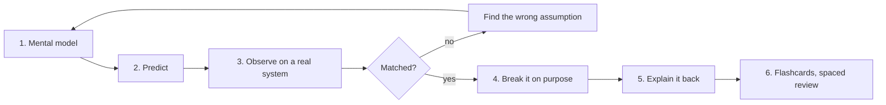

# Study Method

Reading about Linux feels like learning. It is not. Understanding appears when you **predict, test, and are surprised**. Every concept note in this vault follows this loop.

## The six steps
1. **Mental model.** Read the explanation. Ask: what is the kernel or shell actually doing?
2. **Predict.** Before running a command, write what you expect. Even a one-line guess works.
3. **Observe.** Run it. Compare with your prediction. A wrong prediction is the most valuable result.
4. **Break it.** Change one variable (remove a permission, fill a disk, occupy a port) and watch the failure. Operators are made by failures.
5. **Explain back.** Fill the *My explanation* section from memory, as if teaching a junior. If you cannot, the model is not yet yours.
6. **Review.** Use the flashcards (`Question::Answer` format works with the *Spaced Repetition* community plugin). Review at 1 day, 3 days, 1 week, 1 month.

## Understanding levels (be honest)
| Level | Meaning |
|---|---|
| 1 Recognize | I have seen the command |
| 2 Use | I can run it with a guide |
| 3 Explain | I can say what happens underneath |
| 4 Diagnose | I can use it to find a real fault |
| 5 Teach | I can predict edge cases and failure modes |

Set the `level:` property in each note's frontmatter as you progress. Aim for level 4 on anything touching FastMove.

## Note conventions
- `status:` `new` → `learning` → `solid`
- `> [!question]- Answer` blocks hide answers. Answer in your head first, then expand.
- `> [!warning]` marks risk. Read these before you run anything.
- `Q::A` lines are flashcards.
