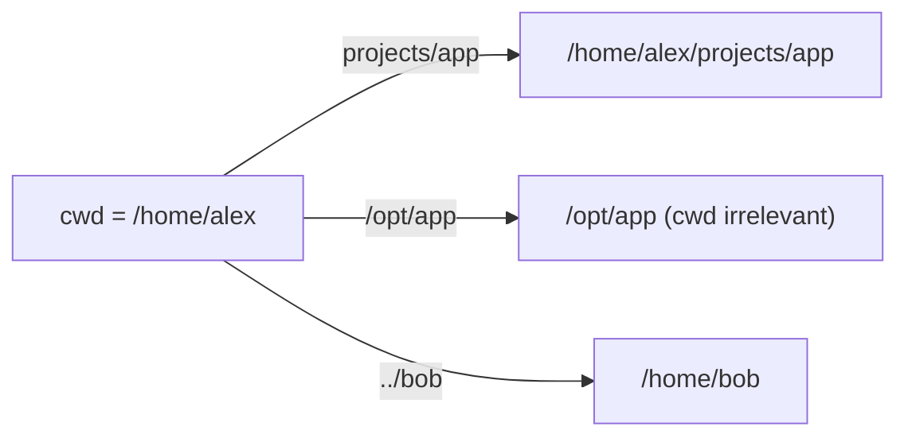

# Absolute vs Relative Paths

## Why it matters
"It works when I run it by hand but fails under systemd/cron" is very often a **working directory** problem.

## Mental model
- **Absolute path**: starts with `/`, independent of where you are.
- **Relative path**: resolved against the *current working directory* of the *process*, not the location of the script file.
- `.` = current directory, `..` = parent.



## Predict, then observe
```bash
cd /tmp && mkdir -p p/q && cd p/q
pwd
realpath ..
realpath ../..
cd -
```
**Predict:** what does `realpath ../..` print?

> [!question]- Answer
> `/tmp`: `q`'s parent is `p`, and `p`'s parent is `/tmp`.

## Why services care
A process started by systemd or cron does **not** start in your project folder. By default systemd's working directory is `/` for system services.

Fragile:
```bash
java -jar target/app.jar     # assumes cwd contains target/
```
Robust:
```bash
cd /opt/fastmove || exit 1
exec /usr/bin/java -jar /opt/fastmove/app.jar
```
Better still, let the unit define it:
```ini
WorkingDirectory=/opt/fastmove
ExecStart=/usr/bin/java -jar /opt/fastmove/app.jar
```
Confirm real paths on your host with `command -v java`.

`exec` replaces the shell with Java so the service manager's signals reach the JVM directly.

## Common mistakes
- Believing a script runs from the folder it is stored in.
- Relying on `~` inside quotes or in systemd units (expansion is a shell feature; units don't use it the same way).
- Using relative paths for logs/config in services.
- Forgetting that every parent directory needs execute permission (see [[Permissions and Ownership]]).

## Active recall
Does an absolute path depend on cwd?:: No.
What is a process's cwd at systemd start?:: Defined by `WorkingDirectory=`; default for system services is `/`.
Why should unit files use absolute `ExecStart` paths?:: systemd does not use your interactive shell's PATH or cwd.
What does `..` mean?:: The parent directory.

## My explanation
> Explain why a relative path in a deploy script can break under systemd:

## Next
→ [[Streams, Pipes and Redirection]]
