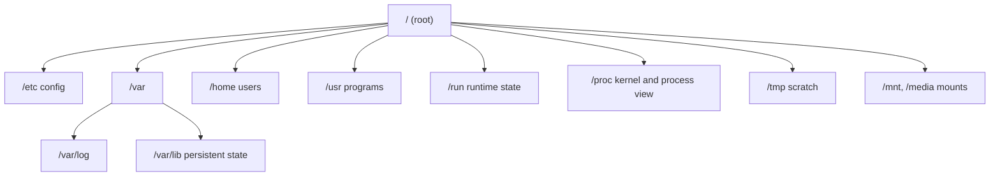

# Filesystem Hierarchy

## Why it matters
When something breaks, you must know *where to look*: config, logs, state, sockets. A map of the tree turns blind searching into targeted inspection.

## Mental model
Linux has **one tree** rooted at `/`. There are no drive letters. Extra disks and virtual filesystems are **mounted** onto directories inside this tree. So a path never tells you which disk holds the data; mount points do.



## The map
| Path | Holds | When you look here |
|---|---|---|
| `/etc` | System configuration (text files) | "Where is this service configured?" |
| `/var/log` | Log files (some systems use journald instead) | Troubleshooting |
| `/var/lib` | Persistent service state (databases, package data) | **Never delete casually** |
| `/home`, `/root` | User homes (`/root` is root's home, not the tree root) | Personal files |
| `/tmp` | Temporary, may be cleared on reboot | Scratch only |
| `/run` | Runtime state since boot: PID files, sockets | Is the socket there? |
| `/usr/bin`, `/usr/sbin`, `/bin` | Executables (often merged on modern distros) | `which`, `type` |
| `/opt` | Add-on application software | Manually installed apps |
| `/dev` | Device nodes (disks, terminals, `/dev/null`) | Devices |
| `/proc` | **Virtual**: process and kernel info generated live | `/proc/<pid>/...`, `/proc/meminfo` |
| `/sys` | **Virtual**: kernel/device model | Hardware and tuning |

Layouts vary by distro. `man hier` or `man 7 hier` shows your system's version.

## Predict, then observe
**Predict:** which filesystem backs `/`, and is `/proc` on a real disk?

```bash
findmnt /
findmnt /proc
df -hT /
ls -la /
```

> [!question]- What should you see?
> `/` is typically ext4, xfs or btrfs on a block device (or overlay inside a container). `/proc` shows type `proc`: no disk at all. Its entries are generated by the kernel on read.

## Worked example: where is my Java service's stuff?
| Question | Likely place |
|---|---|
| Config | `/etc/<app>/`, env file referenced by the unit, or app dir |
| Logs | `journalctl -u <unit>`, or `/var/log/<app>/` |
| JAR | `/opt/<app>/` |
| PID / socket | `/run/<app>/` |
| Data | `/var/lib/<app>/` |

This is convention, not law. Always confirm in the unit file (`systemctl cat <unit>`).

## Common mistakes
- Thinking `/` and `/root` are the same.
- Treating `/proc` and `/sys` files as ordinary config to edit.
- Deleting from `/var/lib` because "it looks like clutter".
- Assuming `/var/log/syslog` exists everywhere (it does not on many systemd-only setups).

## Active recall
What is the difference between `/`, `/root` and `/home`?:: `/` is the top of the tree, `/root` is the root user's home directory, `/home` holds regular users' homes.
Why is `/proc` called virtual?:: Its contents are generated by the kernel on demand and use no disk space.
Where does persistent service state usually live?:: `/var/lib`
What does mounting mean?:: Attaching a filesystem to a directory so it appears inside the single tree.
Which command lists mount points as a tree?:: `findmnt`

## My explanation (write from memory)
> Explain the single tree, mounts, and where to look for config/logs/state:

## Next
→ [[Navigation and Inspection]] · Lab: [[Lab 01 - Explore the Filesystem]]
