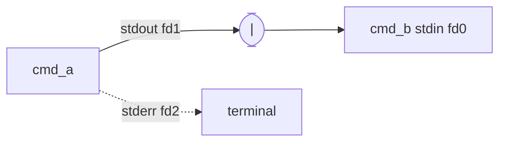

# Streams, Pipes and Redirection

## Why it matters
Logs, scripts, service output and every "one-liner" you will ever write depend on this. It is also the key to understanding where a service's output goes.

## Mental model
Every process starts with three open **file descriptors**:

| fd | Name | Default |
|---|---|---|
| 0 | stdin | keyboard / input |
| 1 | stdout | terminal |
| 2 | stderr | terminal |

Redirection simply reconnects these numbers to files or other processes **before** the program runs. The program does not know.



## Operators
| Syntax | Effect |
|---|---|
| `a \| b` | a's stdout becomes b's stdin |
| `a > f` | stdout to file, **truncates** |
| `a >> f` | stdout appended |
| `a 2> f` | stderr to file |
| `a > f 2>&1` | stdout to f, then stderr to where stdout points (f) |
| `a &> f` | bash shorthand for both |
| `a < f` | f as stdin |
| `a > /dev/null` | discard output |

> [!warning]
> Order matters: `a > f 2>&1` sends both to f. `a 2>&1 > f` sends stderr to the terminal and only stdout to f.

## Predict, then observe
```bash
ls /etc /nonexistent > out.txt
cat out.txt
ls /etc /nonexistent > out.txt 2> err.txt
cat err.txt
```
**Predict:** what appears on the terminal after the first command?

> [!question]- Answer
> The error message about `/nonexistent`: it went to stderr, which was not redirected. `out.txt` holds only the listing of `/etc`.

## Why services care
systemd captures a service's stdout and stderr into the journal. That is why many Spring Boot services simply log to the console and you read them with `journalctl -u`.

## Common mistakes
- `>` where you meant `>>` (silently wipes the file).
- Piping and expecting errors to travel too (stderr does not go through `|` unless `2>&1`).
- `sudo echo x > /root/file`: the redirection is done by *your* shell, not by sudo. Use `echo x | sudo tee /root/file`.

## Active recall
What are fds 0, 1, 2?:: stdin, stdout, stderr.
What does `2>&1` mean?:: Point stderr at wherever stdout currently points.
Why does `sudo echo x > /root/f` fail?:: The shell performs the redirect before sudo runs, with your privileges.
Where does a systemd service's stdout go by default?:: To the journal.

## My explanation
> Describe what the shell does before it starts a command with redirections:

## Next
→ [[Inodes, Links and Everything-is-a-File]]
