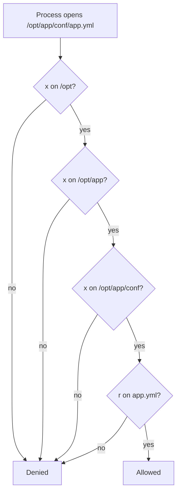

# Permissions and Ownership

## Why it matters
"Permission denied" is among the most common production errors. Guessing with `chmod 777` is the classic bad fix. You will diagnose it *systematically*.

## Mental model
Each inode has an **owner**, a **group**, and 9 permission bits: `rwx` for owner, group, others. The kernel checks, in order: are you the owner? else are you in the group? else "others". **First match wins**; it does not combine.

| Bit | On a file | On a directory |
|---|---|---|
| `r` (4) | read contents | list names |
| `w` (2) | modify contents | create/delete/rename entries (needs `x` too) |
| `x` (1) | execute | **enter / traverse** |


To reach a file you need `x` on **every** parent directory plus the right bit on the file.

## Reading and setting
```bash
ls -l file             # -rw-r----- 1 alice devs 120 ... file
stat -c '%A %a %U:%G %n' file
namei -l /opt/app/conf/app.yml   # permissions of EVERY path component
chmod 640 file         # rw- r-- ---
chmod u+x script.sh
sudo chown fastmove:fastmove /opt/fastmove/app.jar
```
Octal: r=4, w=2, x=1. `640` = owner 4+2, group 4, others 0.

`umask` removes bits from the default for newly created files (default file base is 666, directory 777). Common umask `022` → files 644, dirs 755.

## Predict, then observe
```bash
cd /tmp && mkdir -p perm && cd perm
echo secret > f
chmod 000 f
cat f
chmod 400 f
cat f
```
**Predict:** who can read with `000`? With `400`? (Are you root?)

> [!question]- Answer
> `000`: nobody can read as a normal user. `400`: the owner can read. Root bypasses permission bits, so as root both succeed. That is why testing as root hides real bugs.

## Beyond the nine bits
These can deny access even when bits allow it:
- ACLs (`getfacl`)
- SELinux / AppArmor (`ls -Z`, audit logs)
- Mount options (`ro`, `noexec`, `nosuid`)
- Immutable attribute (`lsattr`)
- Read-only filesystem

## Diagnosis recipe
1. Which user is the process? (`ps`, `systemctl show -p User UNIT`)
2. `namei -l` the full path.
3. Check ACLs/SELinux/mount options if bits look right.
4. Fix **ownership or the minimal bit**, never `777`.

## Common mistakes
- Fixing the file but not a parent directory's `x`.
- Testing as root.
- `chmod -R 777`.
- Forgetting write on the *directory* is needed to delete a file.

## Active recall
What does `640` mean?:: Owner rw, group r, others none.
Why does a directory need `x`?:: To traverse/enter it and access names inside.
Which command shows permissions on every path component?:: `namei -l PATH`
Why is root testing misleading?:: Root bypasses most permission checks.
Why is `chmod 777` poor?:: Gives everyone write access, hides the real ownership problem, is a security risk.
To delete a file, which permission is needed?:: Write+execute on the containing directory.

## My explanation
> Walk through how the kernel decides if a service can read its config file:

## Next
→ [[sudo and Privilege]] · Lab: [[Lab 02 - Permissions Break and Fix]]
