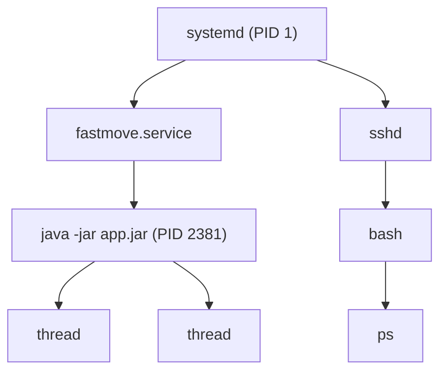

# Processes and Signals

## Why it matters
Restarts, hangs, graceful shutdown, zombie processes, and "why did my app die?" all live here.

## Mental model
A **process** is a running program with: a PID, parent (PPID), credentials, working directory, environment, open file descriptors, and virtual memory. Processes form a tree: each is created by a parent via `fork` + `exec`. The first process (PID 1, usually systemd) is the ancestor of all.



A **service** is a process (or group) managed by a supervisor such as systemd, with start/stop/restart policy and logging.

## Inspect
```bash
ps aux | head
ps -eo pid,ppid,user,stat,etime,cmd --sort=-%mem | head
pgrep -af java
pstree -ap
ls -l /proc/<PID>/cwd /proc/<PID>/exe     # replace <PID> with a real number
ls /proc/<PID>/fd | wc -l                  # open descriptors
cat /proc/<PID>/status | head -20
```

`STAT` letters: `R` running, `S` sleeping, `D` uninterruptible I/O wait, `Z` zombie, `T` stopped.

## Signals
| Signal | # | Meaning | Can be handled? |
|---|---|---|---|
| SIGTERM | 15 | "Please shut down" (default for `kill`) | Yes |
| SIGINT | 2 | Ctrl+C | Yes |
| SIGHUP | 1 | Hangup / reload convention | Yes |
| SIGKILL | 9 | Immediate kill by kernel | **No** |
| SIGSTOP | 19 | Pause | **No** |

```bash
kill -TERM 1234        # polite; JVM runs shutdown hooks, Spring closes gracefully
kill -KILL 1234        # last resort: no cleanup, possible corrupted state
```
Use real, verified PIDs. Prefer `systemctl stop|restart` for services.

## Predict, then observe
```bash
sleep 300 &
echo $!
kill -TERM $!
wait $!; echo "exit=$?"
```
**Predict:** what exit status do you expect?

> [!question]- Answer
> `143` = 128 + 15. A process killed by signal N reports 128+N in the shell. SIGKILL gives `137`, which is the number you will also see for OOM-killed containers.

## Zombies and D-state
- **Zombie (Z):** already dead, parent has not collected exit status. Cannot be killed; fix the parent.
- **D-state:** waiting on I/O (disk, NFS). Even SIGKILL waits. Look at storage, not the process.

## Common mistakes
- `kill -9` as the first move.
- Killing by name without checking what matches.
- Restarting before collecting evidence (thread dump, logs).
- Treating high CPU in `top` as the only hang signal; also check D-state and blocked threads.

## Active recall
Why prefer SIGTERM over SIGKILL?:: SIGTERM lets the process clean up (flush, close connections, run shutdown hooks).
Exit status 143 means?:: Terminated by SIGTERM (128+15).
Exit status 137 means?:: Killed by SIGKILL (128+9), often OOM killer.
What is a zombie?:: A finished process whose parent has not read its exit status.
Which signals cannot be caught?:: SIGKILL and SIGSTOP.
Who is PID 1 on a systemd host?:: systemd.

## My explanation
> Describe what happens, step by step, when you run `systemctl stop fastmove`:

## Next
→ [[systemd Services]] · Lab: [[Lab 03 - Port Already in Use]]
