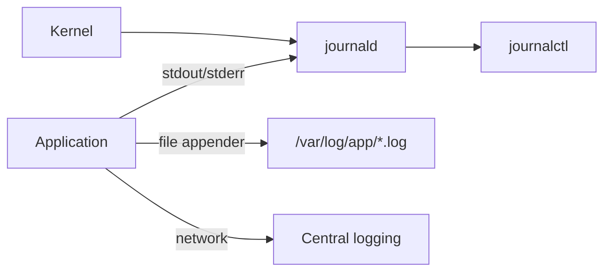

# Logs and Journal

## Mental model
Logs come from several places. First find out *where your service writes*.



## journalctl essentials
```bash
journalctl -u UNIT --since "30 min ago"
journalctl -u UNIT -e                 # jump to end
journalctl -u UNIT -f                 # follow
journalctl -u UNIT -p err             # priority err and worse
journalctl -b                         # since this boot
journalctl -b -1                      # previous boot
journalctl -k                         # kernel messages (OOM, disk errors)
journalctl -u UNIT -o cat             # only the message text
journalctl --disk-usage
```
You may need membership of `systemd-journal` or `adm` to read all logs.

## Reading a log properly
- Find the **first** error, not the last. Later errors are often consequences.
- Check timezone and clock; compare with deploy times.
- Look for restart loops (start, fail, start...).
- Search for `Caused by:` in Java stack traces; the deepest one is usually the root.
- Confirm whether the app was even running at that time.

## Kernel messages worth knowing
```bash
journalctl -k | grep -i -E 'oom|killed process|I/O error|segfault'
dmesg -T | tail
```

## Secret hygiene
Logs can contain tokens, passwords in connection strings, and personal data. Redact before pasting into notes or tickets.

## Common mistakes
- Assuming `/var/log/syslog` exists.
- Reading only the last 20 lines of a crash loop.
- Ignoring that journald may be volatile (lost on reboot) when `/var/log/journal` does not exist.

## Active recall
Command to follow a service's logs?:: `journalctl -u UNIT -f`
How to see logs from the previous boot?:: `journalctl -b -1`
Why look for the first error?:: Later errors are often side effects of the first failure.
How to find OOM kills?:: `journalctl -k` / `dmesg` and grep for "Out of memory" or "Killed process".
Where does a service's console output go under systemd?:: journald.

## My explanation
> Describe your first three actions when a service has just failed:

## Next
→ [[Troubleshooting Method]]
