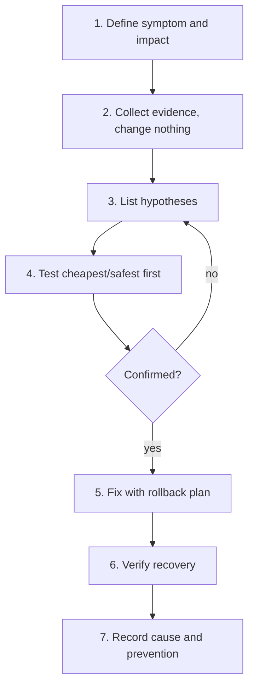

# Troubleshooting Method

> Good diagnosis is a method, not a memory of commands.

## Layered checklist (work from the bottom up or top down, but be systematic)
| Layer | Question | Tools |
|---|---|---|
| Process | Is it running? As whom? Exit status? | `systemctl status`, `ps`, journal |
| Config | Does it read what I think? | `systemctl cat`, env, app logs |
| Permissions | Can that user reach the files? | `namei -l`, `sudo -u` |
| Resources | CPU, memory, disk, inodes, fds? | `top`, `free -h`, `df -hT`, `df -ih`, `ulimit -n` |
| Network | Name resolves? Route? Port open? Protocol OK? | `getent`, `ip route`, `ss`, `curl -v` |
| Dependencies | DB, Kafka, DNS reachable and healthy? | targeted connect tests |
| Change | What changed recently? | deploy history, `journalctl`, git log |

## Distinguish failure shapes
| Symptom | Suggests |
|---|---|
| Connection **refused** | Nothing listening (or reject rule) on that port |
| Connection **timeout** | Packets dropped: firewall, route, down host |
| **DNS** failure | Resolver/name problem |
| HTTP 5xx | Server reached but app/dependency failing |
| Exit 137 | SIGKILL, check OOM |
| Exit 143 | SIGTERM, stopped by someone/something |
| 203/EXEC | Bad ExecStart path or permission |

## Rules
1. Evidence before action. Copy the exact error.
2. One change at a time; note it.
3. Know your rollback before you change.
4. Verify with a **real** check (health endpoint, business request), not "process is up".
5. Write the incident down using `Template - Incident`.

## Active recall
Refused vs timeout?:: Refused = host answered "nothing here"; timeout = no answer (dropped/unreachable).
Why change one thing at a time?:: Otherwise you cannot tell which change fixed or worsened it.
What proves recovery?:: A successful real request/health check plus clean logs, not just a running process.

## My explanation
> Narrate how you would troubleshoot "the API returns 502" on a Linux host:
