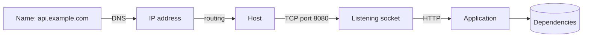

# Ports, DNS and Connectivity

## Mental model
A request to `http://api.example.com:8080/health` passes through layers. Each can fail differently.



## Inspect, layer by layer
```bash
getent hosts example.com            # name → IP (uses the system's real resolution path)
ip addr                             # my addresses
ip route                            # where traffic goes
ss -ltnp                            # listening TCP sockets with owning process
sudo ss -ltnp 'sport = :8080'       # who owns port 8080?
curl -v --connect-timeout 3 http://127.0.0.1:8080/actuator/health
```
`nslookup`/`dig` query DNS directly; `getent` mirrors what applications resolve (includes `/etc/hosts`).

## Bind address matters
| Listening on | Reachable from |
|---|---|
| `127.0.0.1:8080` | Only this machine |
| `0.0.0.0:8080` | All IPv4 interfaces |
| `[::]:8080` | All IPv6 (often IPv4 too) |

"Works with curl on the server, fails from another host" often means it is bound to 127.0.0.1 or a firewall blocks it.

## What each result proves
| Observation | Proves | Does **not** prove |
|---|---|---|
| Name resolves | DNS answered | Host is up |
| Port in `ss -l` | A process bound it | App is healthy |
| TCP connect OK | Path and listener exist | HTTP or dependencies work |
| HTTP 200 on `/health` | That endpoint responded | Every feature works |

## Common mistakes
- Blaming the firewall for a port conflict (see [[Lab 03 - Port Already in Use]]).
- Testing with `localhost` and forgetting IPv4 vs IPv6.
- Not testing from the same network location the client uses.

## Active recall
Refused vs timeout?:: Refused: reached host, nothing listening. Timeout: no response.
Command for listening sockets and owners?:: `ss -ltnp`
Difference between 127.0.0.1 and 0.0.0.0 binding?:: Loopback only vs all interfaces.
Why use `getent hosts` instead of `dig`?:: It uses the same resolution path (nsswitch, /etc/hosts) as applications.

## My explanation
> Describe how you would prove whether a DB connection failure is DNS, network or credentials:

## Next
→ [[TCP Connection States]]
