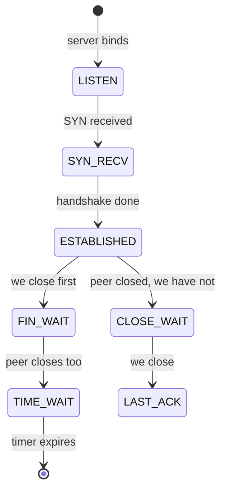

# TCP Connection States

## Why it matters
Reading `ss` output properly tells you about connection leaks, slow clients, and exhausted ports.

## Mental model


## Useful views
```bash
ss -tan state established | wc -l
ss -tan state time-wait | wc -l
ss -tan state close-wait
ss -s
```

## Interpretation
| State | Meaning | Worry when |
|---|---|---|
| LISTEN | Server waiting | Missing when expected |
| ESTABLISHED | Active connection | Count grows without bound |
| TIME_WAIT | Normal wait after active close | Usually harmless unless ephemeral ports run out |
| CLOSE_WAIT | Peer closed; **your app has not closed its end** | Many of them = application connection **leak** |

Piles of `CLOSE_WAIT` in a Java service usually mean code is not closing sockets or pool connections properly.

## Active recall
Many CLOSE_WAIT sockets suggest?:: The local application is not closing connections (leak).
Is TIME_WAIT a problem?:: Normally no; it is protocol housekeeping.
Which command summarizes socket counts?:: `ss -s`

## My explanation
> Explain the difference between TIME_WAIT and CLOSE_WAIT:
