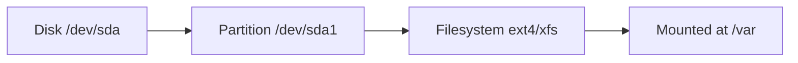

# Storage and Filesystems

## Mental model
Disks hold **block devices**, split into partitions, formatted with a **filesystem**, then **mounted**. Space can run out in three ways: blocks, **inodes**, or a quota/limit at a mount.



## Inspect
```bash
lsblk -f                    # disks, partitions, fs types
findmnt                     # mounts as a tree
df -hT                      # space per filesystem
df -ih                      # inodes per filesystem
du -xhd1 /var | sort -h     # what is big under /var (stay on one filesystem)
sudo lsof +L1               # deleted but still open files
iostat -x 1 3               # device latency/utilisation (sysstat package)
```

## df vs du
| Tool | Asks the | Sees |
|---|---|---|
| `df` | Filesystem | Total blocks used per filesystem |
| `du` | Directory walk | Sum of reachable files |

They disagree when: files are deleted but open, other mounts hide data under a mount point, permissions block `du`, or reserved blocks exist.

## Full-disk playbook
1. `df -hT` → which filesystem?
2. `df -ih` → inode problem instead?
3. `du -xhd1` down the tree → which directory?
4. `lsof +L1` → deleted-open files?
5. Identify the **owner** and its rotation policy. Fix the cause (rotate, cap, move), then free space safely.

> [!warning]
> Do not `rm` unknown files to get space. Truncating a live log is safer than deleting: `: > file` (as appropriate privileges). Understand what owns it first.

## Log rotation
`logrotate` (config in `/etc/logrotate.d/`) and journald's `SystemMaxUse=` cap growth. A service writing to its own file needs its rotation plan, or it will fill the disk.

## Active recall
Two ways a disk can be "full" with space shown free?:: Inodes exhausted; quota or reserved blocks.
Why can `df` > `du`?:: Deleted-but-open files, hidden-under-mount data, permissions.
Command for inode usage?:: `df -ih`
Safer than deleting a live log?:: Truncating it, after identifying its owner.
What does `-x` do in `du`?:: Stays on one filesystem.

## My explanation
> Explain how you would find what is filling `/var` without deleting anything blindly:

## Next
→ [[Lab 04 - Disk Full Mystery]]
