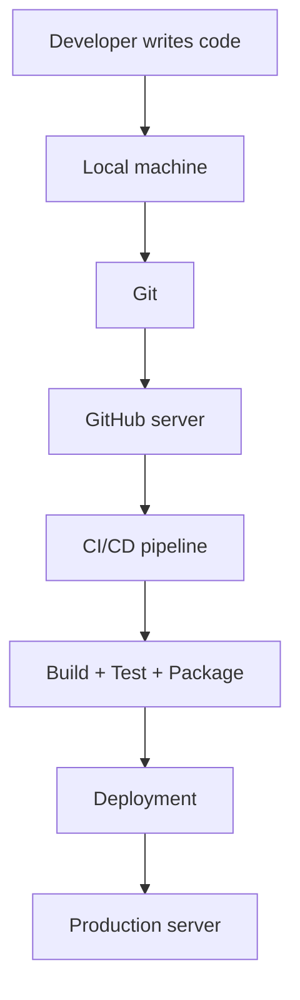

# Lesson 1 – The Big Picture
⬅️ [[00 - Index (MOC)|Index]] | ➡️ [[02 - What Problem Does Git Solve]]

We are building an **enterprise web application**.

| Tech | Choice |
|---|---|
| Backend | Java + Spring Boot |
| Database | PostgreSQL |
| Messaging | Kafka |
| Monitoring | Prometheus + Grafana |
| Build tool | Maven |
| Version control | Git |
| Remote repo | GitHub |
| CI/CD | GitHub Actions |

## Components
| Component | Responsibility |
|---|---|
| Git | Tracks changes in your source code |
| GitHub | Hosts your Git repository remotely |
| CI | Automatically builds and tests your code |
| CD | Automates delivery or deployment |
| Maven | Compiles and packages your Java app |
| Docker | Packages apps into containers |

> [!important] Git ≠ GitHub
> - **Git** is software installed on your computer.
> - **GitHub** is a platform that stores Git repositories on remote servers.
> - You can use Git without GitHub.
