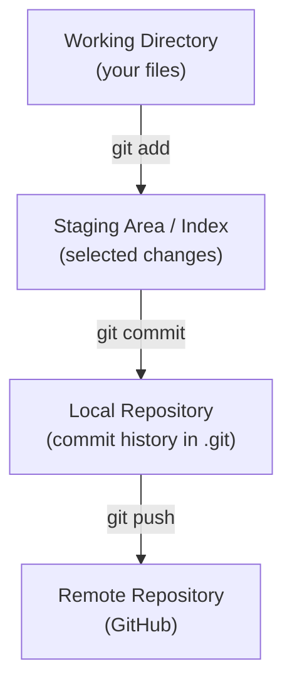

# Lesson 3 – Git Architecture
⬅️ [[02 - What Problem Does Git Solve]] | ➡️ [[04 - Install and Configure Git]]

> [!important] The most important lesson
> Git has four areas.



## 1. Working Directory
Your actual project folder, e.g. `/home/user/projects/scheduler/`. Editing a file here changes the working directory. Git detects the change but has **not** recorded it.

## 2. Staging Area (index)
Where you select what goes into the next commit.
```bash
git add EmployeeService.java
```
**Behind the scenes:** Git takes the file's current content, calculates its content hash, and prepares it for the next commit in its object database. Think of it as a **basket**.

## 3. Local Repository
```bash
git commit -m "Add employee service"
```
A commit records:
- The project snapshot
- Author information
- Commit message
- Parent commit reference
- Timestamp and metadata

Stored in the local `.git` directory.

> [!note]
> Git does **not** copy your entire project per commit. It uses a content-addressed object database and efficient snapshot storage.

## 4. Remote Repository
If your laptop crashes, local history may be lost. Push to GitHub:
```bash
git push origin main
```

## Remember
| Area | Role |
|---|---|
| Working directory | Where you modify files |
| Staging area | Where you select changes |
| Local repository | Where you commit changes |
| Remote repository | Where you share and back up history |
