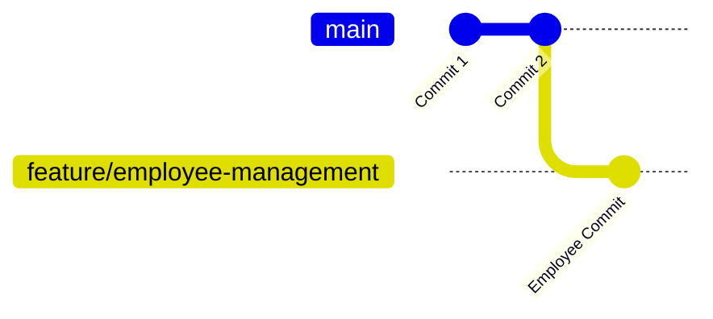

# Lesson 8 – Branches
⬅️ [[07 - First Commit]] | ➡️ [[09 - Connect to GitHub]]

> [!tip] Definition
> A branch is a **movable reference to a commit**.

Production code shouldn't be used for experiments, so we branch.

```bash
git switch -c feature/employee-management   # create + switch
git branch
```
```text
* feature/employee-management
  main
```
`*` marks the current branch.

Add a class:
```java
public class EmployeeService {
    public void saveEmployee() {
        System.out.println("Employee saved");
    }
}
```
```bash
git add .
git commit -m "Add employee management service"
```


The feature is **isolated from `main`**.

## Why companies use branches
Five developers can work independently on: employee management, payment integration, notification service, authentication, reporting – without touching the same production branch simultaneously.
