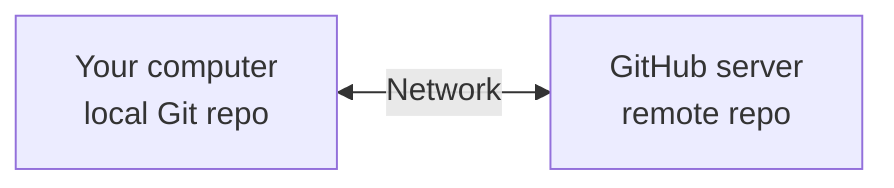

# Lesson 9 – Connect Git to GitHub
⬅️ [[08 - Branches]] | ➡️ [[10 - Fetch Pull Push]]

Until now everything was **local** – no internet needed.



## Step 1 – Create a GitHub repository
Name: `scheduller`, visibility: Private. Create it **empty** (no README / .gitignore) since local files exist.

## Step 2 – Add the remote
```bash
git remote add origin https://github.com/YOUR_USERNAME/scheduller.git
git remote -v
```
- `git remote` manages remote connections
- `add` creates a remote reference
- `origin` is the conventional name
- the URL identifies the GitHub repo

## Step 3 – Push
```bash
git branch -M main
git push -u origin main
```

## Behind the scenes (network view)
1. Git reads local commit history
2. Determines which objects the remote needs
3. Opens a network connection (HTTPS or SSH)
4. Authenticates
5. Transfers the necessary objects
6. GitHub updates its remote branch reference
7. Push completes

HTTPS is protected by **TLS**; SSH uses SSH authentication and encryption.

> [!important]
> `git add` and `git commit` work **locally**. `git push` needs **network** communication.
