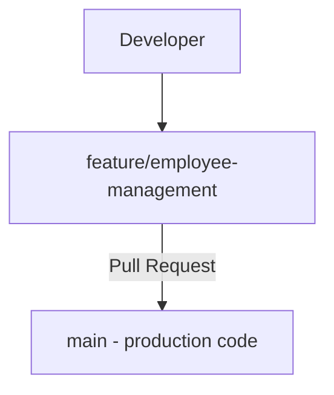

# Lesson 11 – Pull Requests (PR)
⬅️ [[10 - Fetch Pull Push]] | ➡️ [[12 - Merge and Conflicts]]

```bash
git push -u origin feature/employee-management
```
> [!quote] A Pull Request means
> "I have completed my changes. Please review them and consider merging them into the main branch."



## Typical enterprise workflow
1. Create a feature branch
2. Implement functionality
3. Commit changes
4. Push the branch
5. Open a Pull Request
6. Teammates review the code
7. Automated tests run
8. Team approves
9. Feature branch is merged into `main`

## Why PRs matter
Code reviews · bug detection · security checks · automated testing · team collaboration · controlled merging.

> [!warning]
> Pushing code to GitHub does **not** mean it's approved for production.
