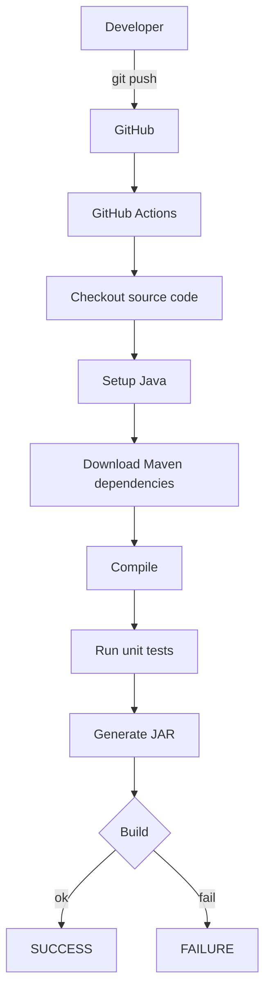
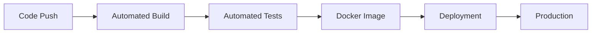

# Lesson 13 – CI/CD Concepts
⬅️ [[12 - Merge and Conflicts]] | ➡️ [[14 - GitHub Actions Pipeline]]

After a `git push`, wouldn't it be nice if GitHub automatically:
1. Downloaded your source code
2. Installed the required Java version
3. Downloaded Maven dependencies
4. Compiled the app
5. Ran unit tests
6. Generated the JAR
7. Built a Docker image
8. Deployed it

## CI – Continuous Integration
Every push or PR triggers an automated build + test.

## CD – two meanings
- **Continuous Delivery:** automatically prepares and validates software so it *can* be released.
- **Continuous Deployment:** automatically deploys successful changes to production *without* manual approval.

