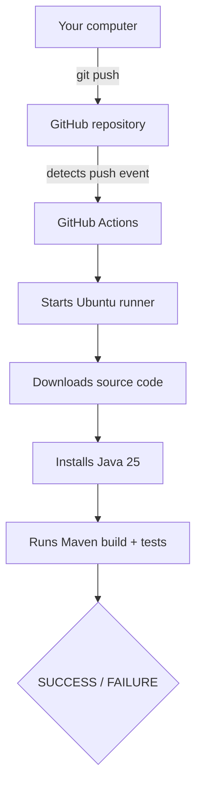

# Lesson 14 – First CI Pipeline (GitHub Actions)
⬅️ [[13 - CI-CD Concepts]] | ➡️ [[15 - Under the Hood of CI-CD]]

## Structure
```text
scheduller/
├── .github/
│   └── workflows/
│       └── ci.yml
├── src/
├── pom.xml
└── .gitignore
```

## `.github/workflows/ci.yml`
```yaml
name: Spring Boot CI Pipeline

on:
  push:
    branches:
      - main

  pull_request:
    branches:
      - main

jobs:

  build:

    runs-on: ubuntu-latest

    steps:

      - name: Checkout source code
        uses: actions/checkout@v4

      - name: Setup Java
        uses: actions/setup-java@v4
        with:
          distribution: temurin
          java-version: '25'
          cache: maven

      - name: Build application
        run: mvn clean package
```

## Line by line
| Part | Meaning |
|---|---|
| `name` | Name shown in GitHub Actions |
| `on: push` | Starts the workflow on every push to `main` |
| `on: pull_request` | Also runs when a PR targeting `main` is created/updated |
| `runs-on: ubuntu-latest` | GitHub provides a temporary Ubuntu VM |
| `actions/checkout@v4` | Downloads your repo into the runner's workspace |
| `actions/setup-java@v4` | Installs Java 25 (Temurin) + enables Maven dependency caching |
| `mvn clean package` | Compile, test, package. Failure ⇒ job fails |

> [!tip]
> Use a Java version supported by your project and available on the selected runner.

## What happens on push

Results: **GitHub Repository → Actions**. 🎉 Your first CI pipeline!
