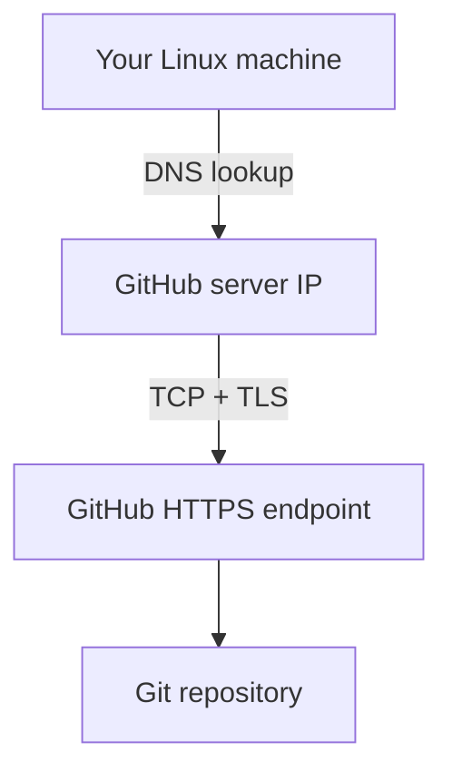

# Lesson 15 – Network & OS Internals During CI/CD
⬅️ [[14 - GitHub Actions Pipeline]] | ➡️ [[17 - Enterprise Workflow]]

You run `git push origin main`. The full journey:

## Step 1 – Local OS
Git runs as a Linux process, reads `/home/etrans/Downloads/scheduller/.git/` and finds commits to transfer.

## Step 2 – Network

- **DNS** resolves the GitHub domain to an IP
- **TCP** gives a reliable connection
- **TLS** encrypts HTTPS traffic
- Git transfers repository objects; GitHub updates the remote branch

## Step 3 – GitHub detects the push
Checks `.github/workflows/ci.yml`; the `push` event matches → workflow starts.

## Step 4 – A temporary VM starts
The Ubuntu runner has its own OS, CPU, memory, filesystem, network connection and installed software. **Your computer is not running the pipeline – the runner is.**

## Step 5 – Maven downloads dependencies
`mvn clean package` reads `pom.xml` and downloads (if not cached) Spring Boot, Hibernate, PostgreSQL driver, Jackson, Kafka… then compiles and packages.

## Step 6 – Result
`BUILD SUCCESS` or `BUILD FAILURE`; inspect logs in GitHub Actions.
