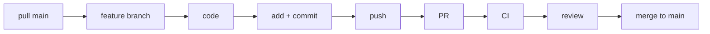

# Lesson 17 – Your First Enterprise Workflow
⬅️ [[15 - Under the Hood of CI-CD]] | ➡️ [[18 - Roadmap and Exercise]]

Developing an employee management feature:

1. **Get latest code**
   ```bash
   git switch main
   git pull origin main
   ```
2. **Create feature branch**
   ```bash
   git switch -c feature/employee-management
   ```
3. **Write Java code:** `EmployeeController`, `EmployeeService`, `EmployeeRepository`, `Employee.java`
4. **Check changes**
   ```bash
   git status
   git diff
   ```
5. **Stage**
   ```bash
   git add .
   ```
6. **Commit**
   ```bash
   git commit -m "Implement employee management"
   ```
7. **Push the branch**
   ```bash
   git push -u origin feature/employee-management
   ```
8. **Open a PR** on GitHub targeting `main` → see [[11 - Pull Requests]]
9. **CI executes** – checkout, setup Java, Maven, tests, report → see [[14 - GitHub Actions Pipeline]]
10. **Review and merge** into `main` after checks + approval


