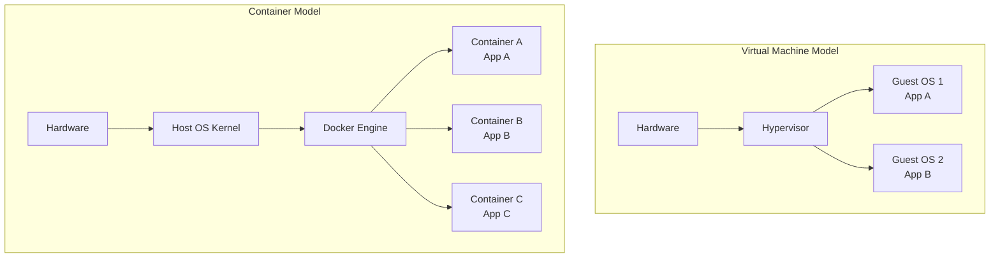
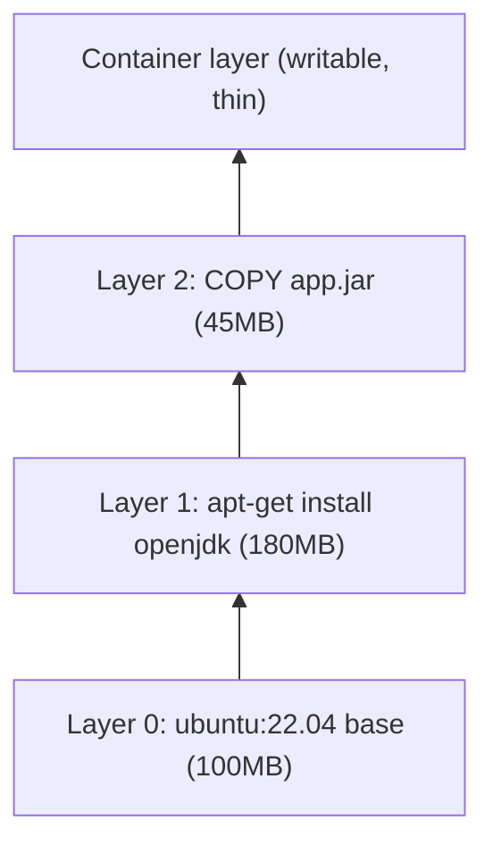
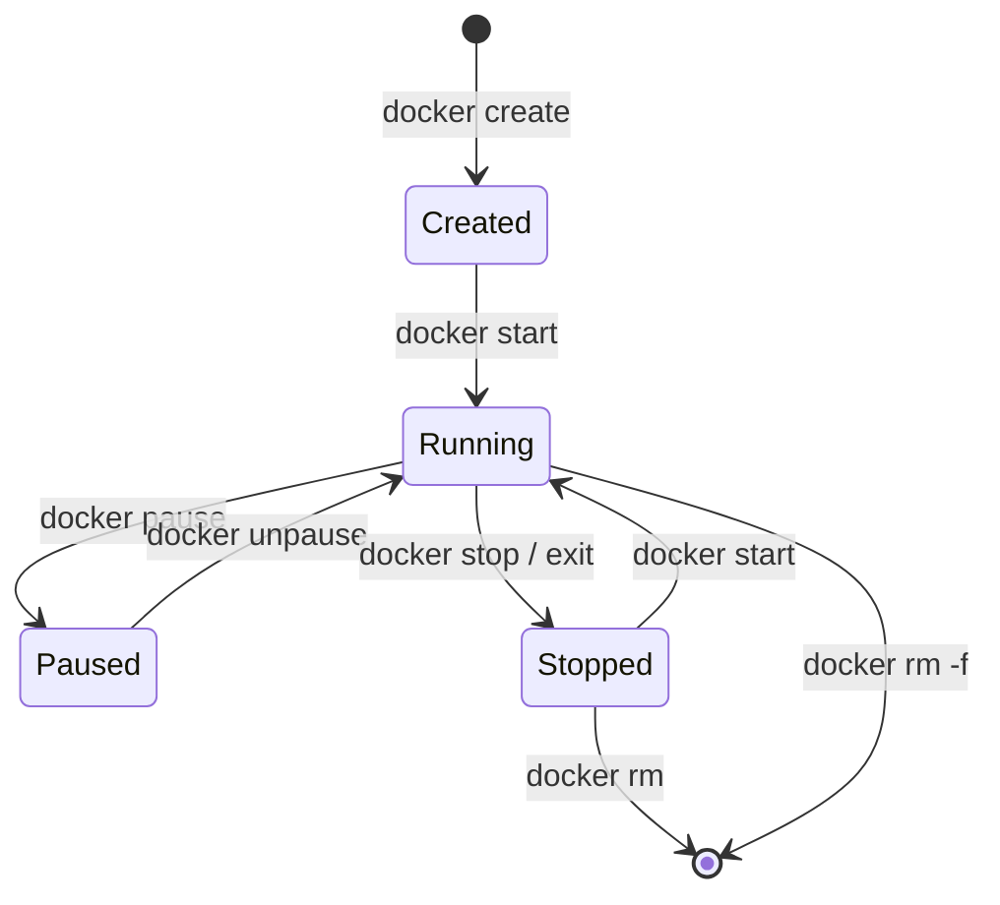
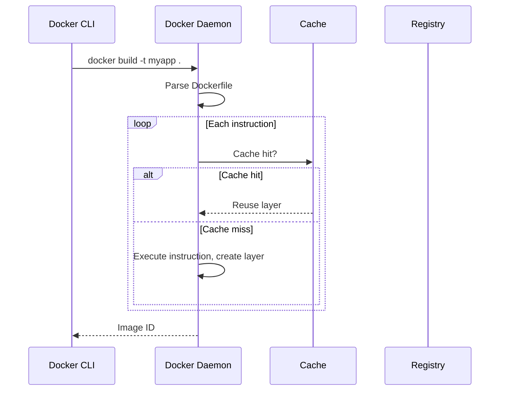
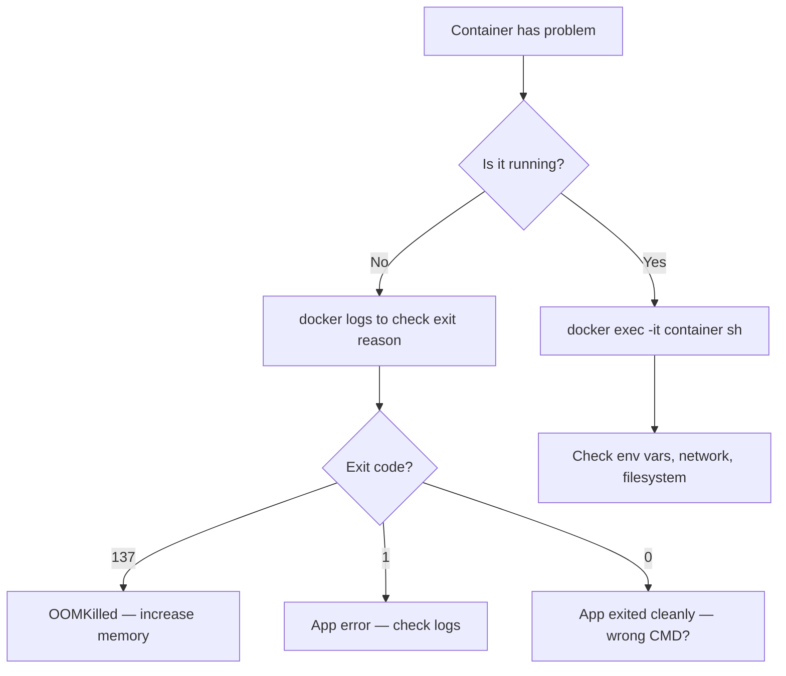

---
tags:
  - docker
  - devops
  - containers
  - springboot
  - cloud-native
  - backend
technology: Docker 24.x / Docker Compose v2
level: Beginner → Advanced
status: In Progress
last_reviewed: 2026-07-27
---

# 🐳 Docker — Complete Mastery Guide

> From zero to production. Covers every concept, every command, every pitfall, and 100 interview questions — connected to real Spring Boot production usage.

---

## 🗂️ Table of Contents

1. [[#1 Introduction]]
2. [[#2 Why Docker Matters]]
3. [[#3 Core Concepts]]
4. [[#4 Internal Working]]
5. [[#5 Installation]]
6. [[#6 Docker CLI]]
7. [[#7 Dockerfile]]
8. [[#8 Multi-stage Builds]]
9. [[#9 Volumes]]
10. [[#10 Networking]]
11. [[#11 Docker Compose]]
12. [[#12 Docker with Spring Boot]]
13. [[#13 Docker Security]]
14. [[#14 Performance Optimization]]
15. [[#15 Production Deployment]]
16. [[#16 CI/CD Integration]]
17. [[#17 Kubernetes Relationship]]
18. [[#18 Interview Preparation — Top 100 Q&A]]
19. [[#19 Common Errors & Debugging]]
20. [[#20 Best Practices]]
21. [[#21 Hands-on Projects]]
22. [[#22 Cheat Sheet]]
23. [[#23 Interview Revision Notes]]
24. [[#24 Key Takeaways]]
25. [[#25 Future Learning Roadmap]]

---

## 1. Introduction

### What is Docker?

Docker is an open-source **containerization platform** that packages an application and all its dependencies (libraries, runtime, config) into a portable unit called a **container**. Containers run identically on any machine — laptop, server, or cloud — that has Docker installed.

> [!tip] Simple mental model
> A container is a **lightweight, isolated process** on your OS. An image is the **blueprint** (read-only template) from which containers are created.

### Why Was Docker Created?

Before Docker (pre-2013), deploying software meant:
- "It works on my machine" — environment drift between dev, staging, and prod
- VMs were heavy (gigabytes, minutes to start)
- No standard packaging format across teams
- Manual dependency management per server

Docker (released 2013 by Solomon Hykes at dotCloud) solved this by standardising how applications are built, shipped, and run.

### Evolution: VMs → Containers

| | Virtual Machines | Containers |
|---|---|---|
| **Isolation** | Full OS per VM | Process-level via kernel namespaces |
| **Size** | GBs (includes OS) | MBs (shares host OS kernel) |
| **Startup** | Minutes | Milliseconds |
| **Overhead** | Hypervisor + Guest OS | Minimal — just the app |
| **Portability** | Moderate | High |
| **Use case** | Strong isolation, different OSes | Microservices, CI/CD, cloud-native |



### History & Ecosystem

| Year | Milestone |
|------|-----------|
| 2013 | Docker 0.1 released (open-source) |
| 2014 | Docker Hub launched |
| 2015 | Docker Compose, OCI standard formed |
| 2016 | Docker Swarm for orchestration |
| 2017 | Kubernetes becomes dominant orchestrator |
| 2019 | Docker Desktop for Mac/Windows |
| 2020 | Docker Desktop free for personal use |
| 2022 | Docker Scout for security scanning |
| 2024 | Docker Desktop 4.x, Compose v2 default |

> **Summary:** Docker replaced VMs as the standard packaging unit for applications, enabling "build once, run anywhere" across the entire software lifecycle.

---

## 2. Why Docker Matters

### Portability
A Docker image built on your MacBook runs identically on an Ubuntu EC2 instance or a Windows Server. The image encapsulates the exact runtime — no "install Java 17 first" instructions needed.

### Reproducibility
Images are immutable snapshots. Tagging `myapp:1.4.2` guarantees that image is always that exact version — nothing changes underneath you.

### Environment Consistency
Dev, staging, and prod use the same image. The only things that change are environment variables (database URLs, secrets). This eliminates entire categories of "works in staging, fails in prod" bugs.

### Faster Deployments
Container startup is milliseconds vs. minutes for VMs. CI pipelines build and push images in seconds. Rolling deploys replace containers one at a time with zero downtime.

### Microservices Enabler
Each service is its own container with its own dependencies. A Node.js frontend, a Java backend, and a Python ML service can run side-by-side without version conflicts.

### Cloud-Native Development
All major cloud platforms (AWS ECS/EKS, GCP GKE, Azure AKS) are built around containers. Docker is the on-ramp to cloud-native architecture.

> **Summary:** Docker solves portability, reproducibility, and environment consistency — the three hardest problems in software deployment.

---

## 3. Core Concepts

### Images
A read-only, layered filesystem snapshot. Think of it as a **class** in OOP — a blueprint.
- Built from a `Dockerfile`
- Stored in a **registry** (Docker Hub, ECR, GCR)
- Identified by `name:tag` (e.g., `eclipse-temurin:21-jre-alpine`)

### Containers
A running instance of an image. Think of it as an **object** (instance of a class).
- Has its own filesystem, network, and process space
- Ephemeral by default — stopping a container does not delete its image
- Can be stopped, started, paused, removed

### Docker Engine
The core runtime. Comprises:
- **Docker Daemon (`dockerd`)** — background service managing containers, images, volumes, networks
- **Docker CLI (`docker`)** — command-line client talking to the daemon via REST API
- **containerd** — low-level container runtime (Docker delegates to this)
- **runc** — OCI-compliant runtime that actually creates containers using kernel features

### Docker Desktop
GUI application for Mac and Windows. Runs Docker inside a Linux VM transparently. Includes Docker Engine, Docker CLI, Docker Compose, and a management GUI.

### Docker Hub
The default public registry at `hub.docker.com`. Hosts official images (`postgres`, `redis`, `eclipse-temurin`) and user images (`username/myapp`).

### Registries
A storage and distribution system for images:
| Registry | Use case |
|----------|----------|
| Docker Hub | Public/private images, CI |
| AWS ECR | AWS-native, IAM auth |
| GCP Artifact Registry | GCP-native |
| GitHub Container Registry (ghcr.io) | GitHub Actions CI |
| Self-hosted (Harbor) | Enterprise, air-gapped |

### Layers & Overlay Filesystem

Each instruction in a `Dockerfile` creates a **layer** (a diff on top of the previous layer). Layers are:
- **Cached** — if input hasn't changed, Docker reuses the cached layer
- **Shared** — multiple images sharing the same base layer share disk space
- **Immutable** — layers are never modified; new layers are added on top

Docker uses **OverlayFS** (or `overlay2` storage driver):



### Copy-on-Write (CoW)
When a container modifies a file from a lower (read-only) layer, it **copies** the file up to the writable container layer before modifying it. Lower layers remain untouched. This allows many containers to share the same base image with near-zero overhead.

### Volumes
Persistent storage outside the container's writable layer. When a container is removed, its writable layer is gone — volumes survive.
- **Named volumes:** `docker volume create mydata` — managed by Docker, best for production
- **Anonymous volumes:** created by Docker, no name, harder to manage
- **Bind mounts:** map a host directory directly into a container — best for development

### Networks
Docker containers communicate over virtual networks:
- **Bridge (default):** isolated virtual network per Docker installation; containers communicate by container name
- **Host:** container shares the host's network stack directly (Linux only)
- **None:** completely isolated, no networking
- **Overlay:** multi-host networking for Docker Swarm / Kubernetes
- **Macvlan:** container gets its own MAC and IP on the physical network (advanced)

### Container Lifecycle



> **Summary:** Images are immutable blueprints; containers are live instances. Layers enable caching and sharing. Volumes persist data. Networks isolate communication.

---

## 4. Internal Working

### What Happens During `docker build`

1. Docker client sends the build context (your project directory) to the daemon
2. Daemon reads the `Dockerfile` instruction by instruction
3. Each instruction → check cache → if hit, reuse layer; if miss, execute and create new layer
4. Final layer stack becomes a new image, stored locally



### What Happens During `docker run`

1. CLI sends `run` command to daemon
2. Daemon checks if image exists locally → pulls from registry if not
3. Creates a new writable layer on top of the image layers
4. Sets up network (assigns IP on bridge network)
5. Creates namespaces (PID, NET, MNT, UTS, IPC, USER)
6. `runc` forks a new process inside those namespaces
7. Your application starts as PID 1 inside the container

### Linux Kernel Features Docker Uses

| Feature | What it does |
|---------|-------------|
| **Namespaces** | Isolate PID, network, mount, hostname, IPC, user per container |
| **cgroups (control groups)** | Limit CPU, memory, disk I/O, network bandwidth per container |
| **OverlayFS** | Layered filesystem, copy-on-write |
| **seccomp** | Filter which syscalls a container can make |
| **capabilities** | Fine-grained Linux privilege control (drop `CAP_NET_RAW`, etc.) |

### Namespaces in Detail

```
Host OS
├── PID namespace: container sees only its own processes (PID 1 = your app)
├── NET namespace: container has its own network interfaces, IP, routing table
├── MNT namespace: container has its own mount points / filesystem view
├── UTS namespace: container has its own hostname
├── IPC namespace: container has its own IPC resources (shared memory, semaphores)
└── USER namespace: container UIDs map to unprivileged host UIDs
```

### Networking Internals

When Docker creates a bridge network, it creates:
- A virtual Ethernet bridge (`docker0`) on the host
- A `veth` pair per container (one end in the container, one on the bridge)
- `iptables` rules for NAT and port forwarding

```
Host
├── eth0 (physical, e.g. 192.168.1.10)
├── docker0 (bridge, 172.17.0.1)
│   ├── veth0 ─── Container A (172.17.0.2)
│   └── veth1 ─── Container B (172.17.0.3)
└── iptables: DNAT rule: host:8080 → 172.17.0.2:8080
```

> **Summary:** Containers are processes isolated by Linux namespaces and resource-limited by cgroups. Docker is a user-friendly layer over these kernel primitives.

---

## 5. Installation

### Linux (Ubuntu/Debian)

```bash
# Remove old versions
sudo apt remove docker docker-engine docker.io containerd runc

# Install dependencies
sudo apt update
sudo apt install ca-certificates curl gnupg

# Add Docker's GPG key
curl -fsSL https://download.docker.com/linux/ubuntu/gpg | sudo gpg --dearmor -o /etc/apt/keyrings/docker.gpg

# Add repository
echo "deb [arch=$(dpkg --print-architecture) signed-by=/etc/apt/keyrings/docker.gpg] \
  https://download.docker.com/linux/ubuntu $(lsb_release -cs) stable" | \
  sudo tee /etc/apt/sources.list.d/docker.list

# Install
sudo apt update
sudo apt install docker-ce docker-ce-cli containerd.io docker-buildx-plugin docker-compose-plugin

# Add user to docker group (avoid sudo)
sudo usermod -aG docker $USER
newgrp docker
```

### macOS
Download **Docker Desktop** from `https://www.docker.com/products/docker-desktop`.
- Runs Docker inside a Linux VM transparently
- Includes Docker Compose and BuildKit

### Windows (WSL2)
1. Enable WSL2: `wsl --install` in PowerShell (Admin)
2. Download **Docker Desktop** — enable WSL2 backend in settings
3. Choose your WSL2 distro (Ubuntu recommended)

### Verification

```bash
docker --version          # Docker version 25.x.x
docker compose version    # Docker Compose version v2.x.x
docker run hello-world    # Pulls and runs the hello-world image
docker info               # Full daemon info (storage driver, cgroups, etc.)
```

---

## 6. Docker CLI

### `docker run` — Create & Start a Container

```bash
# Syntax
docker run [OPTIONS] IMAGE [COMMAND] [ARG...]

# Common flags
-d                    # Detached (background)
-it                   # Interactive terminal
--name <name>         # Name the container
-p <host>:<container> # Port mapping
-e KEY=VALUE          # Environment variable
-v <vol>:<path>       # Volume mount
--rm                  # Remove container on exit
--network <name>      # Attach to network
--memory 512m         # Memory limit
--cpus 1.5            # CPU limit

# Examples
docker run -d --name postgres -e POSTGRES_PASSWORD=secret -p 5432:5432 postgres:16
docker run -it --rm ubuntu:22.04 bash
docker run -d --name redis -p 6379:6379 redis:7-alpine

# Production: always set resource limits and restart policy
docker run -d --name myapp \
  --memory 512m --cpus 1.0 \
  --restart unless-stopped \
  -p 8080:8080 \
  myapp:1.2.0
```

> [!warning] Common mistake
> Forgetting `--rm` on short-lived containers leaves stopped container debris. Use `docker system prune` to clean up.

### `docker build` — Build an Image

```bash
docker build [OPTIONS] PATH

-t name:tag           # Tag the image
-f Dockerfile.prod    # Specify Dockerfile
--no-cache            # Ignore build cache
--build-arg KEY=VAL   # Pass build-time variables
--target stage        # Build to specific multi-stage target
--platform linux/amd64 # Cross-platform build

# Examples
docker build -t myapp:1.0.0 .
docker build -t myapp:prod -f Dockerfile.prod --no-cache .
docker build --platform linux/amd64 -t myapp:latest .
```

### `docker pull` — Download an Image

```bash
docker pull IMAGE[:TAG]
docker pull postgres:16-alpine
docker pull eclipse-temurin:21-jre-alpine
```

### `docker push` — Upload an Image

```bash
docker login                              # Login to Docker Hub
docker tag myapp:1.0.0 user/myapp:1.0.0  # Tag for registry
docker push user/myapp:1.0.0
```

### `docker images` — List Images

```bash
docker images
docker images --filter "dangling=true"    # Untagged layers
docker image prune                         # Remove dangling images
docker image prune -a                      # Remove all unused images
```

### `docker ps` — List Containers

```bash
docker ps                  # Running containers
docker ps -a               # All containers (including stopped)
docker ps --format "table {{.Names}}\t{{.Status}}\t{{.Ports}}"
```

### `docker logs` — View Container Output

```bash
docker logs <container>
docker logs -f <container>         # Follow (tail -f)
docker logs --tail 100 <container> # Last 100 lines
docker logs --since 10m <container> # Last 10 minutes
```

### `docker exec` — Run Command in Running Container

```bash
docker exec -it <container> bash             # Shell into container
docker exec <container> env                  # List env vars
docker exec -it myapp sh                     # Alpine (no bash)
docker exec -u root myapp whoami             # Run as specific user
```

### `docker stop` / `docker kill`

```bash
docker stop <container>    # Sends SIGTERM, waits 10s, then SIGKILL
docker kill <container>    # Sends SIGKILL immediately
docker stop -t 30 myapp    # Give app 30 seconds to shut down gracefully
```

### `docker rm` / `docker rmi`

```bash
docker rm <container>           # Remove stopped container
docker rm -f <container>        # Force remove running container
docker rm $(docker ps -aq)      # Remove all stopped containers
docker rmi <image>              # Remove image
docker rmi -f <image>           # Force remove image
```

### `docker network` — Manage Networks

```bash
docker network ls
docker network create mynet
docker network connect mynet mycontainer
docker network inspect mynet
docker network rm mynet
```

### `docker volume` — Manage Volumes

```bash
docker volume ls
docker volume create mydata
docker volume inspect mydata
docker volume rm mydata
docker volume prune              # Remove all unused volumes
```

### `docker inspect` — Detailed JSON Info

```bash
docker inspect <container|image|volume|network>
docker inspect myapp | jq '.[0].NetworkSettings.IPAddress'
docker inspect --format '{{.State.Status}}' myapp
```

### `docker stats` — Live Resource Usage

```bash
docker stats                    # All running containers
docker stats myapp              # Specific container
docker stats --no-stream        # One-time snapshot (for scripts)
```

### `docker cp` — Copy Files

```bash
docker cp myapp:/app/logs/app.log ./logs/
docker cp ./config.yml myapp:/app/config/
```

### `docker system prune` — Cleanup

```bash
docker system prune             # Remove stopped containers, unused networks, dangling images
docker system prune -a          # Also remove unused images
docker system prune -a --volumes # Also remove unused volumes (DESTRUCTIVE)
docker system df                # Show disk usage breakdown
```

### `docker compose` — Multi-Container Management

```bash
docker compose up -d            # Start all services (detached)
docker compose down             # Stop and remove containers/networks
docker compose down -v          # Also remove volumes
docker compose logs -f          # Follow all service logs
docker compose ps               # List compose services
docker compose exec app bash    # Shell into a service
docker compose build            # Build all services
docker compose pull             # Pull all service images
docker compose restart app      # Restart one service
docker compose scale app=3      # Scale a service
```

> **Summary:** Know `run`, `build`, `exec`, `logs`, `ps`, `inspect`, and `system prune` cold. They cover 90% of daily Docker work.

---

## 7. Dockerfile

A `Dockerfile` is a text file of instructions that Docker executes sequentially to build an image. Each instruction creates a new layer.

### `FROM` — Base Image

```dockerfile
FROM eclipse-temurin:21-jre-alpine
FROM ubuntu:22.04
FROM scratch               # Truly empty base (for static binaries)
FROM eclipse-temurin:21 AS builder  # Named stage for multi-stage builds
```

> Always pin a specific version tag. `FROM openjdk:latest` is a time bomb.

### `RUN` — Execute Commands

```dockerfile
RUN apt-get update && apt-get install -y curl && rm -rf /var/lib/apt/lists/*
RUN mvn -B package -DskipTests
```

> [!tip] Best practice
> Chain commands with `&&` in a single `RUN` to avoid creating separate layers for each step. Always clean up package caches in the same `RUN` instruction.

### `CMD` — Default Command

Sets the default command executed when a container starts. **Overridden** by arguments passed to `docker run`.

```dockerfile
CMD ["java", "-jar", "/app/app.jar"]
CMD ["sh", "-c", "echo $HOME"]
```

### `ENTRYPOINT` — Container Executable

Sets the process the container always runs. Arguments from `docker run` or `CMD` are **appended** to it.

```dockerfile
ENTRYPOINT ["java", "-jar", "/app/app.jar"]
# docker run myapp --spring.profiles.active=prod
# → java -jar /app/app.jar --spring.profiles.active=prod
```

| | CMD | ENTRYPOINT |
|---|---|---|
| **Overridable by `docker run`** | Yes | Partially (`--entrypoint` flag) |
| **Combined** | CMD provides default args to ENTRYPOINT | ENTRYPOINT is the fixed executable |
| **Best for** | Default arguments | Executable containers |

### `COPY` — Copy Files

```dockerfile
COPY src/ /app/src/
COPY --chown=appuser:appuser target/app.jar /app/app.jar
COPY --from=builder /app/target/app.jar /app/app.jar  # From another stage
```

### `ADD` — Copy + Extras

Like `COPY` but also: extracts `.tar.gz` files and fetches URLs. **Prefer `COPY`** unless you specifically need these features — `ADD`'s behaviour is less predictable.

```dockerfile
ADD https://example.com/app.tar.gz /app/   # Avoid: prefer curl in RUN
ADD app.tar.gz /app/                        # OK: auto-extraction
```

### `WORKDIR` — Set Working Directory

```dockerfile
WORKDIR /app
# Creates directory if it doesn't exist
# Subsequent instructions use this as their CWD
```

### `ENV` — Environment Variables (Runtime)

```dockerfile
ENV APP_HOME=/app
ENV JAVA_OPTS="-Xms256m -Xmx512m"
ENV PORT=8080
```

Available at build time AND runtime. Use for configuration.

### `ARG` — Build-time Variables

```dockerfile
ARG JAR_FILE=target/*.jar
ARG BUILD_VERSION=dev

COPY ${JAR_FILE} app.jar
LABEL version=${BUILD_VERSION}
```

Available only during `docker build`. Pass with `--build-arg KEY=VALUE`. **Do not use for secrets** — `ARG` values are visible in the image history.

### `LABEL` — Metadata

```dockerfile
LABEL maintainer="you@example.com"
LABEL version="1.0.0"
LABEL description="Spring Boot Auth Service"
```

### `USER` — Set Process User

```dockerfile
RUN addgroup -S appgroup && adduser -S appuser -G appgroup
USER appuser
```

> Always switch to a non-root user. Running as root inside a container is a security risk — a container escape vulnerability would give root on the host.

### `EXPOSE` — Document Port

```dockerfile
EXPOSE 8080
EXPOSE 8443
```

This is **documentation only** — it doesn't publish the port. Use `-p` in `docker run` or `ports:` in Compose.

### `VOLUME` — Mount Point Declaration

```dockerfile
VOLUME /app/logs
VOLUME /data
```

Documents that this path should be a volume. Docker creates an anonymous volume here if none is specified in `docker run`.

### `HEALTHCHECK` — Container Health

```dockerfile
HEALTHCHECK --interval=30s --timeout=10s --start-period=60s --retries=3 \
  CMD curl -f http://localhost:8080/actuator/health || exit 1
```

### `ONBUILD` — Trigger for Child Images

```dockerfile
ONBUILD COPY . /app
ONBUILD RUN mvn package
```

Runs when this image is used as a `FROM` base in another `Dockerfile`. Used for base image templates.

### `SHELL` — Override Default Shell

```dockerfile
SHELL ["/bin/bash", "-c"]
RUN echo "using bash"
```

### `STOPSIGNAL` — Graceful Shutdown Signal

```dockerfile
STOPSIGNAL SIGTERM   # Default; what Docker sends on docker stop
```

### Layer Caching Strategy

Order your `Dockerfile` from **least-changing to most-changing**:

```dockerfile
FROM eclipse-temurin:21-jre-alpine      # ← Changes rarely (cache hit almost always)
WORKDIR /app
COPY pom.xml .                           # ← Changes when deps change
RUN mvn dependency:go-offline            # ← Heavy, cached until pom.xml changes
COPY src ./src                           # ← Changes every commit
RUN mvn package -DskipTests
```

> **Summary:** Each `Dockerfile` instruction = one layer. Order for cache efficiency. Use `USER` for non-root. Combine `RUN` commands. Pin `FROM` tags.

---

## 8. Multi-stage Builds

### Why Multi-stage?

A Java app needs the JDK (400MB+) to compile but only the JRE (~50MB) to run. Without multi-stage builds, your production image contains the build toolchain — wasting space and increasing attack surface.

### How It Works

```dockerfile
# Stage 1: Build
FROM eclipse-temurin:21-jdk-alpine AS builder
WORKDIR /app
COPY pom.xml .
RUN mvn dependency:go-offline -B
COPY src ./src
RUN mvn package -DskipTests -B

# Stage 2: Run
FROM eclipse-temurin:21-jre-alpine AS runtime
WORKDIR /app
RUN addgroup -S appgroup && adduser -S appuser -G appgroup
USER appuser
COPY --from=builder /app/target/*.jar app.jar
EXPOSE 8080
ENTRYPOINT ["java", "-jar", "app.jar"]
```

**Result:** The `runtime` image contains only the JRE + your JAR. The JDK and build artifacts are discarded.

### Spring Boot with Maven — Layered JAR (Optimal)

Spring Boot 2.3+ supports layered JARs, which split the JAR into layers that cache independently:

```dockerfile
FROM eclipse-temurin:21-jdk-alpine AS builder
WORKDIR /build
COPY pom.xml .
RUN mvn dependency:go-offline -B
COPY src ./src
RUN mvn package -DskipTests -B

FROM eclipse-temurin:21-jre-alpine AS extractor
WORKDIR /app
COPY --from=builder /build/target/*.jar app.jar
RUN java -Djarmode=layertools -jar app.jar extract

FROM eclipse-temurin:21-jre-alpine AS runtime
WORKDIR /app
RUN addgroup -S spring && adduser -S spring -G spring
USER spring
COPY --from=extractor /app/dependencies/ ./
COPY --from=extractor /app/spring-boot-loader/ ./
COPY --from=extractor /app/snapshot-dependencies/ ./
COPY --from=extractor /app/application/ ./
EXPOSE 8080
ENTRYPOINT ["java", "org.springframework.boot.loader.JarLauncher"]
```

**Why layered?** Only the `application/` layer changes between code deploys. Library layers (`dependencies/`) are cached — push/pull is ~10x faster.

### Spring Boot with Gradle

```dockerfile
FROM eclipse-temurin:21-jdk-alpine AS builder
WORKDIR /build
COPY gradlew build.gradle.kts settings.gradle.kts ./
COPY gradle ./gradle
RUN ./gradlew dependencies --no-daemon
COPY src ./src
RUN ./gradlew bootJar --no-daemon

FROM eclipse-temurin:21-jre-alpine AS runtime
WORKDIR /app
COPY --from=builder /build/build/libs/*.jar app.jar
EXPOSE 8080
ENTRYPOINT ["java", "-jar", "app.jar"]
```

### Build to a Specific Stage (Testing)

```bash
docker build --target builder -t myapp:builder .    # Stop at builder stage
```

> **Summary:** Multi-stage builds separate build-time tools from the runtime image, producing smaller, more secure production images.

---

## 9. Volumes

### Named Volumes (Production Default)

Managed by Docker. Data persists until the volume is explicitly removed.

```bash
docker volume create postgres-data
docker run -d \
  -v postgres-data:/var/lib/postgresql/data \
  postgres:16
```

### Anonymous Volumes

Created by Docker, no human-readable name. Hard to reference later. Created when `VOLUME` instruction is in a Dockerfile with no explicit mount.

```bash
docker run -d -v /var/lib/postgresql/data postgres:16  # Anonymous
```

### Bind Mounts (Development)

Map a host directory directly into a container. Changes on the host reflect immediately in the container — great for hot reload.

```bash
docker run -d \
  -v $(pwd)/src:/app/src \   # Bind mount: host path → container path
  myapp:dev
```

### When to Use Each

| | Named Volume | Bind Mount | Anonymous Volume |
|---|---|---|---|
| **Production data** | ✅ Best | ❌ No | ❌ No |
| **Dev hot reload** | ❌ | ✅ Best | ❌ No |
| **Sharing between containers** | ✅ | ✅ | ❌ |
| **Backup** | ✅ Easy | ✅ | ❌ Hard |
| **Performance (Linux)** | ✅ | ✅ | N/A |
| **Performance (Mac/Windows)** | ✅ | ⚠️ Slower | N/A |

### Backup Strategy

```bash
# Backup: run a helper container that tars the volume
docker run --rm \
  -v postgres-data:/data \
  -v $(pwd)/backup:/backup \
  alpine tar czf /backup/postgres-backup-$(date +%Y%m%d).tar.gz /data

# Restore
docker run --rm \
  -v postgres-data:/data \
  -v $(pwd)/backup:/backup \
  alpine tar xzf /backup/postgres-backup-20260727.tar.gz -C /
```

### Security
- Bind mounts expose host filesystem to container — limit paths
- Use `:ro` for read-only mounts: `-v /config:/app/config:ro`
- Never mount `/`, `/etc`, or `/proc`

> **Summary:** Use named volumes for production persistence, bind mounts for development. Always backup named volumes.

---

## 10. Networking

### Bridge Network (Default)

Docker creates a default `bridge` network. Containers on the same bridge can communicate by IP. On **user-defined** bridges, they can also communicate by container name (DNS).

```bash
docker network create mynet
docker run -d --name postgres --network mynet postgres:16
docker run -d --name myapp --network mynet myapp:latest
# myapp can reach postgres at hostname "postgres"
```

> [!warning] Default bridge
> The default `bridge` network does NOT support DNS by name. Always create user-defined networks.

### Host Network (Linux Only)

```bash
docker run --network host myapp:latest
# Container binds directly to host ports — no NAT overhead
# Useful for high-performance applications
```

### None — Completely Isolated

```bash
docker run --network none myapp:latest  # No network access
```

### Overlay — Multi-host (Swarm/K8s)

Spans multiple Docker hosts. Used internally by Docker Swarm and Kubernetes.

### Macvlan — Physical Network Presence

Container appears as a physical device on the LAN with its own MAC and IP. Advanced use case.

### DNS Between Containers

On a user-defined network, Docker runs an embedded DNS server. Container names are hostnames.

```yaml
# In docker-compose.yaml:
services:
  db:
    image: postgres:16
  app:
    image: myapp:latest
    environment:
      SPRING_DATASOURCE_URL: jdbc:postgresql://db:5432/mydb
      # "db" resolves to the postgres container's IP automatically
```

### Port Mapping

```
docker run -p 8080:8080 myapp    # host_port:container_port
docker run -p 127.0.0.1:8080:8080 myapp  # Bind to localhost only (security)
docker run -p 8080-8085:8080-8085 myapp  # Range
docker run -P myapp               # Auto-map all EXPOSE'd ports to random host ports
```

> **Summary:** Always use user-defined bridge networks. Use container names as hostnames. Bind ports to `127.0.0.1` in dev, use a reverse proxy in production.

---

## 11. Docker Compose

Docker Compose defines and runs multi-container applications from a single `compose.yaml` file.

### compose.yaml Structure

```yaml
services:
  app:
    build:
      context: .
      dockerfile: Dockerfile
    image: myapp:latest
    container_name: myapp
    ports:
      - "8080:8080"
    environment:
      - SPRING_PROFILES_ACTIVE=docker
      - SPRING_DATASOURCE_URL=jdbc:postgresql://db:5432/mydb
    env_file:
      - .env.docker
    depends_on:
      db:
        condition: service_healthy
      redis:
        condition: service_healthy
    volumes:
      - app-logs:/app/logs
    networks:
      - backend
    restart: unless-stopped
    healthcheck:
      test: ["CMD", "curl", "-f", "http://localhost:8080/actuator/health"]
      interval: 30s
      timeout: 10s
      retries: 3
      start_period: 60s
    deploy:
      resources:
        limits:
          memory: 512m
          cpus: "1.0"

  db:
    image: postgres:16-alpine
    container_name: postgres
    environment:
      POSTGRES_DB: mydb
      POSTGRES_USER: myuser
      POSTGRES_PASSWORD_FILE: /run/secrets/db_password
    secrets:
      - db_password
    volumes:
      - postgres-data:/var/lib/postgresql/data
      - ./init-scripts:/docker-entrypoint-initdb.d:ro
    networks:
      - backend
    healthcheck:
      test: ["CMD-SHELL", "pg_isready -U myuser -d mydb"]
      interval: 10s
      timeout: 5s
      retries: 5
    restart: unless-stopped

  redis:
    image: redis:7-alpine
    container_name: redis
    command: redis-server --maxmemory 256mb --maxmemory-policy allkeys-lru
    volumes:
      - redis-data:/data
    networks:
      - backend
    healthcheck:
      test: ["CMD", "redis-cli", "ping"]
      interval: 10s
      timeout: 3s
      retries: 3
    restart: unless-stopped

volumes:
  postgres-data:
  redis-data:
  app-logs:

networks:
  backend:
    driver: bridge

secrets:
  db_password:
    file: ./secrets/db_password.txt
```

### `depends_on` with Health Checks

Plain `depends_on: db` only waits for the container to **start**, not for it to be **ready**. Use `condition: service_healthy` with a healthcheck defined on the dependency.

### Environment Variables

```yaml
# Option 1: inline
environment:
  - KEY=VALUE
  - KEY2=${HOST_ENV_VAR}   # From host environment

# Option 2: env_file
env_file:
  - .env.docker

# Option 3: secrets (production)
secrets:
  - db_password
```

### Profiles — Conditional Services

```yaml
services:
  app:
    profiles: []    # Always starts
  prometheus:
    profiles: [monitoring]   # Only with --profile monitoring
  swagger-ui:
    profiles: [dev]           # Only with --profile dev
```

```bash
docker compose --profile monitoring up -d
docker compose --profile dev --profile monitoring up -d
```

> **Summary:** Compose is the primary tool for local development and single-host deployments. Use `depends_on` with health checks, env_file for config, secrets for credentials.

---

## 12. Docker with Spring Boot — End-to-End Example

### Project Structure

```
my-springboot-app/
├── src/
├── pom.xml
├── Dockerfile
├── compose.yaml
├── .env.docker
└── secrets/
    └── db_password.txt
```

### Dockerfile (Production Layered JAR)

```dockerfile
FROM eclipse-temurin:21-jdk-alpine AS builder
WORKDIR /build
COPY pom.xml .
RUN mvn dependency:go-offline -B
COPY src ./src
RUN mvn package -DskipTests -B

FROM eclipse-temurin:21-jre-alpine AS extractor
WORKDIR /app
COPY --from=builder /build/target/*.jar app.jar
RUN java -Djarmode=layertools -jar app.jar extract

FROM eclipse-temurin:21-jre-alpine AS runtime
WORKDIR /app
RUN addgroup -S spring && adduser -S spring -G spring
USER spring
COPY --from=extractor /app/dependencies/ ./
COPY --from=extractor /app/spring-boot-loader/ ./
COPY --from=extractor /app/snapshot-dependencies/ ./
COPY --from=extractor /app/application/ ./
EXPOSE 8080
ENTRYPOINT ["java", \
  "-XX:+UseContainerSupport", \
  "-XX:MaxRAMPercentage=75.0", \
  "org.springframework.boot.loader.JarLauncher"]
```

> [!tip] `-XX:+UseContainerSupport`
> Tells the JVM to respect container memory limits set by cgroups rather than using host RAM. Required since Java 10. `-XX:MaxRAMPercentage=75.0` uses 75% of the container's RAM limit for heap.

### compose.yaml

```yaml
services:
  app:
    build: .
    container_name: my-springboot-app
    ports:
      - "8080:8080"
    environment:
      SPRING_PROFILES_ACTIVE: docker
      SPRING_DATASOURCE_URL: jdbc:postgresql://db:5432/mydb
      SPRING_DATASOURCE_USERNAME: myuser
      SPRING_DATASOURCE_PASSWORD: secret
      SPRING_DATA_REDIS_HOST: redis
      SPRING_DATA_REDIS_PORT: 6379
    depends_on:
      db:
        condition: service_healthy
      redis:
        condition: service_healthy
    networks:
      - backend
    restart: unless-stopped
    healthcheck:
      test: ["CMD", "wget", "--no-verbose", "--tries=1", "--spider",
             "http://localhost:8080/actuator/health"]
      interval: 30s
      timeout: 10s
      retries: 5
      start_period: 90s

  db:
    image: postgres:16-alpine
    container_name: postgres
    environment:
      POSTGRES_DB: mydb
      POSTGRES_USER: myuser
      POSTGRES_PASSWORD: secret
    volumes:
      - postgres-data:/var/lib/postgresql/data
    networks:
      - backend
    healthcheck:
      test: ["CMD-SHELL", "pg_isready -U myuser -d mydb"]
      interval: 10s
      timeout: 5s
      retries: 5
    restart: unless-stopped

  redis:
    image: redis:7-alpine
    container_name: redis
    volumes:
      - redis-data:/data
    networks:
      - backend
    healthcheck:
      test: ["CMD", "redis-cli", "ping"]
      interval: 10s
      timeout: 3s
      retries: 3
    restart: unless-stopped

volumes:
  postgres-data:
  redis-data:

networks:
  backend:
    driver: bridge
```

### application-docker.yml (Spring Boot profile)

```yaml
spring:
  datasource:
    url: ${SPRING_DATASOURCE_URL}
    username: ${SPRING_DATASOURCE_USERNAME}
    password: ${SPRING_DATASOURCE_PASSWORD}
    hikari:
      maximum-pool-size: 10
  data:
    redis:
      host: ${SPRING_DATA_REDIS_HOST:redis}
      port: ${SPRING_DATA_REDIS_PORT:6379}
  jpa:
    hibernate:
      ddl-auto: validate
    show-sql: false
management:
  endpoints:
    web:
      exposure:
        include: health,info,metrics,prometheus
  endpoint:
    health:
      show-details: always
```

### Running

```bash
# Build and start everything
docker compose up -d --build

# Watch logs
docker compose logs -f app

# Check health
curl http://localhost:8080/actuator/health

# Stop everything
docker compose down

# Stop and delete volumes (reset state)
docker compose down -v
```

---

## 13. Docker Security

### 1. Run as Non-Root

```dockerfile
RUN addgroup -S appgroup && adduser -S appuser -G appgroup
USER appuser
```

### 2. Read-only Filesystem

```bash
docker run --read-only --tmpfs /tmp myapp:latest
```

### 3. Drop Linux Capabilities

```bash
docker run --cap-drop ALL --cap-add NET_BIND_SERVICE myapp:latest
```

### 4. No New Privileges

```bash
docker run --security-opt no-new-privileges myapp:latest
```

### 5. Image Scanning

```bash
# Docker Scout (built-in)
docker scout cves myapp:latest

# Trivy (open source)
trivy image myapp:latest

# Snyk
snyk container test myapp:latest
```

### 6. Secrets Management

```yaml
# In compose.yaml — use Docker secrets, not env vars
secrets:
  db_password:
    file: ./secrets/db_password.txt

services:
  db:
    secrets:
      - db_password
    environment:
      POSTGRES_PASSWORD_FILE: /run/secrets/db_password
```

> [!danger] Never put secrets in Dockerfile `ENV` or `ARG`
> They are visible in `docker history`. Use Docker secrets, Kubernetes Secrets, or Vault.

### 7. Image Signing (Docker Content Trust)

```bash
export DOCKER_CONTENT_TRUST=1
docker push myapp:1.0.0   # Automatically signs the image
docker pull myapp:1.0.0   # Verifies signature before pull
```

### 8. Limit Resources

```bash
docker run --memory 512m --cpus 1.0 --pids-limit 100 myapp:latest
```

### 9. Use Minimal Base Images

| Base | Size | Attack surface |
|------|------|---------------|
| `ubuntu` | ~77MB | High |
| `alpine` | ~5MB | Low |
| `distroless` | ~2MB | Very low (no shell) |
| `scratch` | 0 | Minimal (static binary only) |

### Security Checklist

- [ ] Non-root user
- [ ] Read-only filesystem (`--read-only`)
- [ ] Capabilities dropped
- [ ] Image scanned (Trivy / Scout)
- [ ] No secrets in image layers
- [ ] Resource limits set
- [ ] Healthcheck configured
- [ ] Minimal base image

---

## 14. Performance Optimization

### Layer Caching — Order Matters

```dockerfile
# BAD: COPY . first — invalidates cache on every file change
COPY . .
RUN mvn dependency:go-offline -B

# GOOD: Copy pom.xml first, download deps, then copy source
COPY pom.xml .
RUN mvn dependency:go-offline -B
COPY src ./src
RUN mvn package -DskipTests
```

### Smaller Images

```dockerfile
# Use Alpine base (~5MB vs ~80MB for ubuntu)
FROM eclipse-temurin:21-jre-alpine

# Use Distroless (no shell, minimal attack surface)
FROM gcr.io/distroless/java21-debian12
```

### BuildKit (Enable by Default in Docker 23+)

```bash
# Parallel stage building, better caching
DOCKER_BUILDKIT=1 docker build .

# Or in daemon.json
{ "features": { "buildkit": true } }
```

### `.dockerignore` — Skip Unnecessary Context

```
.git
.github
target/
*.log
*.md
.idea/
.vscode/
node_modules/
```

Without `.dockerignore`, Docker sends your entire project directory to the daemon as build context — including `target/`, `.git/`, and other large directories.

### Resource Limits

```yaml
deploy:
  resources:
    limits:
      memory: 512m
      cpus: "1.0"
    reservations:
      memory: 256m
      cpus: "0.5"
```

### JVM Container-Awareness

```dockerfile
ENTRYPOINT ["java", \
  "-XX:+UseContainerSupport", \
  "-XX:MaxRAMPercentage=75.0", \
  "-XX:+UseG1GC", \
  "-jar", "app.jar"]
```

> **Summary:** Cache-order your Dockerfile, use `.dockerignore`, use Alpine/distroless, enable BuildKit, and set JVM container flags.

---

## 15. Production Deployment

### Production Checklist

- [ ] Image pinned to specific digest (`myapp@sha256:abc...`), not `latest`
- [ ] Resource limits (memory, CPU)
- [ ] Restart policy (`--restart unless-stopped`)
- [ ] Healthcheck configured
- [ ] Logging driver configured (`json-file` with log rotation)
- [ ] Non-root user
- [ ] Secrets via Docker secrets / Vault (not env vars)
- [ ] Image scanned
- [ ] Read-only filesystem where possible
- [ ] Network policies (containers only exposed through gateway)

### Logging Configuration

```bash
# Production: use json-file with rotation
docker run \
  --log-driver json-file \
  --log-opt max-size=100m \
  --log-opt max-file=5 \
  myapp:latest
```

### Restart Policies

| Policy | Behavior |
|--------|----------|
| `no` | Never restart (default) |
| `on-failure` | Restart on non-zero exit code |
| `on-failure:3` | Restart max 3 times |
| `always` | Always restart, including on daemon restart |
| `unless-stopped` | Like `always` but not if manually stopped |

> Use `unless-stopped` for production services.

### Rolling Updates (Docker Swarm)

```bash
docker service update \
  --image myapp:1.1.0 \
  --update-parallelism 1 \
  --update-delay 30s \
  --update-failure-action rollback \
  myapp-service
```

### Monitoring

Expose Spring Boot Actuator metrics → Prometheus → Grafana:

```yaml
# In compose.yaml — add Prometheus
  prometheus:
    image: prom/prometheus:latest
    volumes:
      - ./prometheus.yml:/etc/prometheus/prometheus.yml
    ports:
      - "9090:9090"
  
  grafana:
    image: grafana/grafana:latest
    ports:
      - "3000:3000"
```

---

## 16. CI/CD Integration

### GitHub Actions — Build, Scan, Push

```yaml
name: Docker Build & Push

on:
  push:
    branches: [main]
  pull_request:
    branches: [main]

jobs:
  build:
    runs-on: ubuntu-latest
    steps:
      - uses: actions/checkout@v4

      - name: Set up Docker Buildx
        uses: docker/setup-buildx-action@v3

      - name: Login to GitHub Container Registry
        uses: docker/login-action@v3
        with:
          registry: ghcr.io
          username: ${{ github.actor }}
          password: ${{ secrets.GITHUB_TOKEN }}

      - name: Extract metadata
        id: meta
        uses: docker/metadata-action@v5
        with:
          images: ghcr.io/${{ github.repository }}

      - name: Build and push
        uses: docker/build-push-action@v5
        with:
          context: .
          push: ${{ github.ref == 'refs/heads/main' }}
          tags: ${{ steps.meta.outputs.tags }}
          labels: ${{ steps.meta.outputs.labels }}
          cache-from: type=gha
          cache-to: type=gha,mode=max

      - name: Run Trivy vulnerability scan
        uses: aquasecurity/trivy-action@master
        with:
          image-ref: ghcr.io/${{ github.repository }}:main
          format: sarif
          output: trivy-results.sarif
```

### GitLab CI

```yaml
stages:
  - build
  - scan
  - push

build:
  stage: build
  image: docker:24
  services:
    - docker:24-dind
  script:
    - docker build -t $CI_REGISTRY_IMAGE:$CI_COMMIT_SHA .
    - docker push $CI_REGISTRY_IMAGE:$CI_COMMIT_SHA

scan:
  stage: scan
  image: aquasec/trivy:latest
  script:
    - trivy image $CI_REGISTRY_IMAGE:$CI_COMMIT_SHA
```

### AWS ECR + ECS

```bash
# Authenticate to ECR
aws ecr get-login-password --region us-east-1 | \
  docker login --username AWS --password-stdin \
  123456789.dkr.ecr.us-east-1.amazonaws.com

# Tag and push
docker tag myapp:1.0.0 123456789.dkr.ecr.us-east-1.amazonaws.com/myapp:1.0.0
docker push 123456789.dkr.ecr.us-east-1.amazonaws.com/myapp:1.0.0

# Deploy to ECS (task definition update)
aws ecs update-service --cluster mycluster --service myapp --force-new-deployment
```

---

## 17. Kubernetes Relationship

### Docker vs Kubernetes

| | Docker | Kubernetes |
|---|---|---|
| **Purpose** | Build & run containers | Orchestrate containers at scale |
| **Scope** | Single host | Multi-host cluster |
| **Scaling** | Manual (`docker compose scale`) | Automatic (HPA) |
| **Self-healing** | Restart policies | Pod replacement, liveness probes |
| **Service discovery** | DNS within Compose network | kube-dns across cluster |
| **Load balancing** | Manual (Nginx) | Built-in (Service, Ingress) |
| **Secret management** | Docker secrets | Kubernetes Secrets + external (Vault) |

### Docker is still the foundation

Kubernetes runs containers — it just doesn't build them. Your `Dockerfile` and image registry workflow remains identical. Kubernetes adds:
- `Pod` — one or more containers that share network and storage
- `Deployment` — desired state manager for Pods (replicas, rolling updates)
- `Service` — stable DNS + load balancer across Pods
- `Ingress` — HTTP routing from outside the cluster

### When Docker Alone Is Enough

- Local development
- Single-server deployments (Docker Compose + one VPS)
- Small apps with manual scaling
- Internal tools with low availability requirements

**Use Kubernetes when:** you need >3 replicas, multi-region, automatic scaling, complex networking, or advanced secret management.

> **Summary:** Docker builds and runs containers. Kubernetes orchestrates them. You need Docker to use Kubernetes, not vice versa.

---

## 18. Interview Preparation — Top 100 Q&A

### Beginner (1–30)

**1. What is Docker?**
Docker is a containerisation platform that packages applications and their dependencies into portable containers that run consistently across environments.

**2. What is the difference between a Docker image and a container?**
An image is an immutable, read-only template (like a class). A container is a running instance of an image (like an object). Multiple containers can run from the same image.

**3. What is a Dockerfile?**
A text file containing instructions (`FROM`, `RUN`, `COPY`, etc.) that Docker executes sequentially to build an image. Each instruction creates a layer.

**4. What is Docker Hub?**
Docker's default public registry at hub.docker.com. Hosts official images (postgres, redis, nginx) and user images.

**5. How do you build a Docker image?**
`docker build -t myapp:1.0 .` — reads the Dockerfile in the current directory and creates a tagged image.

**6. How do you run a container?**
`docker run -d -p 8080:8080 --name myapp myapp:1.0` — runs in background, maps port, gives a name.

**7. What is the difference between CMD and ENTRYPOINT?**
`ENTRYPOINT` defines the executable; `CMD` provides default arguments. Arguments passed in `docker run` override `CMD` but are appended to `ENTRYPOINT`. Use `ENTRYPOINT` for the main process, `CMD` for default arguments.

**8. What is a Docker volume?**
A mechanism for persisting data outside the container's writable layer. Data survives container removal. Three types: named volumes, anonymous volumes, bind mounts.

**9. What is a bind mount?**
A bind mount maps a host directory directly into a container (`-v /host/path:/container/path`). Changes on the host immediately appear in the container — used in development for hot reload.

**10. How do containers communicate?**
On a user-defined bridge network, containers communicate using container names as DNS hostnames. Docker embeds a DNS resolver.

**11. What does `docker ps -a` show?**
All containers — both running and stopped. `docker ps` shows only running containers.

**12. What is `docker exec`?**
Runs a command in an already-running container. `docker exec -it myapp bash` opens an interactive shell.

**13. What is `docker logs`?**
Shows the stdout/stderr output of a container. `-f` follows in real time (like `tail -f`).

**14. What is `-d` flag in `docker run`?**
Detached mode — runs the container in the background and returns the terminal prompt.

**15. What is `-it` in `docker run`?**
`-i` (interactive) + `-t` (allocate a pseudo-TTY). Together, they enable interactive shell sessions.

**16. How do you stop a container gracefully?**
`docker stop myapp` — sends SIGTERM to PID 1, waits 10 seconds, then sends SIGKILL.

**17. What is Docker Compose?**
A tool that defines and runs multi-container applications from a `compose.yaml` file. Manages services, networks, and volumes declaratively.

**18. What is the difference between `COPY` and `ADD`?**
`COPY` simply copies files. `ADD` also extracts tar archives and fetches URLs. Prefer `COPY` for clarity; use `ADD` only when extraction is needed.

**19. What is Docker Desktop?**
A GUI application for Mac and Windows that runs Docker inside a Linux VM transparently. Includes Docker Engine, CLI, and Compose.

**20. What is `docker system prune`?**
Removes stopped containers, unused networks, and dangling images. `-a` also removes unused images. `-a --volumes` also removes volumes (destructive).

**21. What is a named volume vs anonymous volume?**
Named volumes have a user-given name (`mydata`) and are easy to reference and backup. Anonymous volumes are auto-named UUIDs and difficult to manage.

**22. What is `EXPOSE` in a Dockerfile?**
Documents that the containerised application listens on a port. Does NOT publish the port to the host. Use `-p host:container` or `ports:` in Compose to publish.

**23. What is `docker inspect`?**
Returns detailed JSON metadata about a container, image, volume, or network. Includes IP address, mounts, environment variables, and more.

**24. What is `docker stats`?**
Live CPU, memory, network I/O, and disk I/O metrics for running containers.

**25. What is the default network driver in Docker?**
`bridge`. Docker creates a virtual bridge (`docker0`) and connects containers via virtual ethernet pairs.

**26. How do you pass environment variables to a container?**
`-e KEY=VALUE` in `docker run`, or `environment:` in Compose, or `env_file:` pointing to a `.env` file.

**27. What is `.dockerignore`?**
A file that lists paths to exclude from the build context sent to the Docker daemon. Like `.gitignore`. Essential for excluding `target/`, `.git/`, and `node_modules/`.

**28. What is `docker pull`?**
Downloads an image from a registry to the local machine. `docker run` automatically pulls if the image isn't cached.

**29. What is `docker push`?**
Uploads a tagged image to a registry. Requires `docker login` first.

**30. What happens if a container crashes?**
It stops. With `--restart on-failure` or `--restart unless-stopped`, Docker automatically restarts it.

---

### Intermediate (31–65)

**31. What are Docker layers?**
Each Dockerfile instruction creates an immutable layer (a filesystem diff). Layers are cached, shared between images, and stacked using OverlayFS.

**32. How does Docker layer caching work?**
If the instruction and its inputs (files, commands) haven't changed since the last build, Docker reuses the cached layer instead of re-executing. Cache is invalidated when any input changes — all subsequent layers are also invalidated.

**33. What is multi-stage build and why use it?**
Multiple `FROM` statements in one Dockerfile, each defining a build stage. Enables using a large build environment (JDK, Maven) and copying only the output (JAR) into a smaller runtime image, producing smaller production images.

**34. What is OverlayFS?**
A union filesystem that merges read-only layers into a single view. Docker uses `overlay2` driver. When a container modifies a file, it's copied up to the writable container layer (copy-on-write).

**35. What is copy-on-write?**
When a container reads a file from a read-only layer, no copy is made. When it writes/modifies the file, it's first copied to the container's writable layer, then modified. Read-only layers stay untouched.

**36. What are Docker namespaces?**
Linux kernel feature used by Docker to isolate container resources: PID (process IDs), NET (network), MNT (filesystem), UTS (hostname), IPC (interprocess communication), USER (user IDs).

**37. What are cgroups?**
Linux control groups — kernel feature that limits and accounts for resource usage (CPU, memory, I/O) per process group. Docker uses cgroups to enforce memory/CPU limits on containers.

**38. What is the difference between bridge and host networking?**
Bridge: container has its own virtual network interface, IP, and routing; port mapping required to reach host. Host: container shares the host's network stack — no NAT, no port mapping needed, but no isolation.

**39. What is Docker Swarm?**
Docker's built-in orchestration tool for multi-host container management. Less popular than Kubernetes but simpler for small clusters.

**40. How do you scale a service in Docker Compose?**
`docker compose scale app=3` or add `replicas: 3` under `deploy:` in compose.yaml.

**41. What is a healthcheck in Docker?**
A command Docker runs inside the container periodically to determine if it's healthy. `HEALTHCHECK CMD curl -f http://localhost:8080/health`. Status: starting → healthy | unhealthy.

**42. What is `depends_on` in Docker Compose?**
Declares startup order dependency. With `condition: service_healthy`, the dependent service waits until the dependency's healthcheck passes — not just until the container starts.

**43. What is the difference between `docker stop` and `docker kill`?**
`docker stop` sends SIGTERM (graceful), waits for the process to exit, then sends SIGKILL. `docker kill` sends SIGKILL immediately — no graceful shutdown.

**44. What is PID 1 significance in a container?**
PID 1 is the init process inside the container. It must handle SIGTERM for graceful shutdown. Java apps started with `java -jar` are PID 1. Use `ENTRYPOINT ["java", "-jar", ...]` (exec form, not shell form) so the JVM is PID 1, not a shell process.

**45. What is shell form vs exec form?**
- Shell form: `CMD java -jar app.jar` → Docker wraps in `/bin/sh -c "..."`, so PID 1 is the shell, not Java.
- Exec form: `CMD ["java", "-jar", "app.jar"]` → Docker runs Java directly as PID 1.
Always use exec form for `ENTRYPOINT` and `CMD`.

**46. How do you handle secrets in Docker?**
Use Docker secrets (`docker secret create`) or mount from files (`POSTGRES_PASSWORD_FILE`). Never put secrets in environment variables for production or in Dockerfile `ENV`/`ARG` instructions.

**47. What is Docker Content Trust?**
`DOCKER_CONTENT_TRUST=1` enables image signing and verification using Notary. Docker refuses to pull unsigned images.

**48. What is Docker BuildKit?**
An improved build backend (default since Docker 23). Provides parallel builds, secret mounts during build, better caching, and cross-platform builds.

**49. What is `--build-arg`?**
Passes a build-time variable to the Dockerfile (`ARG` instruction). Available only during build — not in the final image runtime. Do NOT use for secrets (visible in image history).

**50. What is image tagging strategy in production?**
Use semantic versioning: `myapp:1.2.3`. Never push to `latest` in CI. Pin images by digest (`myapp@sha256:...`) for reproducible deployments.

**51. What is `docker image prune`?**
Removes dangling images (layers with no tag, left from failed builds). `-a` removes all images not used by any container.

**52. How do you debug a container that keeps crashing?**
`docker logs <container>` to see output. `docker inspect <container>` for exit code and OOM status. `docker run -it --entrypoint sh image` to open a shell without starting the app.

**53. What is `--restart unless-stopped`?**
Restarts the container automatically on crash or daemon restart, unless it was manually stopped with `docker stop`.

**54. What is Distroless image?**
Google-maintained minimal images with no shell, no package manager, no unnecessary tools. Contains only the application runtime (JRE, Python, etc.). Smallest attack surface.

**55. How do you pass JVM args in a Docker container?**
Via `JAVA_TOOL_OPTIONS` env var (picked up automatically by the JVM) or in the `ENTRYPOINT` command.

**56. What is `docker cp`?**
Copies files between a container and the host filesystem. Works on running and stopped containers.

**57. What is `USER` instruction?**
Sets the user for subsequent `RUN`, `CMD`, and `ENTRYPOINT` instructions. Use to switch from root to an unprivileged user before setting the entrypoint.

**58. What is `WORKDIR`?**
Sets the working directory inside the image. Subsequent `COPY`, `RUN`, `CMD` instructions use this path. Creates the directory if it doesn't exist.

**59. What is `LABEL`?**
Adds metadata key-value pairs to an image. Visible via `docker inspect`. Used for version, maintainer, build date.

**60. What is the `--no-cache` flag in `docker build`?**
Forces Docker to re-execute every instruction without using cached layers. Useful when you need a completely fresh build (e.g., after a security patch to the base image).

**61. What is Docker registry vs repository?**
Registry: the server hosting images (Docker Hub, ECR). Repository: a collection of images with the same name but different tags within a registry (`username/myapp` with tags `1.0`, `1.1`, `latest`).

**62. How do you run a one-off command in Docker Compose?**
`docker compose run --rm app sh` — starts a new container for the `app` service, runs `sh`, then removes it. Does NOT start the defined `command`/`CMD`.

**63. What is `docker compose exec` vs `docker compose run`?**
`exec`: runs a command in an already-running service container. `run`: starts a new container for the service to run a command.

**64. How do you view real-time resource usage?**
`docker stats` — live CPU %, memory usage/limit, network I/O, and block I/O for all running containers.

**65. What is `docker system df`?**
Shows disk usage breakdown: images, containers, volumes, and build cache. Helps identify what's consuming disk space.

---

### Advanced (66–100)

**66. How does overlay2 storage driver work?**
Merges multiple read-only layers (lowerdir) with one writable layer (upperdir) using Linux kernel OverlayFS. The merged view is the container's filesystem. Writes go to upperdir via copy-on-write.

**67. How do you build multi-platform images?**
Use Docker Buildx: `docker buildx build --platform linux/amd64,linux/arm64 -t myapp:1.0 --push .`. Builds for multiple architectures in parallel using QEMU emulation or native builders.

**68. What is Docker Scout?**
Docker's integrated security scanning tool. Analyzes images for CVEs, SBOMs (Software Bill of Materials), and policy compliance. `docker scout cves myapp:latest`.

**69. How do you implement zero-downtime deployments with Docker?**
With Docker Swarm: `docker service update --update-parallelism 1 --update-delay 30s`. With a load balancer: start new containers, wait for health, then remove old ones. With Kubernetes: use rolling deployment strategy.

**70. How do you share data between containers?**
Use a named volume mounted by both containers. Or use a network socket (one container serves data over HTTP/TCP, others connect). Never use bind mounts to share across containers in production.

**71. What is `init` in Docker (`--init`)?**
`docker run --init myapp` — runs a tiny init process (tini) as PID 1 that properly handles zombie processes and forwards signals to your app. Useful when your app doesn't handle SIGTERM correctly.

**72. How do you handle JVM garbage collection in containers?**
Use G1GC (default in Java 11+) with container memory limits. Set `-XX:+UseContainerSupport` (default in Java 10+) and `-XX:MaxRAMPercentage=75.0` to let the JVM read cgroup limits instead of host RAM.

**73. What is a sidecar container pattern?**
Running a secondary container alongside the main app container in the same pod (Kubernetes) or Compose service group. Examples: log shipper (Filebeat), proxy (Envoy), secret refresher. Each has a single responsibility.

**74. What is image immutability and why does it matter?**
A Docker image is a fixed snapshot — its layers never change after build. This guarantees reproducibility: the same tag always means the same software. Mutable deployments (patching running VMs) are replaced by image replacement.

**75. How do you implement graceful shutdown in a Spring Boot Docker container?**
Use exec form `ENTRYPOINT ["java", ...]` so Java is PID 1 and receives SIGTERM. Configure `server.shutdown=graceful` in Spring Boot. Set `docker stop -t 60` to give the JVM 60 seconds to finish in-flight requests.

**76. What is `docker buildx bake`?**
A high-level build command that reads a HCL/JSON/compose file defining multiple build targets with their contexts, platforms, and tags. Useful for building many images in parallel in CI.

**77. How do you manage configuration across environments (dev/staging/prod) in Docker?**
Use environment-specific `compose.override.yaml` files. Base `compose.yaml` defines services; `compose.override.yaml` adds dev-specific ports and volumes. `compose.prod.yaml` overrides for production. Run with `docker compose -f compose.yaml -f compose.prod.yaml up`.

**78. What is Docker layer sharing and why does it matter for storage?**
Multiple images sharing the same base layers (e.g., all apps using `eclipse-temurin:21-jre-alpine`) store that layer once on disk. 100 containers from the same image use ~1 copy of the read-only layers, just 100 thin writable layers.

**79. What is `ONBUILD`?**
An instruction that defers to run when the current image is used as a base. Used to create template base images (e.g., a company base image that auto-copies and builds any child project).

**80. How do you implement Docker in a microservices environment?**
Each service has its own Dockerfile and image. Docker Compose for local development of the full stack. CI/CD pushes images to a registry. Kubernetes deploys and orchestrates in staging/production.

**81. What is a container registry mirror?**
A proxy cache for a public registry (Docker Hub). Reduces pull latency and rate limit impact. Configure via Docker daemon's `registry-mirrors` setting.

**82. How do you limit network access of a container?**
Use `--network none` for complete isolation. Use user-defined networks and only connect containers that need to communicate. Use firewall rules or network policies (Kubernetes) to restrict inter-service traffic.

**83. What is `seccomp` in Docker?**
Secure computing mode — a Linux kernel feature that restricts which system calls a process can make. Docker applies a default seccomp profile that blocks ~44 potentially dangerous syscalls. Custom profiles can be more restrictive.

**84. What is Docker capabilities management?**
Linux capabilities split the monolithic `root` privilege into fine-grained units (`CAP_NET_BIND_SERVICE`, `CAP_SYS_ADMIN`, etc.). `--cap-drop ALL --cap-add NET_BIND_SERVICE` gives a container only the minimum required privilege.

**85. How do you monitor Docker containers in production?**
Expose metrics via `/actuator/prometheus` (Spring Boot). Run Prometheus to scrape metrics. Visualise in Grafana. Alert on CPU, memory, HTTP error rate, JVM heap, and GC pause.

**86. What is `--read-only` flag?**
Makes the container's root filesystem read-only. The application cannot write anywhere except explicitly declared `tmpfs` mounts or volumes. Prevents malware from writing to the container.

**87. How do you implement a health check endpoint in Spring Boot for Docker?**
Expose `/actuator/health` (auto-configured by Spring Boot Actuator). `HEALTHCHECK CMD curl -f http://localhost:8080/actuator/health || exit 1`. The endpoint returns 200 when the app is ready (datasource connected, etc.).

**88. What is the SBOM (Software Bill of Materials) in Docker context?**
A machine-readable inventory of all packages, libraries, and components in an image. Docker Scout and Syft can generate SBOMs. Required for compliance (SLSA, NIST) and supply chain security.

**89. How do you handle DB migrations in Docker?**
Option 1: Let Spring Boot's Liquibase/Flyway run migrations on startup (simple, blocks startup until done). Option 2: Run an init container (a separate container that runs migrations, exits 0, then the app container starts). Option 3: Run migrations as a CI step before deployment.

**90. What is `docker save` and `docker load`?**
`docker save myapp:1.0 > myapp.tar` — exports image to a tar file (for air-gapped transfer). `docker load < myapp.tar` — imports it on another machine without a registry.

**91. How does port mapping work internally?**
Docker creates an `iptables` DNAT rule: traffic arriving on `host:8080` is redirected to `container_ip:8080`. Docker also creates a `docker-proxy` process listening on `0.0.0.0:8080` as a fallback.

**92. What is Containerd and how does it relate to Docker?**
`containerd` is the low-level container runtime that Docker delegates container execution to. It implements the OCI runtime spec via `runc`. Kubernetes can use `containerd` directly, bypassing the Docker daemon entirely.

**93. What is `runc`?**
The OCI-compliant reference implementation of a container runtime. It's the process that actually calls Linux kernel APIs (namespaces, cgroups) to create and start containers. Used by both Docker (via containerd) and Kubernetes.

**94. What is a dangling image?**
An image layer that has no tag (usually left after `docker build` invalidates the previous image for the same tag). `docker image prune` removes dangling images.

**95. How do you do a canary deployment with Docker?**
Run old version (90% of traffic) and new version (10%) behind a load balancer (Nginx, Traefik). Gradually shift traffic to new version while monitoring error rates. Roll back by shifting all traffic back to old version.

**96. What is Docker's `--platform` flag?**
Specifies the target platform (OS/architecture) for an image: `--platform linux/amd64` or `--platform linux/arm64`. Critical for building on Apple M-series Macs and deploying to `x86_64` cloud servers.

**97. What is Trivy and how do you use it?**
Open-source vulnerability scanner for container images, filesystems, and IaC. `trivy image myapp:1.0` scans for CVEs in OS packages and language dependencies. Integrates into CI pipelines.

**98. How do you handle logging in Docker production?**
Configure a logging driver: `json-file` with rotation for simple setups, `fluentd` or `awslogs` for centralised logging. For Spring Boot: log to stdout/stderr (12-factor app principle), Docker captures it.

**99. What is the difference between `CMD` override and `ENTRYPOINT` override?**
`CMD` is overridden by any arguments after the image name in `docker run myapp <args>`. `ENTRYPOINT` is only overridden with `docker run --entrypoint /bin/sh myapp`. Combine: ENTRYPOINT = fixed executable, CMD = overridable defaults.

**100. How would you architect a Docker setup for a high-traffic Spring Boot microservice?**
Multi-stage Dockerfile with layered JAR → push to ECR via GitHub Actions → Kubernetes deployment with 3 replicas, HPA on CPU, liveness/readiness probes (`/actuator/health/liveness`, `/actuator/health/readiness`), ConfigMap for config, Kubernetes Secrets for credentials, Prometheus metrics, resource limits, non-root user, distroless image.

---

## 19. Common Errors & Debugging

### `permission denied while trying to connect to Docker daemon`
```bash
sudo usermod -aG docker $USER && newgrp docker
# Log out and back in for the group change to take effect
```

### `Port already in use`
```bash
lsof -i :8080                     # Find what's using port 8080
kill -9 <PID>                     # Kill the process
# Or change the host port: -p 8081:8080
```

### `Container exited immediately`
```bash
docker logs <container>           # Check what the app printed before exiting
docker inspect <container>        # Check ExitCode and Error
# ExitCode 1 = app error, ExitCode 137 = OOMKilled
docker run -it --entrypoint sh myapp  # Shell in without starting app
```

### `Image not found` / `Unable to find image`
```bash
docker images                     # Is the image local?
docker pull myapp:1.0             # Pull explicitly
# Check registry URL typo and tag
```

### `OOMKilled` (Exit Code 137)
```bash
docker inspect <container> | grep -i oom
# Increase memory limit: --memory 1g
# Or optimize JVM: -XX:MaxRAMPercentage=75.0
```

### Volume Permissions
```bash
# Container writes as root, host sees root-owned files
# Fix: match UID in Dockerfile
RUN adduser -u 1001 appuser
USER appuser
# Or use --user flag: docker run --user $(id -u):$(id -g) myapp
```

### Network — Container Can't Reach Another Container
```bash
docker network inspect mynet      # Is both container in the network?
docker exec app ping db           # DNS resolves?
# Ensure both containers are on the same user-defined network
```

### Cache Issues — Old Code Running
```bash
docker build --no-cache .         # Force full rebuild
docker system prune -a            # Nuclear option: remove all cached layers
```

### General Debugging Process



---

## 20. Best Practices

### Naming Conventions
```
Registry/  repository:tag
ghcr.io/   myorg/myapp:1.2.3
```
- Use lowercase, hyphens (not underscores)
- Semantic versioning for tags (`major.minor.patch`)
- Never use `latest` in production deployments

### Dockerfile Optimization
1. Pin base image versions: `eclipse-temurin:21.0.3_9-jre-alpine`
2. Use multi-stage builds
3. Order instructions: dependencies before source
4. Combine `RUN` commands with `&&`
5. Clean up in the same layer: `&& rm -rf /var/cache/apk/*`
6. Use `.dockerignore`
7. Use non-root user
8. Use exec form for `CMD`/`ENTRYPOINT`

### Security
- Scan images in CI before push
- Use distroless or Alpine
- Run non-root
- Set resource limits
- Use secrets, not env vars
- `--read-only` + `--tmpfs /tmp`

### Production Deployment Checklist
- [ ] Specific image tag (never `latest`)
- [ ] Healthcheck defined
- [ ] Resource limits set
- [ ] Restart policy: `unless-stopped`
- [ ] Logging with rotation
- [ ] Non-root user
- [ ] Secrets via Docker secrets / Vault
- [ ] Image scanned for CVEs

---

## 21. Hands-on Projects

### Beginner: Hello World to HTTP Server
```bash
docker run -d -p 80:80 --name nginx-hello nginx:alpine
curl http://localhost
```

### Beginner: Spring Boot + PostgreSQL (Compose)
Use the `compose.yaml` from [[#12 Docker with Spring Boot]]. Run `docker compose up -d --build` and test the API.

### Intermediate: Microservices Stack
```yaml
# User Service + Order Service + API Gateway + PostgreSQL + Redis
services:
  gateway:
    image: nginx:alpine
  user-service:
    build: ./user-service
  order-service:
    build: ./order-service
  db:
    image: postgres:16-alpine
  cache:
    image: redis:7-alpine
```

### Advanced: Full Observability Stack
Add Prometheus + Grafana + Loki to any Compose stack. Import Spring Boot dashboard (ID: 11378) into Grafana. Alert on error rate > 1%.

### Enterprise: CI/CD Pipeline
GitHub Actions → Trivy scan → `docker buildx build --platform linux/amd64,linux/arm64` → Push to ECR → `aws ecs update-service`.

---

## 22. Cheat Sheet

```bash
# ── BUILD ──────────────────────────────────────────────────────
docker build -t name:tag .                    # Build image
docker build --no-cache -t name:tag .         # Build without cache
docker build --target stage -t name:tag .     # Build to specific stage

# ── RUN ────────────────────────────────────────────────────────
docker run -d -p 8080:8080 --name app img:tag # Run detached
docker run -it --rm img:tag bash              # Interactive, auto-remove
docker run -e KEY=VAL -v vol:/path img:tag    # Env + volume

# ── LIFECYCLE ──────────────────────────────────────────────────
docker ps / docker ps -a                      # List running / all
docker stop app / docker kill app             # Graceful / force stop
docker start app / docker restart app         # Start / restart
docker rm app / docker rm -f app              # Remove (stopped/running)

# ── INSPECT ────────────────────────────────────────────────────
docker logs -f app                            # Follow logs
docker exec -it app bash                      # Shell into container
docker stats                                  # Live metrics
docker inspect app                            # Full JSON metadata
docker top app                                # Running processes

# ── IMAGES ─────────────────────────────────────────────────────
docker images                                 # List images
docker pull img:tag / docker push img:tag     # Pull / push
docker tag src:tag dst:tag                    # Retag
docker rmi img:tag                            # Remove image
docker image prune -a                         # Remove unused images

# ── VOLUMES ────────────────────────────────────────────────────
docker volume ls / create / rm / prune        # Volume management
docker volume inspect vol                     # Volume details

# ── NETWORKS ───────────────────────────────────────────────────
docker network ls / create / rm / inspect     # Network management
docker network connect net container          # Add container to network

# ── COMPOSE ────────────────────────────────────────────────────
docker compose up -d --build                  # Start + rebuild
docker compose down / down -v                 # Stop / stop+delete volumes
docker compose logs -f                        # Follow all logs
docker compose exec app bash                  # Shell into service
docker compose ps / restart app               # Status / restart one

# ── CLEANUP ────────────────────────────────────────────────────
docker system prune -a --volumes              # Nuclear cleanup (DESTRUCTIVE)
docker system df                              # Disk usage
```

---

## 23. Interview Revision Notes

- **Image** = immutable blueprint (class). **Container** = running instance (object).
- Each `Dockerfile` instruction = one **layer**. Order from least-changing to most-changing for cache efficiency.
- **`CMD`** = overridable defaults. **`ENTRYPOINT`** = fixed executable. Use exec form `["java", "-jar", ...]` — not shell form.
- **Multi-stage builds** = build with JDK, run with JRE. Smaller image, smaller attack surface.
- **Namespaces** isolate. **cgroups** limit resources. **OverlayFS** layers the filesystem.
- **User-defined bridge networks** support DNS by container name. Default bridge does NOT.
- **`depends_on` with `condition: service_healthy`** = wait for healthcheck, not just container start.
- **Never store secrets in `ENV`/`ARG`** — visible in `docker history`. Use Docker secrets or mounted files.
- **`-XX:+UseContainerSupport`** = JVM respects cgroup memory limit, not host RAM.
- **Production must-haves:** pinned tag, healthcheck, resource limits, restart policy, non-root user, image scan.
- **`docker stop`** = SIGTERM + 10s wait + SIGKILL. **`docker kill`** = immediate SIGKILL.
- **Docker vs Kubernetes:** Docker runs containers on one host. Kubernetes orchestrates containers across many hosts.

---

## 24. Key Takeaways

1. **Containers are processes**, not VMs. They share the host kernel, isolated by namespaces.
2. **Images are immutable** — the same image always produces the same container. This is the foundation of reproducible deployments.
3. **Layer caching is your performance multiplier** — order Dockerfile instructions correctly to avoid rebuilding dependencies on every code change.
4. **Multi-stage builds are non-negotiable** for Java/Spring Boot — they keep production images lean and secure.
5. **Never run as root** in a container. Always add a non-root user.
6. **Secrets don't belong in images** — use Docker secrets, environment injection at runtime, or Vault.
7. **`depends_on` + healthcheck** is the correct way to sequence dependent services in Compose.
8. **JVM must know its container limits** — `-XX:+UseContainerSupport` + `-XX:MaxRAMPercentage=75.0`.
9. **Docker is the foundation for Kubernetes** — the Dockerfile and image registry workflow doesn't change.
10. **Observability is built-in** — expose `/actuator/health` and `/actuator/prometheus`, let Docker/Kubernetes and Prometheus do the rest.

---

## 25. Future Learning Roadmap

After mastering Docker, follow this structured path. Each technology builds directly on the previous one.

| # | Technology | Why It Matters | Builds On |
|---|-----------|----------------|-----------|
| 1 | **Linux fundamentals** | Docker is Linux — namespaces, filesystems, processes, networking | — |
| 2 | **Networking basics** | TCP/IP, DNS, NAT, ports — Docker networking makes sense only with this foundation | Linux |
| 3 | **Docker** ✅ | Standard packaging and runtime for all containers | Linux + Networking |
| 4 | **Docker Compose** ✅ | Local multi-service development | Docker |
| 5 | **Kubernetes** | Orchestrate containers at scale — self-healing, scaling, rolling deploys | Docker |
| 6 | **Helm** | Package manager for Kubernetes — deploy complex apps with one command | Kubernetes |
| 7 | **CI/CD (GitHub Actions/GitLab CI)** | Automate build → test → scan → push → deploy | Docker + K8s |
| 8 | **AWS / GCP / Azure** | Run your containers in the cloud (EKS, ECS, GKE, AKS) | All above |
| 9 | **Terraform** | Infrastructure as Code — provision cloud resources reproducibly | Cloud |
| 10 | **Prometheus & Grafana** | Monitor containers, JVM metrics, business KPIs | Kubernetes |
| 11 | **Observability (OpenTelemetry)** | Traces + logs + metrics unified — understand distributed system behavior | Prometheus |
| 12 | **Service Mesh (Istio/Linkerd)** | mTLS, traffic management, circuit breaking at the network layer | K8s + Observability |
| 13 | **DevSecOps** | Integrate security scanning (Trivy, Snyk, SAST) into every stage of CI/CD | All above |

### 3-Month Learning Plan

```
Month 1:  Docker mastery (this note) + Docker Compose + Linux fundamentals
Month 2:  Kubernetes core (Pods, Deployments, Services, Ingress, ConfigMaps, Secrets)
          + Helm + GitHub Actions CI/CD pipeline
Month 3:  AWS EKS/ECS + Terraform + Prometheus/Grafana monitoring
```

---

## 🔗 Related Notes
- [[Docker-Kubernetes-Deployment]]
- [[Actuator-Metrics-Prometheus-Grafana]]
- [[Redis-Caching-Strategies]]
- [[Service-Discovery-Eureka]]
- [[API-Gateway-Spring-Cloud-Gateway]]
- [[Resiliency-Circuit-Breaker-Resilience4j]]

---

## ✅ Revision Checklist

- [ ] Can explain container vs VM to a non-engineer
- [ ] Can write a production Dockerfile from scratch (multi-stage, non-root, layered JAR)
- [ ] Understand layer caching — can order instructions correctly
- [ ] Know `CMD` vs `ENTRYPOINT` difference cold
- [ ] Can write a `compose.yaml` with DB, cache, healthchecks, and `depends_on`
- [ ] Know how namespaces and cgroups work at a conceptual level
- [ ] Can explain why `-XX:+UseContainerSupport` is required
- [ ] Can debug an OOMKilled container
- [ ] Know the security checklist (non-root, image scan, secrets, resource limits)
- [ ] Can explain Docker vs Kubernetes and when to use each

## 📚 Further Reading

- [Docker Official Docs](https://docs.docker.com)
- [Play with Docker](https://labs.play-with-docker.com) — browser-based lab
- [Docker Security Best Practices (Snyk)](https://snyk.io/blog/10-docker-image-security-best-practices/)
- [Spring Boot Docker Guide](https://spring.io/guides/topicals/spring-boot-docker)
- [Google Distroless Images](https://github.com/GoogleContainerTools/distroless)
- [Trivy — Container Scanner](https://github.com/aquasecurity/trivy)
- [BuildKit Documentation](https://docs.docker.com/build/buildkit/)
- Book: *Docker Deep Dive* — Nigel Poulton (concise, recommended)
