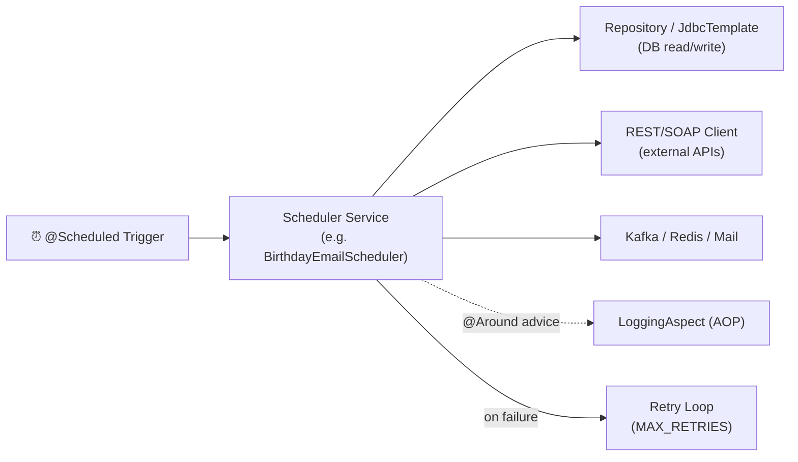

# 🗂️ Spring Boot Scheduler Module — Vault Home

Welcome. This vault turns the "Spring Boot Scheduler Module" reference sheet into **clear, interview-ready notes**, all linked together like a mind map. Click any `[[link]]` in Obsidian's Graph View to jump around, or just read top to bottom.

> 💡 **How to use this vault**: Each note follows the same shape — *What it is → Why it exists → How it works (with code) → Common interview questions*. Start with the topic you're weakest on.

---

## 🧭 Learning Path (recommended order)

1. [[01 - Spring Scheduling Basics]] — the heart of the module: `@Scheduled`, `@EnableScheduling`, `TaskScheduler`
2. [[02 - Virtual Threads and SimpleAsyncTaskScheduler]] — modern Java 21 concurrency for schedulers
3. [[03 - Configuration Classes Overview]] — how the app wires itself together
4. [[04 - AOP - Aspect Oriented Programming]] — cross-cutting logging/error handling
5. [[05 - Retry Pattern]] — how scheduled jobs survive transient failures
6. [[06 - Data Access Layer - JDBC and Repository Pattern]]
7. [[07 - REST and SOAP Clients]]
8. [[08 - Spring Cloud and Microservices]]
9. [[09 - Kafka and RabbitMQ Messaging]]
10. [[10 - Redis Caching]]
11. [[11 - Email Services]]
12. [[12 - File Processing]]
13. [[13 - Concurrency - Async and Threads]]
14. [[14 - Monitoring - Actuator and Logging]]
15. [[15 - Security - JWT OAuth2 MSAL]]
16. [[16 - Testing in Spring Boot]]
17. [[17 - Serialization - Jackson Gson JAXB]]
18. [[18 - Database and Transactions]]
19. [[19 - Recommended Multi-Module Structure]]
20. [[20 - Interview Cheat Sheet]] ⭐ — quick-fire Q&A summary of everything above

---

## 📦 By Category

### Core Scheduling
- [[01 - Spring Scheduling Basics]]
- [[02 - Virtual Threads and SimpleAsyncTaskScheduler]]
- [[05 - Retry Pattern]]

### Configuration & Wiring
- [[03 - Configuration Classes Overview]]
- [[08 - Spring Cloud and Microservices]]

### Cross-Cutting Concerns
- [[04 - AOP - Aspect Oriented Programming]]
- [[14 - Monitoring - Actuator and Logging]]
- [[15 - Security - JWT OAuth2 MSAL]]

### Data & Integration
- [[06 - Data Access Layer - JDBC and Repository Pattern]]
- [[07 - REST and SOAP Clients]]
- [[09 - Kafka and RabbitMQ Messaging]]
- [[10 - Redis Caching]]
- [[18 - Database and Transactions]]

### Supporting Concerns
- [[11 - Email Services]]
- [[12 - File Processing]]
- [[13 - Concurrency - Async and Threads]]
- [[17 - Serialization - Jackson Gson JAXB]]
- [[16 - Testing in Spring Boot]]

### Architecture
- [[19 - Recommended Multi-Module Structure]]

---

## 🏗️ The Big Picture

This module is essentially a **standalone Spring Boot batch/scheduler service** — no web UI, no controllers taking requests. Instead, `@Scheduled` methods wake up on a timer (cron or fixed rate), pull/push data to external systems (databases, REST/SOAP APIs, Kafka, email), and log everything via AOP.

Keep this diagram in your head — almost every class in the original reference sheet is one of these five boxes.

---

## 🎯 If you only have 10 minutes before an interview
Go straight to [[20 - Interview Cheat Sheet]].
