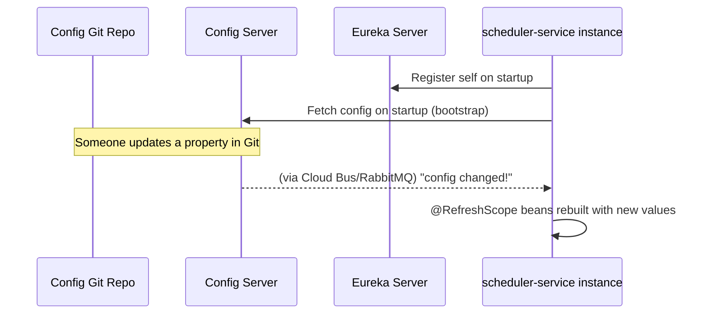

# Spring Cloud & Microservices

Related: [[02 - Configuration Classes Overview|03 - Configuration Classes Overview]] · [[09 - Kafka and RabbitMQ Messaging]] · [[20 - Interview Cheat Sheet]]

## 🧩 What it is
When you split a monolith into many small services, you need infrastructure to help them **find each other** and **share configuration** — that's what Spring Cloud provides.

## 🔑 Core Pieces

| Component | Solves |
|---|---|
| **Eureka Client** (`@EnableDiscoveryClient`) | *Service discovery*: "where is the Payment service right now?" — services register themselves with a Eureka server and look each other up by name instead of hardcoded URLs |
| **Spring Cloud Config** | *Centralized configuration*: all services pull their `application.yml` from one Git-backed config server, instead of each having its own copy |
| **Spring Cloud Bus** (via RabbitMQ, `spring-cloud-starter-bus-amqp`) | *Broadcast config refresh*: when config changes, a message goes out over the bus so every service instance refreshes without a restart |
| **`@RefreshScope`** | Marks a bean as *refreshable* — when Cloud Bus signals a config change, `@RefreshScope` beans are recreated with the new values, live |

## 🛠️ How they work together

## 📦 Key Dependencies (from the reference sheet)

| Dependency | Gives you |
|---|---|
| `spring-cloud-starter-config` | Config Server *client* support |
| `spring-cloud-starter-netflix-eureka-client` | Eureka registration/discovery |
| `spring-cloud-starter-bus-amqp` | RabbitMQ transport for Cloud Bus |
| `spring-cloud-starter-bootstrap` | Re-enables `bootstrap.properties`/`bootstrap.yml` loading (needed in newer Spring Cloud versions where bootstrap context was made opt-in) |

## ❓ Interview Q&A

**Q: Why would a *scheduler* (not a web-facing service) need Eureka/service discovery?**
A: Because it calls **other internal microservices** (not just external partners) — e.g., it might call an internal "notification-service" or "employee-service" by logical name via Eureka, rather than a hardcoded host:port that changes across environments/scaling.

**Q: What problem does `@RefreshScope` solve that a normal `@Bean` doesn't?**
A: A normal singleton bean is built once at startup and never rebuilt. If a config property changes (say, a cron expression or an API key) you'd need to *restart* the app to pick it up. `@RefreshScope` beans are destroyed and lazily re-created on the next access after a refresh event, applying new property values without a restart.

**Q: Why do you need `spring-cloud-starter-bootstrap` explicitly in modern Spring Cloud?**
A: Since Spring Cloud 2020.0 (Ilford), the separate "bootstrap context" (which loaded config *before* the main application context, needed for Config Server client lookup) was made opt-in rather than automatic — you must add this starter to restore that early-loading behavior.

**Q: How does Spring Cloud Bus differ from just having each instance poll the Config Server?**
A: Polling means each instance individually re-checks on an interval (delay + wasted requests). Cloud Bus **pushes** a single refresh event across a message broker (e.g., RabbitMQ) to all instances simultaneously and immediately.
