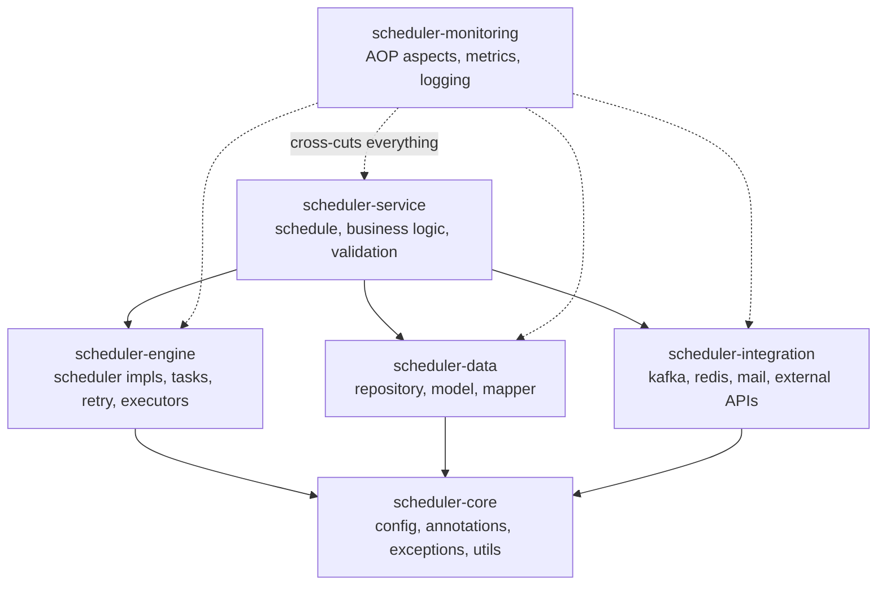

# Recommended Multi-Module Structure

Related: [[00-Home|Home]] · [[20 - Interview Cheat Sheet]]

## 🧩 Why split into modules at all?
As this codebase grows, one giant module mixing scheduling, data access, external clients, and messaging becomes hard to test, reuse, or reason about. Splitting by **responsibility** (not by "layer for the sake of layers") gives cleaner dependency direction and lets pieces be reused (e.g., `scheduler-core` in another project entirely).

## 🗂️ The Proposed Modules

| Module | Contains | Depends on |
|---|---|---|
| **scheduler-core** | Base config, custom annotations, exceptions, shared utils — see [[03 - Configuration Classes Overview]] | Nothing internal — the foundation |
| **scheduler-engine** | Actual scheduler implementations, task definitions, [[05 - Retry Pattern]], executors — see [[01 - Spring Scheduling Basics]] | `core` |
| **scheduler-data** | [[06 - Data Access Layer - JDBC and Repository Pattern]], domain models, mappers | `core` |
| **scheduler-integration** | [[09 - Kafka and RabbitMQ Messaging]], [[10 - Redis Caching]], [[11 - Email Services]], [[07 - REST and SOAP Clients]] | `core` |
| **scheduler-service** | Wires business logic on top of engine + data + integration | `engine`, `data`, `integration` |
| **scheduler-monitoring** | [[04 - AOP - Aspect Oriented Programming]] aspects, custom metrics, [[14 - Monitoring - Actuator and Logging]] | Cuts across everything (that's the nature of AOP) |

## 🧠 Design Principles This Reflects
1. **Dependency points inward/downward** — `service` depends on `engine`/`data`/`integration`, never the reverse. `core` depends on nothing internal. This avoids circular module dependencies.
2. **Cross-cutting concerns get their own module** — `monitoring` isn't "above" or "below" the others in the dependency chain; it wraps around them via AOP proxies, which is why the arrows are dotted.
3. **Integration is isolated** — swapping Kafka for RabbitMQ, or one partner client for another, stays contained to `scheduler-integration` and doesn't ripple into `scheduler-engine`'s scheduling logic.

## ❓ Interview Q&A

**Q: Why put `retry` inside `scheduler-engine` rather than its own module?**
A: Retry logic is tightly coupled to *how tasks execute* (the engine's job) rather than being a standalone concern like data access or messaging — it's specific to task execution, not reusable in isolation the way, say, the Redis integration is.

**Q: What's the benefit of `scheduler-core` having zero internal dependencies?**
A: It guarantees no circular dependency risk and means `core` can be reused by *any* other module (or even a totally different project) without dragging in unrelated concerns like Kafka or JDBC.

**Q: If `scheduler-monitoring` needs to log calls happening inside `scheduler-data`, doesn't that mean `monitoring` depends on `data`?**
A: Not necessarily in code — AOP pointcuts can target packages/annotations generically (e.g., `execution(* com.etrans..*.service..*(..))`) without `monitoring` importing concrete classes from `data`. The *aspect* is generic; it's woven in via Spring's proxy mechanism at runtime, keeping compile-time coupling low even though it observes calls everywhere.

**Q: What's a real risk of over-modularizing a project like this?**
A: Excessive fragmentation increases build complexity (more POMs/version management), can obscure the overall flow across many small modules, and adds friction for genuinely small teams. Modularity is a tool for managing growth/reuse — it's not free, and should track real boundaries (like "this could plausibly be its own library") rather than being applied dogmatically.
