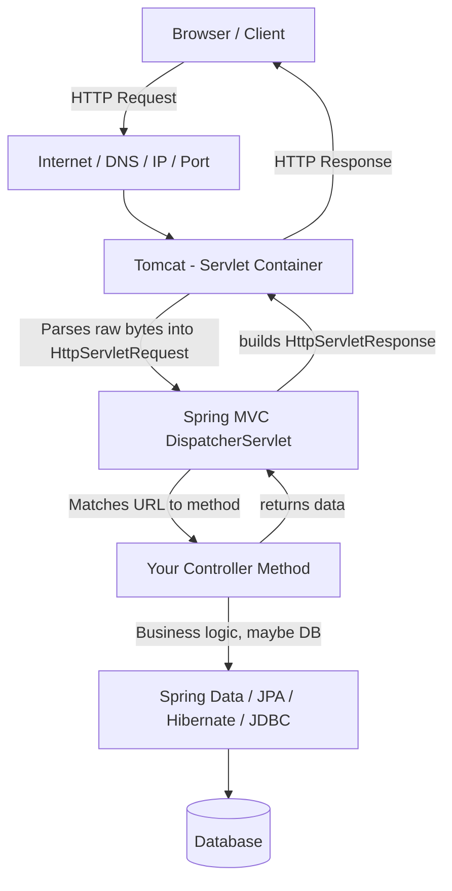

# 🗺️ Spring Boot & Backend Fundamentals — Map of Content

This vault reconstructs and expands on handwritten notes covering how a web request travels from a browser all the way down to a Java method — and back. It's organized **bottom-up conceptually** but you can read in whatever order you like; everything is cross-linked.

> [!tip] How to use this vault
> Start at [[01 - Client, Server & The Request-Response Cycle]] if you're new, or jump straight to [[08 - Our First Spring Boot Endpoint]] if you just want the practical walkthrough. Use the graph view — this vault is intentionally dense with links.

---

## 🧭 The Big Picture

---

## 📚 Sections

### 1. Networking Foundations
- [[01 - Client, Server & The Request-Response Cycle]]
- [[02 - IP Address vs Port Number]]
- [[03 - Localhost and 127.0.0.1]]
- [[04 - DNS and Default Ports]]

### 2. The HTTP Protocol
- [[05 - What is HTTP and HTTPS]]
- [[06 - Anatomy of an HTTP Request]]
- [[07 - Anatomy of an HTTP Response]]

### 3. Core Java Refresher
- [[08 - Core Java Structure - Main Method]]
- [[09 - From .java to .class - Compilation and the JVM]]

### 4. Building a Server By Hand (Why Spring Boot Exists)
- [[10 - Building a Raw Server with java.net]]
- [[11 - The Manual Server Checklist (5 Painful Steps)]]
- [[12 - Code Flow vs Website Flow (while(true))]]

### 5. Servlets & Containers
- [[13 - What is a Servlet]]
- [[14 - Servlet Containers and Tomcat]]

### 6. The Spring Ecosystem
- [[15 - Spring Framework Overview]]
- [[16 - Spring Core - DI, IoC, Beans]]
- [[17 - Spring Boot vs Spring Framework]]

### 7. Data Access Layer
- [[18 - Spring Data JPA, Hibernate and JDBC Explained]]

### 8. Hands-On: First Application
- [[19 - Spring Initializr and Dependencies]]
- [[20 - Anatomy of a Spring Boot Project]]
- [[21 - The Main Application Class]]
- [[22 - Controllers and @RestController]]
- [[23 - Creating Our First Endpoint - @GetMapping]]
- [[24 - Complete Request Flow Walkthrough]]
- [[25 - Changing the Server Port]]

### 9. The "Why" Behind It All
- [[26 - Why Spring Boot Feels Like Magic]]
- [[27 - Why You Still Need to Learn the Internals]]

---

## 🏷️ Tag Index
`#networking` `#http` `#java` `#jvm` `#servlet` `#tomcat` `#spring` `#spring-boot` `#spring-data` `#jpa` `#hibernate` `#interview-prep`

---

## 🔑 Key Terms Glossary (Quick Reference)

| Term | One-line definition | Detail note |
|---|---|---|
| Port | Identifies *which application* on a machine receives data | [[02 - IP Address vs Port Number]] |
| Localhost | Your own machine, `127.0.0.1` | [[03 - Localhost and 127.0.0.1]] |
| Servlet | A Java class that handles one HTTP request/response cycle | [[13 - What is a Servlet]] |
| Servlet Container | Software (e.g. Tomcat) that manages servlets, sockets & threads | [[14 - Servlet Containers and Tomcat]] |
| Dependency | An external library your project needs | [[19 - Spring Initializr and Dependencies]] |
| IoC / DI | Spring creates & wires your objects for you | [[16 - Spring Core - DI, IoC, Beans]] |
| `@RestController` | Marks a class as an HTTP-handling class returning raw data | [[22 - Controllers and @RestController]] |
| `@GetMapping` | Maps a GET request at a URL to a Java method | [[23 - Creating Our First Endpoint - @GetMapping]] |

---
*Source material: hand-drawn lecture notes on the Spring Framework stack + "Lecture 2: Writing Our First Spring Boot Application" (Coder Army).*
