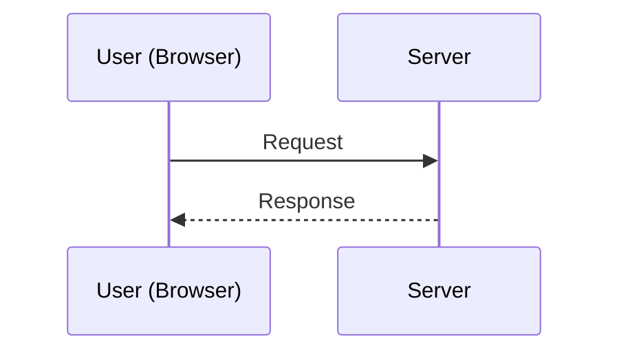
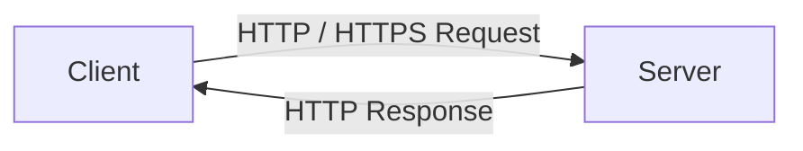

# Client, Server & The Request-Response Cycle

## The core idea

Every interaction on the web boils down to one simple pattern, drawn at the very top of the original notes:

> [!quote] From the notes
> `User [Browser] (www.amazon.in)` ⇄ `Server`
> - Arrow going out = **Request**
> - Arrow coming back = **Response**

The **browser** (e.g. Chrome) is the concrete example of a *client*. When you type `www.amazon-in` (or, properly, `www.amazon.in`) into the address bar, the browser becomes the *client* half of this relationship.

## Client vs Server, generalized

The notes generalize "User/Browser" into the more formal term **Client**:

A **client** is anything that *initiates* a request. A **server** is anything that *listens* and *responds*. This client role isn't limited to browsers:

| Client type | Example |
|---|---|
| Browser | Chrome, Firefox, Safari |
| Mobile App | An Android/iOS app calling your backend |
| Frontend framework | A React app calling `fetch()` |
| Testing tool | Postman |

> [!note] The notes explicitly list these under "Browser / Mobile App / React FE / Android/iOS / Postman" all pointing at one underlined word: **Server**.

## The one-sentence mental model

> [!important] Core relationship
> **Client → Ask**
> **Server → Respond**

That's it. Everything else in this vault — Tomcat, Servlets, Spring MVC, Controllers — exists purely to make the *"Respond"* side of this equation smarter, faster, and easier to build.

## What is the "entity" being exchanged?

The notes label the arrow from Server back with the word **entity** — this is the actual payload of data returned (HTML, JSON, plain text, etc.), which later becomes the **Body** of the [[07 - Anatomy of an HTTP Response|HTTP Response]].

## Where this leads next

- The *language* client and server speak to communicate is **HTTP/HTTPS** → see [[05 - What is HTTP and HTTPS]]
- But before two computers can even find each other, the client needs to know *where* to send the request → see [[02 - IP Address vs Port Number]]

## Related
- [[02 - IP Address vs Port Number]]
- [[05 - What is HTTP and HTTPS]]
- [[13 - What is a Servlet]]
