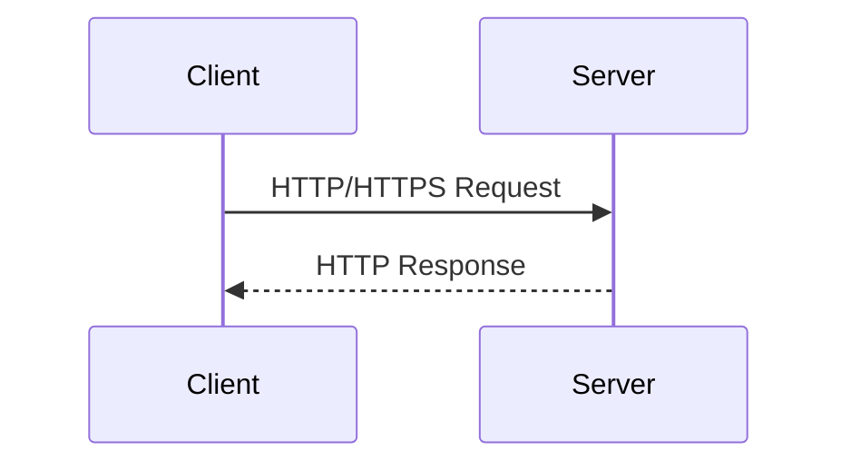

# What is HTTP and HTTPS

> [!abstract] One-Line Definition
> **HTTP** (HyperText Transfer Protocol) is the agreed-upon *language* a client and server use to exchange requests and responses; **HTTPS** is the same thing, encrypted.

---

## 1. Big Picture / Mental Model

> [!quote] From the notes
> `Client → Ask`
> `Server → Respond`
> and the entity returned by the server is called the response **entity**.

## 2. Why It Matters

Without a shared protocol, a browser and a server (written in totally different languages, on totally different machines) would have no common format to exchange data in. HTTP is that common format — a plain-text convention both sides agree to follow.

## 3. How It Works

HTTP itself just defines four things, per the notes:
1. **Request structure** — how a request is formatted.
2. **Response structure** — how a response is formatted.
3. **Methods** — `GET`, `POST`, `DELETE`, `PUT`, `PATCH`.
4. **How data will be sent** — headers, body encoding, etc.

### HTTP Methods (from the notes)

| Method | Typical purpose |
|---|---|
| `GET` | Retrieve data |
| `POST` | Create data / submit a form (e.g. login) |
| `PUT` | Replace/update a resource |
| `PATCH` | Partially update a resource |
| `DELETE` | Remove a resource |

### HTTPS

**HTTPS** = HTTP + **TLS/SSL encryption**. The structure of the request/response is identical; the difference is that the data is encrypted in transit, and it defaults to port `443` instead of `80` (see [[04 - DNS and Default Ports]]).

## 4. Spring Boot / Java Notes

Every `@GetMapping` you write in Spring is literally saying "when an HTTP **GET** request arrives at this path, run this method." See [[23 - Creating Our First Endpoint - @GetMapping]].

## 5. Common Pitfalls & Misconceptions

- ❌ Thinking HTTPS is "a different protocol" from HTTP — it's HTTP *wrapped* in TLS encryption, not a redesign of the request/response model.
- ❌ Confusing the *method* (`GET`, `POST`, etc.) with the *URL/path* — they are two separate parts of the request line.

## 6. Interview Questions

**Beginner**
1. What does HTTP stand for and what problem does it solve?
2. What's the difference between HTTP and HTTPS?
3. Name three common HTTP methods and what they're typically used for.

## 7. Quick Revision
- HTTP = shared language for client/server communication.
- HTTPS = HTTP + encryption, defaults to port 443.
- 4 things HTTP defines: request structure, response structure, methods, data transfer format.

## Related
- [[06 - Anatomy of an HTTP Request]]
- [[07 - Anatomy of an HTTP Response]]
- [[01 - Client, Server & The Request-Response Cycle]]
