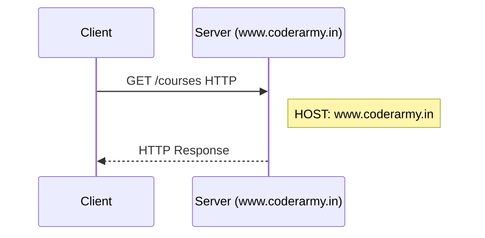

# Anatomy of an HTTP Request

> [!abstract] One-Line Definition
> An HTTP request is a plain-text message with four parts: **method name, URL/path, headers, and (optionally) a body**.

---

## 1. Big Picture / Mental Model



## 2. Why It Matters

The server needs to know exactly *what* the client wants (which method, which resource), *who* to reply to (host), *what format* the data is in, and *what data* is being sent — the request format packages all of that predictably.

## 3. How It Works — the four parts

From the notes:
> Request:
> - Method Name
> - URL / Path
> - Headers
> - Body

### Example 1 — a simple GET request

```http
GET /courses
HOST: www.coderarmy.in
```

### Example 2 — a POST request with a JSON body (login)

```http
POST /login
HOST: www.coderarmy.in
Content-Type: application/json

{
  "email": "...",
  "password": "..."
}
```

Breaking this down:
- **Method Name** → `POST`
- **URL / Path** → `/login`
- **Headers** → `HOST`, `Content-Type` (tells the server the body is JSON)
- **Body** → the actual `{ email, password }` payload

> [!tip] GET vs POST bodies
> `GET /courses` typically has **no body** — everything needed is in the URL. `POST /login` needs a body because it's *sending data* (credentials), not just asking for a resource.

## 4. Spring Boot / Java Notes

In Spring MVC, each of these parts maps directly onto annotations you'll use constantly:

| HTTP Request part | Spring annotation / concept |
|---|---|
| Method + URL | `@GetMapping("/hello")`, `@PostMapping("/login")` |
| Headers | `@RequestHeader` |
| Body | `@RequestBody` |

## 5. Common Pitfalls & Misconceptions

- ❌ Thinking headers are optional metadata you can ignore — `Content-Type` in particular tells the server *how to parse* the body; get it wrong and parsing fails.
- ❌ Forgetting the `HOST` header — this is how a single server (with one IP) can serve multiple domains (virtual hosting).

## 6. Interview Questions

**Beginner**
1. What four things make up an HTTP request?
2. Why does a `POST /login` request usually include a body but a `GET /courses` request doesn't?

**Intermediate**
1. What is the purpose of the `Content-Type` header?

## 7. Quick Revision
- Request = Method + URL/Path + Headers + Body
- `Content-Type: application/json` tells the server how to parse the body.

## Related
- [[05 - What is HTTP and HTTPS]]
- [[07 - Anatomy of an HTTP Response]]
- [[22 - Controllers and @RestController]]
