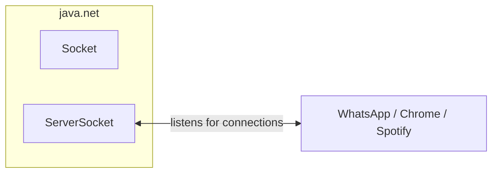

# Building a Raw Server with `java.net`

> [!abstract] One-Line Definition
> Before Spring Boot, before Tomcat, before Servlets — you can build an HTTP server *by hand* in plain Java using `java.net.ServerSocket`, which is exactly what all of them are built on top of.

---

## 1. Big Picture / Mental Model



> [!quote] From the notes
> `java.1 → java.net → Socket, ServerSocket`
> `ServerSocket server = new ServerSocket(8080);`

## 2. Why It Matters

Every framework you'll ever use (Tomcat, Spring, Node.js, etc.) is, underneath everything, opening a socket on a port and reading/writing raw bytes. Understanding this layer demystifies "how does the browser talk to Java?" — one of the exact questions the original lecture notes pose.

## 3. How It Works

`java.net` gives you two core classes:

| Class | Role |
|---|---|
| `ServerSocket` | Opens and listens on a port, waiting for incoming connections |
| `Socket` | Represents one active connection between client and server |

### Minimal example

```java
import java.net.ServerSocket;
import java.net.Socket;

public class RawServer {
    public static void main(String[] args) throws Exception {
        ServerSocket server = new ServerSocket(8080);
        System.out.println("Listening on port 8080...");

        while (true) {                       // keep the server alive forever
            Socket client = server.accept(); // blocks until a client connects
            // ... read the raw HTTP request bytes from client.getInputStream()
            // ... manually parse method, path, headers
            // ... manually write an HTTP response to client.getOutputStream()
            client.close();
        }
    }
}
```

This directly matches the notes' **"Website Flow"**:
```text
START
RUN
Wait for Request.
Give Response.
Keep Running.
```
...implemented literally as a Java `while (true) { ... }` loop.

## 4. Spring Boot / Java Notes

This is precisely the code that a **Servlet Container** like Tomcat runs *for you* — see [[14 - Servlet Containers and Tomcat]]. Spring Boot doesn't reinvent this; it just bundles an already-built, production-grade version of it (Tomcat) so you never have to write this loop yourself.

## 5. Common Pitfalls & Misconceptions

- ❌ Thinking Spring Boot "avoids" sockets — it doesn't; it just hides this exact `ServerSocket` code inside the embedded Tomcat server.
- ❌ Forgetting `while(true)` — without an infinite loop, the server would handle exactly one request and then exit.

## 6. Interview Questions

**Beginner**
1. What two classes does `java.net` provide for basic server/client networking?
2. Why does a server need an infinite loop?

**Intermediate**
1. What does Tomcat do that this raw `java.net` example doesn't (yet)?

## 7. Quick Revision
- `ServerSocket` = opens/listens on a port.
- `Socket` = one active client connection.
- A server is fundamentally: open port → loop forever → accept connection → read/respond.

## Related
- [[11 - The Manual Server Checklist (5 Painful Steps)]]
- [[12 - Code Flow vs Website Flow (while(true))]]
- [[14 - Servlet Containers and Tomcat]]
