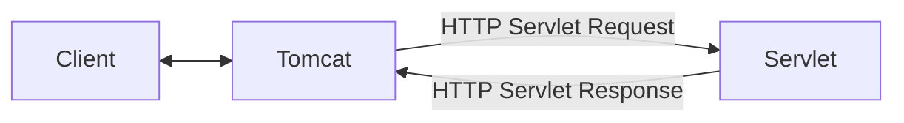

# What is a Servlet

> [!abstract] One-Line Definition
> A **Servlet** is a Java class following a standard contract for handling one HTTP request and producing one HTTP response — introduced in **1997** as part of **Java EE**.

---

## 1. Big Picture / Mental Model



> [!quote] From the notes
> `Servlet & Servlet Container → Server`
> `1997 · Java EE`

## 2. Why It Matters

Remember the [[11 - The Manual Server Checklist (5 Painful Steps)|5 painful manual steps]]? A Servlet standardizes step 3 and beyond: instead of hand-writing `if/else` routing and manually parsing bytes, you implement a well-known interface, and a **Servlet Container** (like Tomcat) does the socket-level work for you, handing your code a nicely parsed request object and expecting a response object back.

## 3. How It Works

A Servlet's job, conceptually:
```text
Client → Ask → Servlet Container (Tomcat) → hands off to → Servlet → Respond
```

The container converts raw HTTP bytes into an `HttpServletRequest` object, calls the appropriate Servlet method, and takes the `HttpServletResponse` object the Servlet fills in and serializes it back into raw HTTP bytes for the client.

## 4. Spring Boot / Java Notes

You will almost never write a raw Servlet by hand in Spring Boot — **Spring MVC's `DispatcherServlet` is itself one big Servlet** that Spring registers with Tomcat automatically. Every `@RestController` and `@GetMapping` you write is ultimately invoked *through* this single Servlet. See [[22 - Controllers and @RestController]].

## 5. Common Pitfalls & Misconceptions

- ❌ Thinking "Servlet" and "Spring Boot" are competing technologies — Spring Boot is built *on top of* the Servlet API; it doesn't replace it, it wraps it in a much friendlier layer.
- ❌ Confusing a Servlet with the Servlet **Container** — a Servlet is *your handler code*; the container is the *software that runs and manages* your Servlets (see next note).

## 6. Interview Questions

**Beginner**
1. What is a Servlet, in one sentence?
2. What year and Java specification introduced Servlets?

**Intermediate**
1. What role does `DispatcherServlet` play in a Spring Boot app?

## 7. Quick Revision
- Servlet = standardized Java class for handling one request/response cycle.
- Introduced 1997, part of Java EE.
- Spring MVC's `DispatcherServlet` is a Servlet under the hood.

## Related
- [[11 - The Manual Server Checklist (5 Painful Steps)]]
- [[14 - Servlet Containers and Tomcat]]
- [[22 - Controllers and @RestController]]
