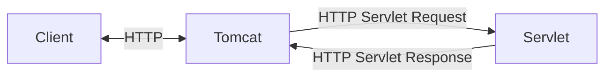
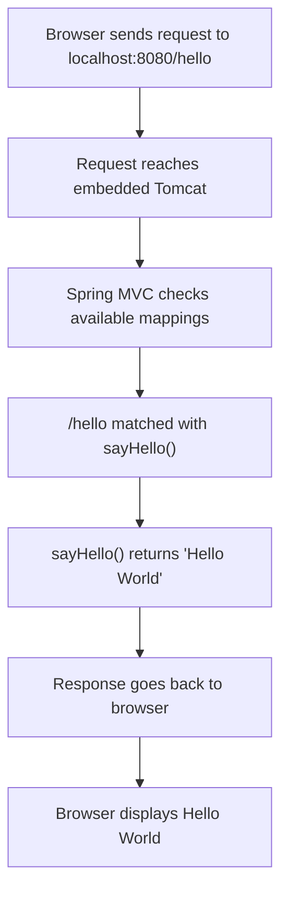

# Servlet Containers and Tomcat

> [!abstract] One-Line Definition
> A **Servlet Container** (Tomcat being the most common) is the piece of software that actually opens a network port, manages threads, and runs your Servlets for you — the production-grade version of the `while(true)` server you'd otherwise write by hand.

---

## 1. Big Picture / Mental Model



> [!quote] From the notes
> `Servlet & Servlet Container → Server`
> Examples: **Tomcat**, Jetty, Undertow

## 2. Why It Matters

This is the direct, concrete answer to the questions Lecture 2 raises: *"Who starts the server? Who listens on port 8080?"* — **Tomcat does.** Spring Boot doesn't build its own server; it embeds Tomcat (or Jetty/Undertow) and configures it for you.

## 3. How It Works — Tomcat's job, from the notes

```text
Servlet Container (Tomcat)
  ↳ Open port (say 8080)
  ↳ Read incoming bytes
  ↳ Parse HTTP request
  ↳ Manage threads
  ↳ Create HTTP response
```

This maps 1:1 onto the [[11 - The Manual Server Checklist (5 Painful Steps)|5 manual steps]] from earlier — Tomcat is simply an already-built, battle-tested, high-performance implementation of exactly that checklist.

## 4. Spring Boot / Java Notes

> [!quote] From the notes (Lecture 2)
> "We did not install Tomcat separately. We did not write socket programming code. We did not manually create a server. Still, Tomcat started. Why? Because Spring Boot includes and configures an **embedded** Tomcat server for us when we use the web dependency."

When you see this in your console:
```text
Tomcat started on port 8080
```
...that log line is Tomcat itself, running *inside* your Spring Boot process (not as a separate installed program), announcing that it's now listening.



## 5. Common Pitfalls & Misconceptions

- ❌ Thinking you need to install Tomcat separately for Spring Boot to work — the *web* starter dependency (`spring-boot-starter-web`) already bundles an embedded Tomcat.
- ❌ Assuming Tomcat = Spring — Tomcat is a general-purpose Servlet Container; Spring is a separate framework that happens to run *on top of* it.

## 6. Interview Questions

**Beginner**
1. What does "Tomcat started on port 8080" actually mean?
2. Name the responsibilities of a Servlet Container.

**Intermediate**
1. What's the difference between an "embedded" server and a traditionally deployed one (e.g., deploying a WAR to a standalone Tomcat install)?

## 7. Quick Revision
- Servlet Container = software that runs Servlets (opens port, manages threads, parses HTTP).
- Tomcat is the default one Spring Boot embeds automatically.
- Jetty and Undertow are alternatives.

## Related
- [[13 - What is a Servlet]]
- [[10 - Building a Raw Server with java.net]]
- [[24 - Complete Request Flow Walkthrough]]
