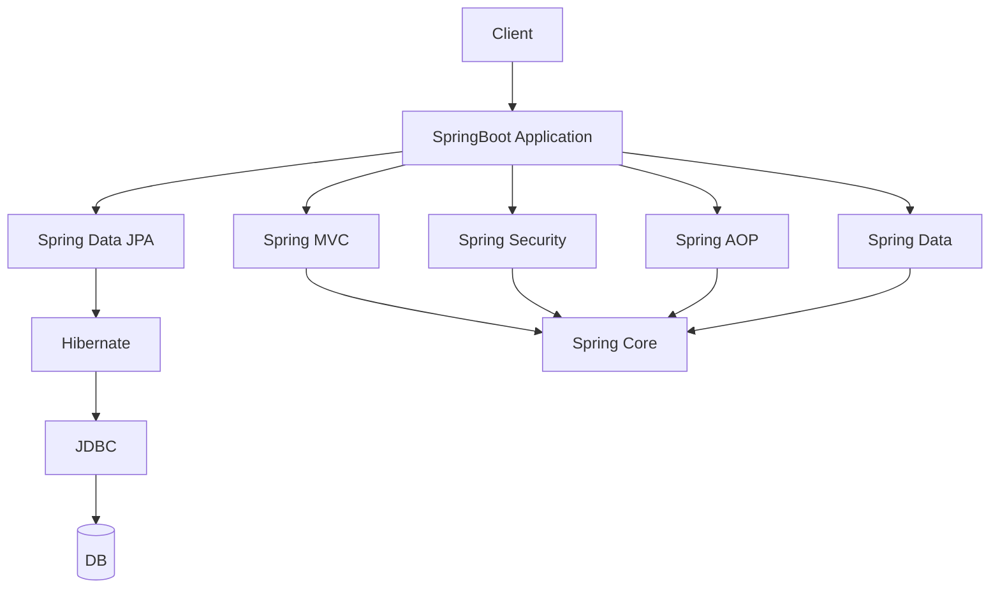

# Spring Framework Overview

> [!abstract] One-Line Definition
> **Spring** is a large ecosystem of Java modules — built on top of Tomcat/Servlets — that removes boilerplate and gives structure to real-world applications.

---

## 1. Big Picture / Mental Model



> [!quote] From the notes
> `SpringBoot` sits above `Spring MVC`, `Spring Security`, `Spring AOP`, `Spring Data` — all of which sit on `Spring Core`.

## 2. Why It Matters

Tomcat and Servlets solve *networking* problems (getting a request into your Java code). They say nothing about *how to structure* a large application — how to manage objects, secure endpoints, talk to a database, or handle cross-cutting logic like logging. That's what Spring adds.

## 3. How It Works — The module map

| Module | What it's for |
|---|---|
| **Spring Core** | Dependency Injection (DI), Inversion of Control (IoC), Beans — the foundation everything else builds on. See [[16 - Spring Core - DI, IoC, Beans]]. |
| **Spring MVC** | Handles web requests, routing, controllers (`@RestController`, `@GetMapping`). |
| **Spring Security** | Authentication & authorization. |
| **Spring AOP** | Aspect-Oriented Programming — cross-cutting concerns like logging, transactions. |
| **Spring Data** | Simplifies database access (JPA, JDBC). See [[18 - Spring Data JPA, Hibernate and JDBC Explained]]. |
| **Spring AI** | Newer module for integrating AI/LLM capabilities. |

**Spring Boot** sits *above* all of these — it's not a separate framework, it's an opinionated, auto-configuring way to assemble them quickly (see [[17 - Spring Boot vs Spring Framework]]).

## 4. Spring Boot / Java Notes

A typical business flow the notes sketch out as an example:
```text
order → payment
user → payment
```
This kind of multi-service business logic is exactly what Spring MVC (handling the request), Spring Data (talking to the DB), and Spring Security (making sure only the right user can trigger a payment) work together to support.

## 5. Common Pitfalls & Misconceptions

- ❌ Thinking "Spring" and "Spring Boot" are the same thing — Spring Boot is a *starter/auto-configuration layer* on top of the Spring Framework, not a replacement for it.
- ❌ Assuming you need to learn every module before building anything — most beginner apps only touch Spring Core, Spring MVC, and Spring Data.

## 6. Interview Questions

**Beginner**
1. What sits at the base of the entire Spring module stack?
2. Name three Spring modules and what each is responsible for.

**Intermediate**
1. Why is Spring described as an "ecosystem" rather than a single library?

## 7. Quick Revision
- Spring Core (DI/IoC/Beans) is the foundation.
- Spring MVC, Security, AOP, Data all build on Spring Core.
- Spring Boot sits above everything, auto-configuring it all.

## Related
- [[16 - Spring Core - DI, IoC, Beans]]
- [[17 - Spring Boot vs Spring Framework]]
- [[18 - Spring Data JPA, Hibernate and JDBC Explained]]
