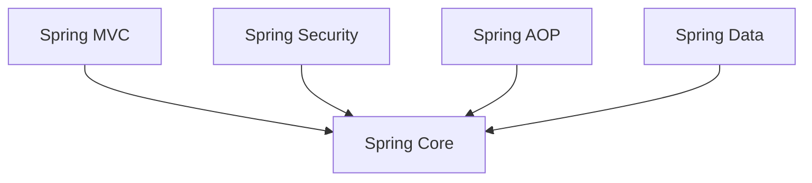

# Spring Core — DI, IoC, Beans

> [!abstract] One-Line Definition
> **Spring Core** is the foundation module that manages object creation and wiring for you, via **Inversion of Control (IoC)**, **Dependency Injection (DI)**, and objects called **Beans**.

---

## 1. Big Picture / Mental Model

> [!quote] From the notes
> `Spring Core → DI, IoC, Beans ---`

Every other Spring module (MVC, Security, AOP, Data) sits *on top of* this foundation:



## 2. Why It Matters

In plain Java, if `ClassA` needs `ClassB`, you write `new ClassB()` yourself, inside `ClassA`. As an app grows to hundreds of interdependent classes, manually wiring all of them becomes unmanageable — and hard to test, since you can't easily swap in a fake/mock version.

**Inversion of Control** flips this: instead of your code creating its own dependencies, you *describe what you need*, and the **Spring container** creates and hands them to you.

## 3. How It Works

| Term | Meaning |
|---|---|
| **IoC (Inversion of Control)** | Object creation control is handed *from your code* to the *Spring container*. |
| **Bean** | An object whose lifecycle (creation, configuration, destruction) is managed by Spring. |
| **DI (Dependency Injection)** | The mechanism by which Spring *hands* a Bean's dependencies to it (via constructor, field, or setter) instead of the Bean creating them itself. |

```java
@RestController
public class HelloController {
    // Spring creates and injects this for you — you never write `new SomeService()`
    private final SomeService service;

    public HelloController(SomeService service) {
        this.service = service;
    }
}
```

## 4. Spring Boot / Java Notes

Every `@RestController` you write (see [[22 - Controllers and @RestController]]) is itself a **Bean**. When Spring Boot starts, it scans your packages, finds classes annotated like this, creates instances of them, and wires in anything they need — all automatically, all part of "Created application context" from the [[26 - Why Spring Boot Feels Like Magic|Spring Boot magic list]].

## 5. Common Pitfalls & Misconceptions

- ❌ Thinking DI and IoC are two unrelated concepts — DI is the *specific technique* used to achieve the broader *principle* of IoC.
- ❌ Manually calling `new` on a class you want Spring to manage — this bypasses the container and breaks DI for that object.

## 6. Interview Questions

**Beginner**
1. What is Dependency Injection, in your own words?
2. What is a "Bean" in Spring?

**Intermediate**
1. How is IoC different from DI?
2. Why does IoC make testing easier?

## 7. Quick Revision
- IoC = principle: control of object creation moves to the framework.
- DI = mechanism: framework injects dependencies into your objects.
- Bean = an object Spring manages.

## Related
- [[15 - Spring Framework Overview]]
- [[22 - Controllers and @RestController]]
- [[26 - Why Spring Boot Feels Like Magic]]
