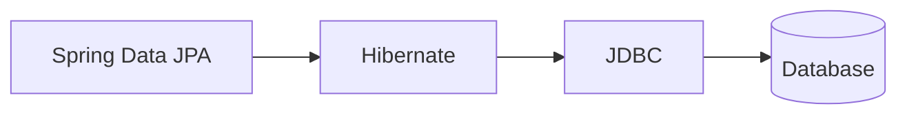

# Spring Data JPA, Hibernate and JDBC Explained

> [!abstract] One-Line Definition
> **JDBC** is the low-level Java API for talking to a database; **Hibernate** is an ORM that implements the **JPA** specification on top of JDBC; **Spring Data JPA** is a Spring module that makes using Hibernate/JPA even easier.

---

## 1. Big Picture / Mental Model



> [!quote] From the notes
> `Spring JPA → Hibernate → JDBC → DB`
> Also: `JDBC ⇄ JPA`, `JPA → Hibernate`

## 2. Why It Matters

Writing raw JDBC for every query is repetitive and error-prone (manual `Connection`, `PreparedStatement`, mapping `ResultSet` rows to Java objects by hand). This stack exists to progressively remove that boilerplate, layer by layer.

## 3. How It Works — the layers, bottom to top

| Layer | Role |
|---|---|
| **JDBC** (Java Database Connectivity) | The raw, low-level API for opening connections and running SQL. Everything below ultimately calls JDBC. |
| **JPA** (Jakarta/Java Persistence API) | A *specification* (interface) describing how Java objects should map to database tables — it's not an implementation itself. |
| **Hibernate** | The most popular *implementation* of JPA — it takes your annotated Java classes (entities) and generates the actual SQL/JDBC calls. |
| **Spring Data JPA** | A Spring module that sits on top of Hibernate/JPA and lets you define repository interfaces — Spring generates the implementation for you (e.g. `findById`, `save`) with almost no code. |

```java
// You write only this interface — Spring Data JPA generates the implementation
public interface UserRepository extends JpaRepository<User, Long> {
}
```

## 4. Spring Boot / Java Notes

When your `pom.xml` includes `spring-boot-starter-data-jpa` (see [[19 - Spring Initializr and Dependencies]]), calling `userRepository.save(user)` triggers this full chain: Spring Data JPA → Hibernate generates SQL → Hibernate calls JDBC → JDBC talks to the database.

## 5. Common Pitfalls & Misconceptions

- ❌ Thinking JPA and Hibernate are the same thing — JPA is a *spec* (an interface), Hibernate is one *implementation* of it (there are others, like EclipseLink).
- ❌ Assuming Spring Data JPA replaces Hibernate — it doesn't; it's a convenience layer that still uses Hibernate underneath by default.
- ❌ Forgetting that, ultimately, *everything* still becomes plain JDBC calls to the database.

## 6. Interview Questions

**Beginner**
1. What's the difference between JDBC and JPA?
2. What is Hibernate's role in this stack?

**Intermediate**
1. Why would you choose Spring Data JPA over writing raw JDBC?
2. What does Spring Data JPA actually generate for you when you extend `JpaRepository`?

## 7. Quick Revision
- JDBC = low-level DB access API.
- JPA = specification for object-relational mapping.
- Hibernate = implementation of JPA, generates SQL.
- Spring Data JPA = convenience layer over Hibernate/JPA (auto-generates repository code).

## Related
- [[15 - Spring Framework Overview]]
- [[19 - Spring Initializr and Dependencies]]
