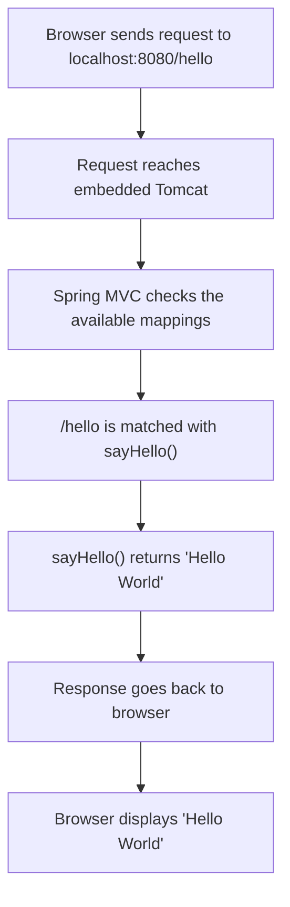

# Complete Request Flow Walkthrough

> [!abstract] One-Line Definition
> This is the full, end-to-end journey of a single browser request — from the address bar to your Java method and back — tying together every concept in this vault.

---

## 1. Big Picture / Mental Model

## 2. Why It Matters

This is "what happens behind one simple line in the browser" — `localhost:8080/hello` — as the original lecture puts it. Being able to narrate every arrow in this diagram, from memory, is the single best sign that you actually understand the stack rather than just copy-pasting annotations.

## 3. How It Works — step by step, with the note that explains each hop

| Step | What happens | See |
|---|---|---|
| 1 | Browser resolves `localhost` → `127.0.0.1`, connects to port `8080` | [[03 - Localhost and 127.0.0.1]], [[02 - IP Address vs Port Number]] |
| 2 | Browser sends a raw `GET /hello HTTP/1.1` request | [[06 - Anatomy of an HTTP Request]] |
| 3 | Embedded Tomcat (a Servlet Container) accepts the connection, reads and parses the bytes | [[14 - Servlet Containers and Tomcat]] |
| 4 | Tomcat hands off a parsed request to Spring MVC's `DispatcherServlet` | [[13 - What is a Servlet]] |
| 5 | Spring MVC checks its registered mappings and matches `/hello` to `sayHello()` | [[23 - Creating Our First Endpoint - @GetMapping]] |
| 6 | `sayHello()` runs and returns `"Hello World"` | [[22 - Controllers and @RestController]] |
| 7 | Spring MVC wraps the returned string into a full HTTP response (status `200`, headers, body) | [[07 - Anatomy of an HTTP Response]] |
| 8 | Tomcat sends the raw response bytes back over the socket | [[10 - Building a Raw Server with java.net]] |
| 9 | Browser receives the response and renders `Hello World` | [[01 - Client, Server & The Request-Response Cycle]] |

## 4. Spring Boot / Java Notes

> [!quote] From the notes — everything Spring Boot did behind this one simple `@GetMapping`
> - Created application context
> - Started embedded Tomcat
> - Configured Spring MVC
> - Detected controller class
> - Registered `/hello` endpoint
> - Handled HTTP request and response
> - Returned data to browser

## 5. Common Pitfalls & Misconceptions

- ❌ Thinking any single layer (e.g. "Spring") does *all* of this alone — it's a relay: networking → Tomcat → Servlet API → Spring MVC → your code, and back.
- ❌ Debugging a `404` by only looking at your controller code — the checklist in [[27 - Why You Still Need to Learn the Internals]] spans every layer in this table.

## 6. Interview Questions

**Intermediate**
1. Walk through, in order, everything that happens between a browser request and `sayHello()` executing.
2. If a request never reaches `sayHello()`, which layers could be the cause?

## 7. Quick Revision
- Full path: Browser → DNS/localhost → Port → Tomcat → Servlet layer → Spring MVC → Controller method → back the same way.
- Being able to narrate this end-to-end is the real "understanding" the notes are aiming for.

## Related
- [[14 - Servlet Containers and Tomcat]]
- [[23 - Creating Our First Endpoint - @GetMapping]]
- [[27 - Why You Still Need to Learn the Internals]]
