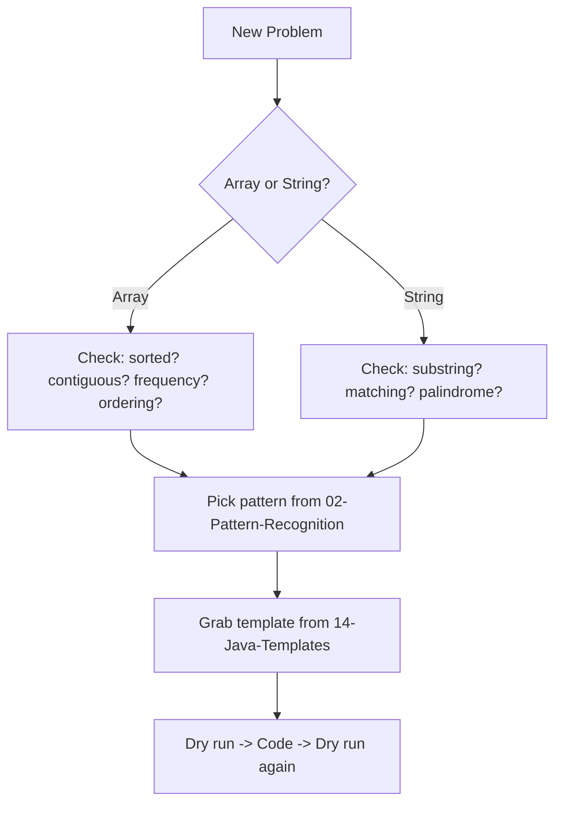

# 🧠 Arrays & Strings — Interview Notebook

> [!tip] How to use this vault
> - **< 1 hour available** → read [[13-One-Page-Revision-Sheet]]
> - **< 15 minutes available** → read [[14-15-Min-Revision-Sheet]]
> - **Mid-practice, need a pattern** → jump to [[02-Pattern-Recognition]]
> - **Stuck on a problem** → check [[09-Interview-Flowchart]]
> - **Drilling recall** → use [[10-Flashcards]]
> - **Right before you open the editor** → run [[15-Final-Interview-Checklist]]

## 📁 Vault Map

| # | Note | Contents |
|---|---|---|
| 00 | [[00-Home]] | You are here |
| 01 | [[01-Mind-Map]] | Full pattern roadmap (Arrays + Strings) |
| 02 | [[02-Pattern-Recognition]] | 40+ clue→pattern table |
| 03 | [[03-Arrays-Foundations]] | Traversal, Prefix Sum, Difference Array, Kadane, Two Pointer |
| 04 | [[04-Arrays-Windows-Search]] | Sliding Window (fixed/variable), Binary Search, Binary Search on Answer, Dutch Flag |
| 05 | [[05-Arrays-Sorting-Selection]] | Merge Intervals, Sweep Line, Cyclic Sort, Quick Select, Moore Voting, Sorting family |
| 06 | [[06-Arrays-Hashing-Greedy]] | HashMap, HashSet, Frequency Array, Greedy |
| 07 | [[07-Arrays-Stack-Queue-Heap]] | Monotonic Stack/Queue, Deque, Heap, Bucket/Counting/Merge/Quick Sort |
| 08 | [[08-Arrays-Advanced-DS]] | Fenwick Tree, Segment Tree, Sparse Table, Union Find |
| 09 | [[09-Matrix-Grid]] | Matrix traversal/rotation/spiral/diagonal/transpose, Flood Fill, BFS/DFS Grid |
| 10 | [[10-Strings-Foundations]] | Char Frequency, Sliding Window, Anagram, Palindrome, Expand Around Center, Manacher |
| 11 | [[11-Strings-Advanced]] | KMP, Rabin-Karp, Z-Algorithm, Rolling Hash, Trie, Suffix Array, LCP, Lexicographic, Builder/ASCII/Unicode/Regex |
| 12 | [[12-Comparison-Tables]] | Head-to-head pattern comparisons |
| 13 | [[13-Complexity-Cheat-Sheet]] | One-page complexity table |
| 14 | [[14-Java-Templates]] | All reusable Java code templates in one place |
| 15 | [[15-Common-Tricks]] | 100+ interview tricks |
| 16 | [[16-Edge-Case-Checklist]] | Pre-submission checklist |
| 17 | [[17-Interview-Flowchart]] | Decision tree: problem → pattern |
| 18 | [[18-Flashcards]] | 150+ Q&A flashcards |
| 19 | [[19-Common-Mistakes]] | Per-algorithm mistake list |
| 20 | [[20-LeetCode-Roadmap]] | Problems grouped by pattern |
| 21 | [[21-One-Page-Revision-Sheet]] | Everything, compressed |
| 22 | [[22-15-Min-Revision-Sheet]] | Ultra-condensed pre-interview read |
| 23 | [[23-Final-Interview-Checklist]] | Mental checklist before you type |

> [!note] Numbering note
> File numbers above match the actual filenames in this vault (some renumbering happened during compilation — always trust the link target, not the number).

## 🗺️ Quick Visual: The Big Picture

Next: [[01-Mind-Map]]
