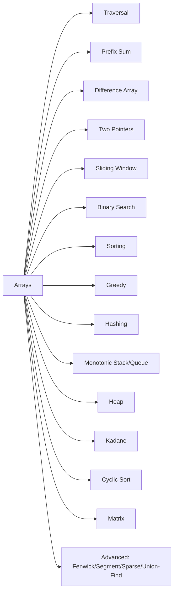
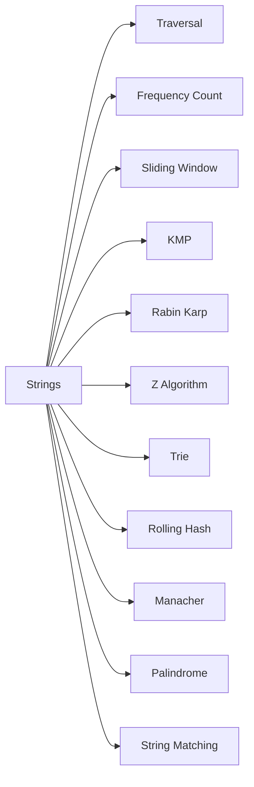
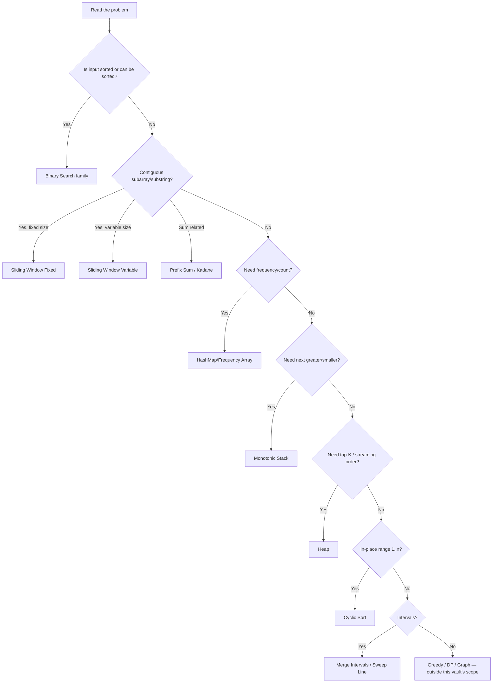

# 1. Mind Map

⬅ [[00-Home]] | Next: [[02-Pattern-Recognition]]

## Arrays

## Strings

> [!tip] Mnemonic — "PALS THINK BIG" for array patterns
> **P**refix sum, **A**rray traversal, **L**inear scan, **S**liding window,
> **T**wo pointer, **H**ashing, **I**ntervals, **N**ested search (binary),
> **K**adane, **B**ucket/counting sort, **I**ncreasing/decreasing stack, **G**reedy
Duplicate       → Frequency
Missing         → Frequency
Anagram         → Character Frequency
Most frequent   → Frequency
Unique element  → Frequency
Count elements  → Frequency
Repeated values → Frequency
## One Diagram to Rule Them All — Pattern Selector

Next: [[02-Pattern-Recognition]]
