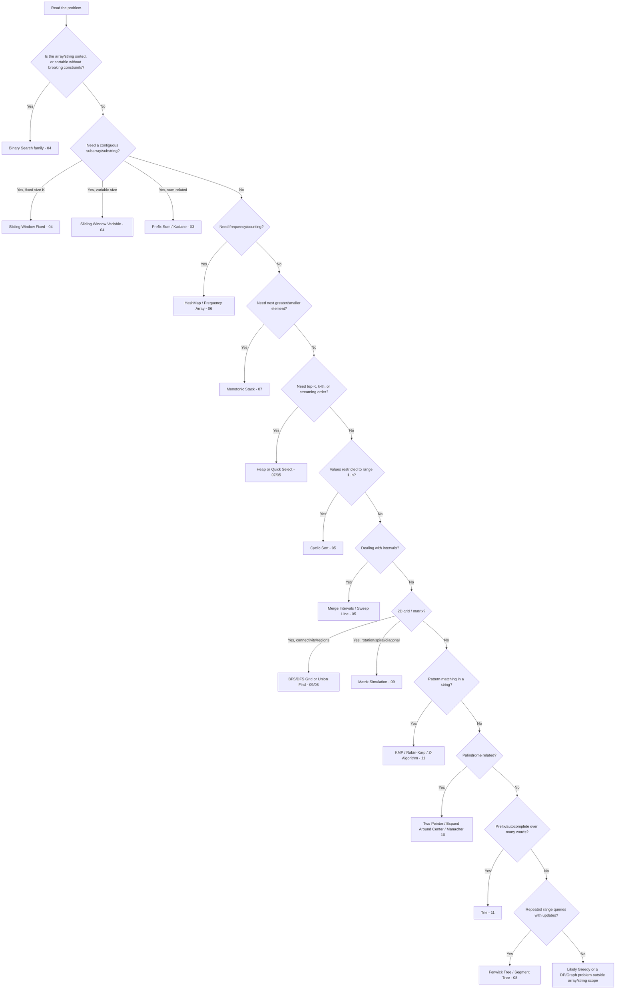

# 17. Interview Flowchart — Given a Problem, Now What?

⬅ [[00-Home]] | Prev: [[16-Edge-Case-Checklist]] | Next: [[18-Flashcards]]

## Textual Walkthrough (for when you can't see the diagram)

1. **Sorted?** → Binary Search.
2. **Not sorted, need contiguous range?** → Sliding Window (fixed/variable) or Prefix Sum / Kadane if sum-related.
3. **Need counting/frequency?** → HashMap or fixed-size Frequency Array.
4. **Need "next greater/smaller"?** → Monotonic Stack.
5. **Need top-K / k-th element / streaming order?** → Heap (or Quick Select for one-shot k-th).
6. **Values confined to [1,n] or [0,n-1]?** → Cyclic Sort (O(1) space missing/duplicate tricks).
7. **Intervals?** → Merge Intervals (static) or Sweep Line (overlap counting).
8. **2D grid, connectivity?** → BFS/DFS or Union Find.
9. **2D grid, geometric transform?** → Matrix simulation (rotate/spiral/diagonal/transpose).
10. **String pattern matching?** → KMP (guaranteed), Rabin-Karp (multiple patterns), Z-Algorithm (alternative).
11. **Palindrome?** → Two Pointer (validation) or Expand Around Center / Manacher (substring search).
12. **Prefix-heavy, many words?** → Trie.
13. **Repeated range queries with mutation?** → Fenwick Tree or Segment Tree.
14. **None of the above fit cleanly?** → Reconsider: could be Greedy, DP, or a Graph problem — outside pure array/string pattern scope, but check [[06-Arrays-Hashing-Greedy#Greedy|Greedy]] first since it overlaps often.

Next: [[18-Flashcards]]
