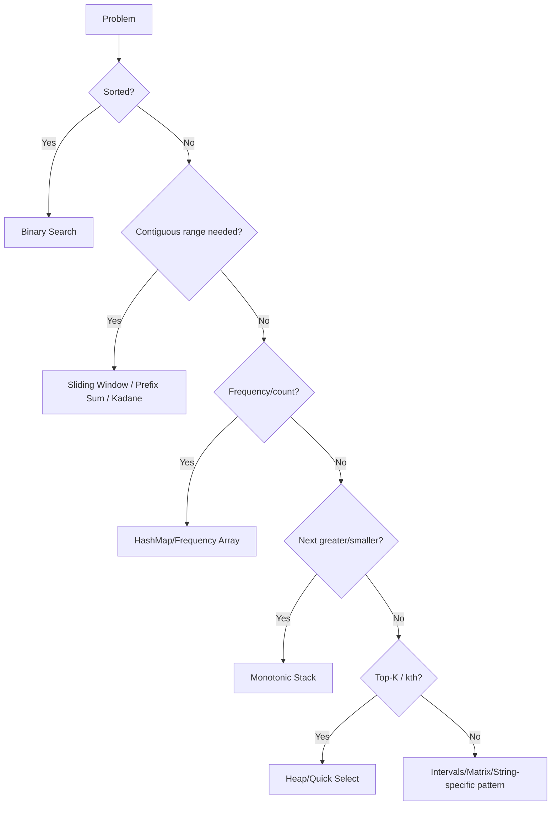

# 21. One-Page Revision Sheet

⬅ [[00-Home]] | Prev: [[20-LeetCode-Roadmap]] | Next: [[22-15-Min-Revision-Sheet]]

## Patterns at a Glance

| Clue | Pattern |
|---|---|
| Contiguous + sum | Prefix Sum / Kadane |
| Substring/subarray with condition | Sliding Window |
| Sorted + pair search | Two Pointer |
| kth/top-k | Heap / Quick Select |
| Next greater/smaller | Monotonic Stack |
| Range [1,n], missing/duplicate | Cyclic Sort |
| Intervals | Merge Intervals / Sweep Line |
| Frequency/counting | HashMap / Frequency Array |
| Range queries + updates | Fenwick / Segment Tree |
| Connectivity (grid/graph) | BFS/DFS / Union Find |
| Prefix/autocomplete (many words) | Trie |
| Pattern matching (text) | KMP / Rabin-Karp / Z-Algo |
| Palindrome | Two Pointer / Expand Around Center / Manacher |

## Complexity Snapshot

| Bucket | Examples |
|---|---|
| O(1) space, O(n) time | Kadane, Two Pointer, Cyclic Sort, Moore Voting |
| O(n) space, O(n) time | HashMap/Set, Prefix Sum, Monotonic Stack |
| O(n log n) | Sorting-based, Merge Intervals, Binary Search on Answer |
| O(log n) per op | Binary Search, Heap insert/extract, Fenwick/Segment Tree |
| O(n+m) | KMP, Z-Algorithm, Rabin-Karp (average) |

## Decision Tree (Condensed)



## Formulas to Memorize

```java
mid = lo + (hi - lo) / 2;                       // safe binary search midpoint
prefix[i+1] = prefix[i] + arr[i];               // prefix sum build
rangeSum = prefix[r+1] - prefix[l];             // range query
maxEndingHere = Math.max(arr[i], maxEndingHere + arr[i]); // Kadane
i & (-i)                                         // Fenwick tree lowest set bit
lps[i] = length of longest prefix==suffix        // KMP failure function
Z[i] = length of longest prefix match at i       // Z-array
```

## Top Tricks (Condensed)

- XOR cancels duplicates: `a ^ a = 0`
- Negative marking for O(1) space "visited" flags
- Coordinate compression before Fenwick/Segment Tree on large sparse values
- `StringBuilder`, never `String +=` in a loop
- Prefix × suffix product for "product except self"
- Sentinel values (`-∞`, `+∞`, `-1`) to simplify boundary logic
- `long` for any sum/product that could exceed `int` range

## Edge Cases (Condensed) — see [[16-Edge-Case-Checklist]] for full list

Empty · single element · all duplicates · negatives · zero · overflow · sorted vs unsorted · circular · window size 1 or n · k=0 or k>n · no valid answer.

Next: [[22-15-Min-Revision-Sheet]]
