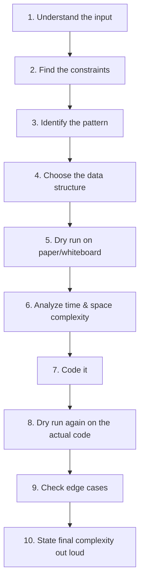

# 23. Final Interview Checklist

⬅ [[00-Home]] | Prev: [[22-15-Min-Revision-Sheet]]

> [!warning] Run this mentally before you write a single line of code.

## Step-by-Step

1. **Understand the input** — repeat the problem back in your own words; ask about types, sizes, ranges.
2. **Find the constraints** — n ≤ 10^5? Negative numbers allowed? Sorted? This dictates the expected complexity class.
3. **Identify the pattern** — use [[02-Pattern-Recognition]] and [[17-Interview-Flowchart]] mentally.
4. **Choose the data structure** — HashMap, Heap, Stack, Deque, Trie, etc. — matched to the pattern.
5. **Dry run on paper/whiteboard** — small example, trace the pointers/window/stack by hand before coding.
6. **Analyze complexity** — say it out loud before coding: "this will be O(n) time, O(1) space."
7. **Code it** — clean variable names, small helper functions if needed, comment tricky boundary logic.
8. **Dry run again** — trace your actual code (not just the algorithm) on the same example.
9. **Check edge cases** — run through [[16-Edge-Case-Checklist]] explicitly: empty, single element, duplicates, negatives, overflow.
10. **State final complexity** — confirm time and space complexity matches what you promised in step 6.

## Final Sanity Phrases to Say Out Loud

- "Let me restate the problem to make sure I understand it."
- "The constraints suggest an O(n log n) or better solution."
- "This looks like a [pattern] problem because [clue]."
- "Let me dry-run this on a small example first."
- "Edge cases I should check: empty input, single element, duplicates, negative numbers."
- "This solution runs in O(_) time and O(_) space."

> [!tip] You're ready.
> If you can walk through all 10 steps without hesitation, you have everything you need from this notebook. Good luck! 🚀

⬅ Back to [[00-Home]]
