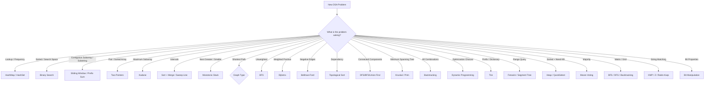

Absolutely. The best way to master DSA is **not** to memorize 500 solutions. It is to train yourself to look at a problem and answer:

> **What clues are present → which algorithm/pattern fits → why → what invariant am I maintaining → what is the complexity?**

Below is a **master DSA practice cheatsheet** designed around exactly that skill.

# 🧠 DSA Mastery — Algorithm Recognition & Practice Cheatsheet

> [!tip] Goal  
> Do **not** start by asking "How do I code this?"
> 
> First ask:
> 
> **1. What is the input?**  
> **2. What is being asked?**  
> **3. What constraint matters?**  
> **4. What structure/pattern do I see?**  
> **5. Which algorithm reduces the brute force?**  
> **6. What invariant makes the algorithm correct?**  
> **7. What is the time/space complexity?**

---

# 00 — The Master Algorithm Map



---

# 01 — The 30 Algorithms You Should Master

| #   | Algorithm / Pattern     | Recognize it when...                           |
| --- | ----------------------- | ---------------------------------------------- |
| 1   | HashMap                 | lookup/frequency/count                         |
| 2   | HashSet                 | duplicate/existence/unique                     |
| 3   | Prefix Sum              | range sum/subarray sum                         |
| 4   | Difference Array        | many range updates                             |
| 5   | Two Pointers            | pair/sorted/opposite ends                      |
| 6   | Sliding Window          | contiguous + optimize                          |
| 7   | Binary Search           | sorted/monotonic search space                  |
| 8   | Binary Search on Answer | minimize/maximize feasible value               |
| 9   | Kadane                  | maximum/minimum subarray                       |
| 10  | Sorting                 | ordering simplifies problem                    |
| 11  | Merge Intervals         | overlapping intervals                          |
| 12  | Sweep Line              | events over a coordinate/time axis             |
| 13  | Cyclic Sort             | values in `[1,n]`                              |
| 14  | QuickSelect             | kth smallest/largest                           |
| 15  | Heap                    | top-K / continuously smallest/largest          |
| 16  | Monotonic Stack         | next greater/smaller                           |
| 17  | Monotonic Queue         | sliding-window min/max                         |
| 18  | Greedy                  | locally optimal choice can be proven           |
| 19  | Backtracking            | generate all valid possibilities               |
| 20  | DFS                     | explore/connectivity                           |
| 21  | BFS                     | level-order/shortest unweighted path           |
| 22  | Union Find              | dynamic connectivity/components                |
| 23  | Topological Sort        | dependency ordering                            |
| 24  | Dijkstra                | shortest path, non-negative weights            |
| 25  | Bellman-Ford            | shortest path + negative edges                 |
| 26  | Kruskal / Prim          | minimum spanning tree                          |
| 27  | Dynamic Programming     | overlapping subproblems + optimal substructure |
| 28  | Trie                    | prefix/dictionary queries                      |
| 29  | Fenwick / Segment Tree  | dynamic range queries                          |
| 30  | String Matching         | pattern search in text                         |

---

# 02 — HashMap / HashSet

### Recognition

Think HashMap/HashSet when you see:

- "Have I seen this before?"
    
- duplicate
    
- frequency
    
- count occurrences
    
- complement
    
- pair with target
    
- first/last occurrence
    
- grouping
    

### 5 Practice Problems

1. **Two Sum**
    
2. **Contains Duplicate**
    
3. **Group Anagrams**
    
4. **Longest Consecutive Sequence**
    
5. **Subarray Sum Equals K**
    

### Master question

> Can I trade `O(n²)` searching for `O(n)` lookup?

---

# 03 — Prefix Sum

### Recognition

Look for:

- subarray sum
    
- range sum
    
- repeated range queries
    
- sum from `L` to `R`
    
- count subarrays satisfying sum condition
    

Formula:

```text
prefix[i] = prefix[i - 1] + arr[i]

sum(L,R) = prefix[R] - prefix[L-1]
```

### 5 Practice Problems

1. Range Sum Query
    
2. Subarray Sum Equals K
    
3. Find Pivot Index
    
4. Continuous Subarray Sum
    
5. Product of Array Except Self
    

### Master question

> Can I precompute information so each range query becomes `O(1)`?

---

# 04 — Difference Array

### Recognition

You have:

- many range updates
    
- add `x` to `[L,R]`
    
- update ranges
    
- then ask for final array
    

### 5 Practice Problems

1. Range Addition
    
2. Corporate Flight Bookings
    
3. Car Pooling
    
4. Increment Submatrices by One
    
5. Maximum Population Year
    

### Core idea

Instead of:

```text
for i = L → R
    arr[i] += x
```

do:

```text
diff[L] += x
diff[R + 1] -= x
```

Then recover the array with prefix sum.

---

# 05 — Two Pointers

### Recognition

Especially:

- sorted array
    
- pair
    
- triplet
    
- opposite ends
    
- remove duplicates
    
- partition
    
- palindrome
    

### 5 Practice Problems

1. Two Sum II
    
2. 3Sum
    
3. Container With Most Water
    
4. Valid Palindrome
    
5. Remove Duplicates from Sorted Array
    

### Master question

> Can two moving boundaries eliminate unnecessary comparisons?

---

# 06 — Sliding Window

### Recognition

Look for:

> **contiguous subarray / substring + optimize/count**

Types:

```text
Fixed Window
Variable Window
Longest Window
Shortest Window
Count Windows
```

### 5 Practice Problems

1. Maximum Sum Subarray of Size K
    
2. Longest Substring Without Repeating Characters
    
3. Longest Repeating Character Replacement
    
4. Minimum Window Substring
    
5. Permutation in String
    

### Master question

> What condition makes the current window invalid, and when can I shrink it?

---

# 07 — Binary Search

### Recognition

Classic:

```text
sorted array
```

But also:

```text
Can I answer YES/NO for a candidate?
```

If YES/NO changes monotonically:

```text
FFFFTTTT
```

→ Binary Search.

### 5 Practice Problems

1. Binary Search
    
2. Search in Rotated Sorted Array
    
3. Find First and Last Position
    
4. Find Minimum in Rotated Sorted Array
    
5. Koko Eating Bananas
    

---

# 08 — Binary Search on Answer

### Recognition

Words like:

- minimum possible
    
- maximum possible
    
- smallest value such that
    
- largest value such that
    
- minimize maximum
    
- maximize minimum
    
- feasible
    

### 5 Practice Problems

1. Koko Eating Bananas
    
2. Capacity to Ship Packages Within D Days
    
3. Split Array Largest Sum
    
4. Aggressive Cows
    
5. Minimum Number of Days to Make M Bouquets
    

### Master question

> If I guess an answer `X`, can I efficiently determine whether `X` is feasible?

---

# 09 — Kadane's Algorithm

### Recognition

Maximum/minimum:

> **contiguous subarray**

Core:

```text
current = max(nums[i], current + nums[i])
best = max(best, current)
```

### 5 Practice Problems

1. Maximum Subarray
    
2. Maximum Sum Circular Subarray
    
3. Best Time to Buy and Sell Stock
    
4. Maximum Product Subarray
    
5. Maximum Subarray With One Deletion
    

---

# 10 — Sorting

### Recognition

Sometimes sorting doesn't directly solve the problem.

It **creates structure**.

### Know

```text
Bubble       O(n²)
Selection    O(n²)
Insertion    O(n²)
Merge        O(n log n)
Quick        O(n log n) average
Heap         O(n log n)
Counting     O(n+k)
Bucket       ~O(n+k)
```

### 5 Practice Problems

1. Sort Colors
    
2. Largest Number
    
3. Meeting Rooms
    
4. H-Index
    
5. Sort Characters by Frequency
    

---

# 11 — Merge Intervals

### Recognition

Words:

- intervals
    
- ranges
    
- overlapping
    
- meetings
    
- schedules
    
- merge
    
- conflicts
    

### Standard approach

```text
sort by start
```

Then:

```text
if current.start <= previous.end
    merge
else
    create new interval
```

### 5 Practice Problems

1. Merge Intervals
    
2. Insert Interval
    
3. Non-overlapping Intervals
    
4. Meeting Rooms II
    
5. Minimum Number of Arrows to Burst Balloons
    

---

# 12 — Sweep Line

### Recognition

Events happen at:

```text
start
end
```

and you care about:

- maximum overlap
    
- active intervals
    
- simultaneous events
    
- timeline
    

### 5 Practice Problems

1. Meeting Rooms II
    
2. Maximum Population Year
    
3. Car Pooling
    
4. My Calendar I
    
5. Employee Free Time
    

---

# 13 — Cyclic Sort

### Recognition

The biggest clue:

```text
numbers are in [1,n]
```

and the question asks:

- missing number
    
- duplicate
    
- corrupt pair
    
- disappeared numbers
    

### 5 Practice Problems

1. Missing Number
    
2. Find All Numbers Disappeared in an Array
    
3. Find the Duplicate Number
    
4. Find All Duplicates in an Array
    
5. Set Mismatch
    

---

# 14 — QuickSelect

### Recognition

You need:

- kth smallest
    
- kth largest
    
- median
    
- order statistic
    

but **don't need the entire array sorted**.

### 5 Practice Problems

1. Kth Largest Element in an Array
    
2. Kth Smallest Element
    
3. Top K Frequent Elements
    
4. Find K Closest Elements
    
5. Median of Two Unsorted Arrays
    

---

# 15 — Heap / Priority Queue

### Recognition

Think heap when:

> I repeatedly need the smallest/largest element.

Especially:

- Top K
    
- Kth largest
    
- scheduling
    
- merge K sorted things
    
- streaming data
    

### 5 Practice Problems

1. Kth Largest Element
    
2. Top K Frequent Elements
    
3. K Closest Points to Origin
    
4. Merge K Sorted Lists
    
5. Find Median from Data Stream
    

---

# 16 — Monotonic Stack

### Recognition

The magic words:

- next greater
    
- next smaller
    
- previous greater
    
- previous smaller
    
- temperature
    
- histogram
    
- contribution of elements
    

### 5 Practice Problems

1. Next Greater Element
    
2. Daily Temperatures
    
3. Largest Rectangle in Histogram
    
4. Trapping Rain Water
    
5. Sum of Subarray Minimums
    

### Master question

> Can I maintain elements in increasing/decreasing order so each element is pushed/popped once?

---

# 17 — Monotonic Queue / Deque

### Recognition

Usually:

```text
sliding window + max/min
```

### 5 Practice Problems

1. Sliding Window Maximum
    
2. Shortest Subarray With Sum at Least K
    
3. Constrained Subsequence Sum
    
4. Jump Game VI
    
5. Longest Continuous Subarray With Absolute Diff ≤ Limit
    

---

# 18 — Greedy

### Recognition

You repeatedly make a choice that looks locally best.

But **recognition is not enough**.

You need a proof that the local decision can be part of an optimal global solution.

### 5 Practice Problems

1. Jump Game
    
2. Jump Game II
    
3. Gas Station
    
4. Partition Labels
    
5. Candy
    

---

# 19 — Backtracking

### Recognition

The problem says:

- generate all
    
- find all combinations
    
- all permutations
    
- choose/not choose
    
- subsets
    
- arrangements
    
- valid configurations
    

### Template

```text
choose
explore
undo
```

### 5 Practice Problems

1. Subsets
    
2. Permutations
    
3. Combination Sum
    
4. N-Queens
    
5. Word Search
    

---

# 20 — DFS

### Recognition

Think DFS for:

- connected components
    
- explore everything reachable
    
- islands
    
- cycle detection
    
- tree traversal
    
- graph traversal
    

### 5 Practice Problems

1. Number of Islands
    
2. Clone Graph
    
3. Course Schedule
    
4. Pacific Atlantic Water Flow
    
5. Number of Connected Components
    

---

# 21 — BFS

### Recognition

Think BFS when:

> Every edge has equal cost and I want the shortest number of steps.

Also:

- level order
    
- minimum moves
    
- nearest
    
- spreading process
    

### 5 Practice Problems

1. Binary Tree Level Order Traversal
    
2. Rotting Oranges
    
3. Word Ladder
    
4. Shortest Path in Binary Matrix
    
5. Open the Lock
    

---

# 22 — Union Find

### Recognition

Strong clues:

- connected components
    
- merge groups
    
- connectivity after adding edges
    
- redundant connection
    
- dynamic grouping
    

### 5 Practice Problems

1. Number of Connected Components
    
2. Redundant Connection
    
3. Accounts Merge
    
4. Graph Valid Tree
    
5. Most Stones Removed With Same Row or Column
    

---

# 23 — Topological Sort

### Recognition

The problem contains:

> **prerequisites / dependencies / ordering**

Example:

```text
A must happen before B
B must happen before C
```

### 5 Practice Problems

1. Course Schedule
    
2. Course Schedule II
    
3. Alien Dictionary
    
4. Parallel Courses
    
5. Minimum Height Trees
    

---

# 24 — Dijkstra

### Recognition

Graph:

```text
weighted edges
non-negative weights
shortest path
```

### 5 Practice Problems

1. Network Delay Time
    
2. Cheapest Flights Within K Stops
    
3. Path With Minimum Effort
    
4. Swim in Rising Water
    
5. Number of Ways to Arrive at Destination
    

---

# 25 — Bellman-Ford

### Recognition

Use when:

```text
shortest path
+
negative edge weights
```

Also useful for detecting negative cycles.

### 5 Practice Problems

1. Network Delay variant with negative edges
    
2. Cheapest Flights Within K Stops
    
3. Bellman-Ford shortest path implementation
    
4. Negative Cycle Detection
    
5. Currency Arbitrage / negative-cycle modeling
    

---

# 26 — Minimum Spanning Tree

### Algorithms

```text
Kruskal
Prim
```

### Recognition

The problem asks for:

> Connect all nodes with minimum total cost.

Not shortest path.

### 5 Practice Problems

1. Min Cost to Connect All Points
    
2. Connecting Cities With Minimum Cost
    
3. Optimize Water Distribution in a Village
    
4. Kruskal MST implementation
    
5. Prim MST implementation
    

---

# 27 — Dynamic Programming

This is one of the biggest topics.

First identify the **state**.

Ask:

```text
What information from the past affects my future decision?
```

Then:

```text
state
transition
base case
answer
```

### 5 Foundation Problems

1. Climbing Stairs
    
2. House Robber
    
3. Coin Change
    
4. Longest Increasing Subsequence
    
5. 0/1 Knapsack
    

---

# 28 — 2D Dynamic Programming

### Recognition

Problems involving:

- two sequences
    
- grid optimization
    
- edit operations
    
- choose/skip
    
- matching
    

### 5 Practice Problems

1. Unique Paths
    
2. Minimum Path Sum
    
3. Longest Common Subsequence
    
4. Edit Distance
    
5. Distinct Subsequences
    

---

# 29 — Trie

### Recognition

Think Trie when the problem involves:

```text
prefix
dictionary
autocomplete
startsWith
word search
many strings sharing prefixes
```

### 5 Practice Problems

1. Implement Trie
    
2. Design Add and Search Words
    
3. Word Search II
    
4. Replace Words
    
5. Maximum XOR of Two Numbers
    

---

# 30 — Fenwick Tree

### Recognition

You need:

```text
point update
+
prefix/range query
```

with dynamic data.

Complexity:

```text
update O(log n)
query  O(log n)
```

### 5 Practice Problems

1. Fenwick Tree implementation
    
2. Range Sum Query - Mutable
    
3. Count of Smaller Numbers After Self
    
4. Reverse Pairs
    
5. Number of Integers in Intervals
    

---

# 31 — Segment Tree

### Recognition

You need:

```text
range query
+
updates
```

and the operation isn't conveniently handled by a simple prefix sum.

### 5 Practice Problems

1. Range Minimum Query
    
2. Range Sum Query - Mutable
    
3. Count of Smaller Numbers After Self
    
4. My Calendar III
    
5. Falling Squares
    

---

# 32 — Bit Manipulation

### Recognition

Words like:

- XOR
    
- binary
    
- set bits
    
- power of two
    
- single number
    
- subset masks
    

### Essential operations

```java
x & 1
x << 1
x >> 1
x ^ y
x & (x - 1)
```

### 5 Practice Problems

1. Single Number
    
2. Number of 1 Bits
    
3. Counting Bits
    
4. Missing Number
    
5. Subsets using Bitmask
    

---

# 33 — String Algorithms

## KMP

Use when:

```text
pattern matching
many repeated prefix/suffix comparisons
```

Practice:

1. Implement `strStr`
    
2. KMP Pattern Matching
    
3. Repeated Substring Pattern
    
4. Shortest Palindrome
    
5. Find Pattern Occurrences
    

## Rabin-Karp

Use when:

```text
hash-based string matching
```

Practice:

1. Pattern Search
    
2. Multiple Pattern Matching
    
3. Repeated DNA Sequences
    
4. Duplicate Substrings
    
5. Longest Duplicate Substring
    

## Z Algorithm

Practice:

1. Pattern Matching
    
2. String Prefix Matching
    
3. Count Pattern Occurrences
    
4. Longest Prefix-Suffix
    
5. Concatenated Pattern Search
    

---

# 34 — Matrix / Grid

Think of a grid as a graph.

```text
cell = node
neighbor = edge
```

### 5 Practice Problems

1. Number of Islands
    
2. Flood Fill
    
3. Rotting Oranges
    
4. Surrounded Regions
    
5. Word Search
    

---

# 35 — Tree Algorithms

You should master:

```text
DFS
BFS
recursion
height
diameter
LCA
BST
path problems
```

### 10 Essential Problems

1. Maximum Depth of Binary Tree
    
2. Diameter of Binary Tree
    
3. Invert Binary Tree
    
4. Binary Tree Level Order Traversal
    
5. Validate BST
    
6. Lowest Common Ancestor
    
7. Kth Smallest Element in BST
    
8. Binary Tree Maximum Path Sum
    
9. Serialize and Deserialize Binary Tree
    
10. Construct Binary Tree from Preorder + Inorder
    

---

# 36 — Graph Algorithms

Your core graph toolbox should be:

```text
DFS
BFS
Union Find
Topological Sort
Dijkstra
Bellman-Ford
Floyd-Warshall
Kruskal
Prim
```

### 10 Essential Problems

1. Number of Islands
    
2. Clone Graph
    
3. Course Schedule
    
4. Pacific Atlantic Water Flow
    
5. Word Ladder
    
6. Network Delay Time
    
7. Cheapest Flights Within K Stops
    
8. Redundant Connection
    
9. Min Cost to Connect All Points
    
10. Alien Dictionary
    

---

# 37 — The 50 Mixed Problems

**Important:** Don't look at the algorithm name first.

For each problem, your job is:

```text
Problem
   ↓
Analyze constraints
   ↓
Identify clues
   ↓
Choose algorithm
   ↓
Explain why
   ↓
Code
   ↓
Complexity
   ↓
Alternative approach
```

---

## Level 1 — Foundation

### 1. Two Sum

Ask:

> Why not nested loops?

Expected thinking:

```text
HashMap
```

---

### 2. Contains Duplicate

```text
HashSet
```

---

### 3. Best Time to Buy and Sell Stock

Don't immediately memorize the solution.

Ask:

> What information from the past do I need?

Think:

```text
minimum price so far
```

---

### 4. Valid Anagram

Think:

```text
frequency
```

---

### 5. Maximum Subarray

Think:

```text
contiguous
maximum
```

---

### 6. Product of Array Except Self

Ask:

> Can I calculate left contribution and right contribution separately?

---

### 7. Valid Palindrome

Ask:

> Is this naturally an opposite-direction traversal?

---

### 8. Merge Sorted Arrays

Ask:

> Both arrays are already ordered. Can I exploit that?

---

### 9. Missing Number

Ask:

> What mathematical/bit property can identify the missing value?

---

### 10. Majority Element

Ask:

> Is there a property stronger than frequency counting?

---

# Level 2 — Pattern Recognition

### 11. Longest Substring Without Repeating Characters

Identify:

```text
substring
+
longest
+
condition
```

---

### 12. Minimum Window Substring

Identify:

```text
substring
+
minimum
+
required frequency
```

---

### 13. 3Sum

Ask:

> After sorting, can I reduce the problem?

---

### 14. Container With Most Water

Ask:

> Which boundary can safely move?

---

### 15. Product of Array Except Self

Try:

```text
prefix
suffix
```

---

### 16. Subarray Sum Equals K

Ask:

> Can previous prefix sums help?

---

### 17. Longest Consecutive Sequence

Ask:

> Can I identify the beginning of each sequence?

---

### 18. Daily Temperatures

Ask:

> For each element, am I looking for a future greater value?

---

### 19. Sliding Window Maximum

Ask:

> Why isn't a normal sliding window enough?

---

### 20. Kth Largest Element

Compare:

```text
sort
heap
quickselect
```

This problem is particularly important because it teaches **multiple approaches**.

---

# Level 3 — Searching / Sorting

### 21. Search in Rotated Sorted Array

Identify:

```text
sorted structure
+
binary search
+
rotation
```

---

### 22. Find Minimum in Rotated Sorted Array

Again:

```text
binary search
```

But understand **why**.

---

### 23. Koko Eating Bananas

Don't think "banana problem."

Think:

```text
minimum speed
+
feasibility
+
monotonic
```

---

### 24. Capacity to Ship Packages Within D Days

Identify:

```text
minimize capacity
+
feasibility
```

---

### 25. Split Array Largest Sum

Identify:

```text
binary search on answer
```

---

### 26. Merge Intervals

Identify:

```text
interval overlap
```

---

### 27. Non-overlapping Intervals

Ask:

> What ordering makes the greedy decision obvious?

---

### 28. Meeting Rooms II

Compare:

```text
heap
vs
sweep line
```

---

### 29. Sort Colors

Ask:

> Can this be done in one pass without normal sorting?

---

### 30. Find the Duplicate Number

Try multiple approaches:

```text
HashSet
Sorting
Floyd Cycle Detection
```

This is a great **alternative approach** problem.

---

# Level 4 — Trees / Graphs

### 31. Number of Islands

Ask:

> What happens if every land cell is treated as a graph node?

---

### 32. Rotting Oranges

Identify:

```text
multi-source BFS
```

---

### 33. Word Ladder

Ask:

> Each word is a node. What connects two nodes?

Then:

```text
BFS
```

---

### 34. Course Schedule

Identify:

```text
dependency graph
cycle detection
topological sort
```

---

### 35. Course Schedule II

Same underlying concept, but now you need the ordering.

---

### 36. Clone Graph

Identify:

```text
graph traversal
+
mapping original → clone
```

---

### 37. Network Delay Time

Identify:

```text
weighted graph
+
shortest path
+
non-negative weights
```

---

### 38. Redundant Connection

Ask:

> What happens when an edge connects two already-connected components?

Think:

```text
Union Find
```

---

### 39. Min Cost to Connect All Points

Ask:

> Am I looking for shortest paths or a minimum-cost network connecting everything?

Answer:

```text
MST
```

---

### 40. Alien Dictionary

Identify:

```text
ordering constraints
+
directed graph
+
topological sort
```

---

# Level 5 — DP / Backtracking / Advanced

### 41. House Robber

Ask:

> At each house, do I take or skip?

This should lead you to:

```text
DP
```

---

### 42. Coin Change

Ask:

> What is the minimum number of choices needed to construct the amount?

Think:

```text
DP
```

---

### 43. Longest Increasing Subsequence

Try:

```text
O(n²) DP
```

then learn:

```text
O(n log n)
```

This is excellent for learning alternative approaches.

---

### 44. Combination Sum

Ask:

> Do I need to generate every valid combination?

Think:

```text
backtracking
```

---

### 45. Word Search

Think:

```text
grid
+
DFS
+
backtracking
```

---

### 46. N-Queens

Think:

```text
backtracking
+
constraint checking
```

---

### 47. Longest Common Subsequence

Two strings:

```text
i
j
```

What does `dp[i][j]` represent?

---

### 48. Edit Distance

Think:

```text
insert
delete
replace
```

Then derive the state yourself.

---

### 49. Implement Trie

Ask:

> Why would HashMap<String,...> be inefficient for prefix operations?

---

### 50. Range Sum Query - Mutable

Ask:

> Why doesn't normal prefix sum work when values change?

Then compare:

```text
Fenwick Tree
Segment Tree
```

---

# 38 — The "Same Problem, Different Algorithm" Training

This is **extremely important** for interviews.

Don't stop after getting AC.

For selected problems, solve them multiple ways.

|Problem|Approach 1|Approach 2|Approach 3|
|---|---|---|---|
|Two Sum|Brute Force|HashMap|Sort + Two Pointer|
|Kth Largest|Sort|Heap|QuickSelect|
|Meeting Rooms II|Heap|Sweep Line||
|Duplicate Number|HashSet|Binary Search|Floyd|
|Top K Frequent|Sorting|Heap|Bucket|
|Number of Islands|DFS|BFS|Union Find|
|Course Schedule|DFS|Kahn BFS||
|LIS|DP `O(n²)`|Binary Search `O(n log n)`||
|Range Sum Mutable|Segment Tree|Fenwick||
|Shortest Path|BFS|Dijkstra|Bellman-Ford|
|MST|Kruskal|Prim||
|Pattern Matching|Naive|KMP|Rabin-Karp|
|Majority Element|HashMap|Sorting|Moore Voting|

> [!important]  
> **Mastery = knowing when an algorithm is appropriate, not merely knowing how to implement it.**

---

# 39 — The Algorithm Selection Cheat Sheet

When you see this:

### "Find pair"

```text
Unsorted → HashMap
Sorted → Two Pointer
Need all pairs → Two Pointer / Hashing
```

### "Contiguous subarray"

```text
Fixed size → Fixed Sliding Window
Longest/shortest satisfying condition → Variable Sliding Window
Sum-related → Prefix Sum + HashMap
Maximum sum → Kadane
```

### "Substring"

```text
Frequency condition → Sliding Window
Palindrome → Two Pointer / Expand Center / Manacher
Pattern matching → KMP / Z / Rabin-Karp
Prefix → Trie
```

### "Kth"

```text
Need complete order → Sorting
Kth only → QuickSelect
Streaming → Heap
```

### "Next greater/smaller"

```text
Monotonic Stack
```

### "Top K"

```text
Heap
Bucket Sort
QuickSelect
```

### "Intervals"

```text
Overlap → Sort + Merge
Maximum simultaneous → Sweep Line / Heap
```

### "Range queries"

```text
Static → Prefix Sum / Sparse Table
Point update + range query → Fenwick / Segment Tree
Range update → Difference Array / Lazy Segment Tree
```

### "Shortest path"

```text
Unweighted → BFS

0/1 weights → 0-1 BFS

Positive weights → Dijkstra

Negative edges → Bellman-Ford

All pairs → Floyd-Warshall
```

### "Connect everything cheaply"

```text
MST
→ Kruskal / Prim
```

### "Dependencies"

```text
Topological Sort
```

### "Connected components"

```text
DFS
BFS
Union Find
```

### "Generate all possibilities"

```text
Backtracking
```

### "Optimal answer from smaller answers"

```text
Dynamic Programming
```

---

# 40 — Your DSA Decision Process

For **every problem**, force yourself to fill this out before coding:

```text
Problem:
____________________________________

Input:
____________________________________

Output:
____________________________________

Constraints:
____________________________________

Brute Force:
____________________________________

Brute Force Complexity:
____________________________________

Important Clues:
____________________________________

Is it:
[ ] Sorted
[ ] Contiguous
[ ] Frequency
[ ] Pair
[ ] Range
[ ] Interval
[ ] Graph
[ ] Tree
[ ] String
[ ] Optimization
[ ] Generation
[ ] Dependency

Candidate Algorithm:
____________________________________

Why this algorithm?
____________________________________

Invariant:
____________________________________

Time:
____________________________________

Space:
____________________________________

Alternative Approach:
____________________________________

Why is my approach better?
____________________________________
```

---

# 41 — The 5-Question Rule

When you're stuck, **don't immediately look at the solution**.

Ask yourself these five questions:

### Q1

> **Can I solve it by brute force?**

If no → understand the problem first.

### Q2

> **What makes brute force slow?**

Examples:

```text
Repeated lookup
Repeated range calculation
Repeated comparison
Repeated traversal
Repeated state
```

### Q3

> **Can I preprocess something?**

Possibilities:

```text
HashMap
Prefix Sum
Sorting
Frequency Array
Trie
```

### Q4

> **Can I avoid looking at elements I've already eliminated?**

Think:

```text
Two Pointer
Sliding Window
Binary Search
Monotonic Stack
Greedy
```

### Q5

> **Does the problem contain a state that repeats?**

Think:

```text
Dynamic Programming
Memoization
```

---

# 42 — Complexity Master Sheet

|Algorithm|Typical Time|Space|
|---|--:|--:|
|HashMap|O(n)|O(n)|
|HashSet|O(n)|O(n)|
|Prefix Sum|O(n)|O(n)|
|Difference Array|O(n)|O(n)|
|Two Pointer|O(n)|O(1)|
|Sliding Window|O(n)|O(k)|
|Binary Search|O(log n)|O(1)|
|Merge Sort|O(n log n)|O(n)|
|QuickSort|O(n log n) avg|O(log n) avg|
|Heap|O(log n) operation|O(n)|
|QuickSelect|O(n) avg|O(1)|
|Monotonic Stack|O(n)|O(n)|
|BFS|O(V+E)|O(V)|
|DFS|O(V+E)|O(V)|
|Union Find|~O(1) amortized|O(V)|
|Topological Sort|O(V+E)|O(V)|
|Dijkstra|O((V+E)log V)|O(V)|
|Bellman-Ford|O(VE)|O(V)|
|Floyd-Warshall|O(V³)|O(V²)|
|Kruskal|O(E log E)|O(V)|
|Prim|O(E log V)|O(V)|
|Trie|O(L)|O(total chars)|
|Fenwick|O(log n)|O(n)|
|Segment Tree|O(log n)|O(n)|
|KMP|O(n+m)|O(m)|
|Rabin-Karp|O(n+m) avg|O(1)|
|Backtracking|Usually exponential|Depends|
|DP|Depends on states|Depends on states|

---

# 43 — The Actual Mastery Roadmap

Don't randomly solve the 50 problems.

Use this progression.

## Phase 1 — Learn the basic weapons

```text
1. Arrays
2. Strings
3. HashMap
4. HashSet
5. Two Pointer
6. Sliding Window
7. Prefix Sum
8. Sorting
```

Solve **30–40 problems**.

---

## Phase 2 — Search & Optimization

```text
9. Binary Search
10. Binary Search on Answer
11. Heap
12. QuickSelect
13. Kadane
14. Greedy
15. Intervals
```

Solve **30–40 problems**.

---

## Phase 3 — Stack / Queue

```text
16. Monotonic Stack
17. Monotonic Queue
18. Deque
```

Solve **20–30 problems**.

---

## Phase 4 — Trees

```text
19. Binary Tree
20. BST
21. DFS
22. BFS
23. LCA
24. Tree DP
```

Solve **30–40 problems**.

---

## Phase 5 — Graphs

```text
25. DFS/BFS
26. Union Find
27. Topological Sort
28. Dijkstra
29. Bellman-Ford
30. MST
```

Solve **40–50 problems**.

---

## Phase 6 — Backtracking

```text
31. Subsets
32. Permutations
33. Combination
34. Constraint Search
35. Grid Backtracking
```

Solve **20–30 problems**.

---

## Phase 7 — Dynamic Programming

Go in this order:

```text
1D DP
 ↓
2D DP
 ↓
Knapsack
 ↓
Subsequence DP
 ↓
String DP
 ↓
Grid DP
 ↓
Interval DP
 ↓
Tree DP
 ↓
Bitmask DP
```

This should be one of your largest practice sections.

---

## Phase 8 — Advanced Data Structures

Finally:

```text
Trie
Fenwick Tree
Segment Tree
Sparse Table
Advanced String Algorithms
```

---

# 44 — The Most Important Rule

For every problem you solve, create **three answers**:

### Answer A — Brute Force

```text
What is the obvious solution?
```

### Answer B — Optimal

```text
What algorithm makes it fast?
```

### Answer C — Alternative

```text
What other algorithm could solve it?
```

For example:

```text
Kth Largest

A → Sort
B → QuickSelect
C → Heap
```

Then write:

```text
Why B?
When would I choose C?
What are the tradeoffs?
```

This is how you move from:

> "I can solve LeetCode problems"

to:

> **"I can analyze an unfamiliar problem and choose an algorithm."**

---

# 45 — Final Interview Mental Model

Before touching the keyboard:

```text
                    NEW PROBLEM
                         │
                         ▼
                  Read constraints
                         │
                         ▼
                Find the bottleneck
                         │
          ┌──────────────┼──────────────┐
          ▼              ▼              ▼
       Lookup         Ordering       Contiguous
          │              │              │
       HashMap        Sort/Binary    Window/Prefix
                                      │
          ┌──────────────┼──────────────┐
          ▼              ▼              ▼
       Graph           Tree          Optimization
          │              │              │
      BFS/DFS/MST     DFS/BFS/LCA       DP/Greedy
          │
          ▼
       Dependency?
          │
          └── Yes → Topological Sort

       Next Greater?
          │
          └── Yes → Monotonic Stack

       Kth / Top K?
          │
          └── Heap / QuickSelect

       Prefix?
          │
          └── Trie

       Range Query?
          │
          └── Prefix / Fenwick / Segment Tree
```

> [!success] The ultimate goal  
> After enough practice, you should see:
> 
> **"longest substring with..."** → Sliding Window  
> **"subarray sum..."** → Prefix Sum / HashMap  
> **"next greater..."** → Monotonic Stack  
> **"kth largest..."** → Heap / QuickSelect  
> **"minimum possible maximum..."** → Binary Search on Answer  
> **"prerequisite..."** → Topological Sort  
> **"shortest unweighted..."** → BFS  
> **"shortest weighted..."** → Dijkstra  
> **"connect all nodes minimum cost..."** → MST  
> **"all combinations..."** → Backtracking  
> **"optimal choices with repeated states..."** → DP  
> **"prefix..."** → Trie  
> **"dynamic range query..."** → Fenwick / Segment Tree
> 
> **That recognition skill is the real DSA mastery.**

### Recommended way to use this notebook

For the **50 mixed problems**, hide the algorithm labels completely. Give yourself **30–45 minutes per problem** and record only:

```text
1. Brute force
2. Bottleneck
3. Clues
4. Chosen algorithm
5. Why it works
6. Complexity
7. Alternative algorithm
```

Only after committing to an approach should you look at the solution. This trains the exact skill you asked for: **seeing a new problem and independently selecting the right algorithm.**