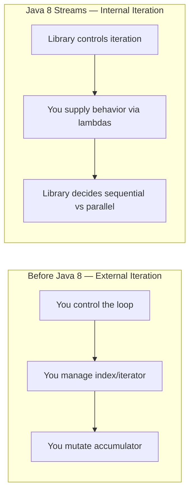

# 2. Why Streams Were Introduced

⬅ Back to [[00-Home]] | Prev: [[01-Introduction]] | Next: [[03-Internal-Architecture]]

## The Problem Before Java 8

### 1. Verbose, imperative boilerplate
```java
// Pre-Java 8: find names longer than 4 chars, uppercase, sorted
List<String> names = Arrays.asList("Ravi", "Anita", "Suresh", "Meena");
List<String> result = new ArrayList<>();
for (String n : names) {
    if (n.length() > 4) {
        result.add(n.toUpperCase());
    }
}
Collections.sort(result);
```
Compare with the declarative Stream version in [[01-Introduction]] — same logic, far less noise, and the *intent* (filter → transform → sort) is visible at a glance.

### 2. No easy parallelism
Manually parallelizing a `for` loop required `ExecutorService`, thread pools, manual partitioning of data, and merging of partial results — error-prone and repetitive. Streams give you parallel execution via **one method call**: `.parallelStream()`.

### 3. Multi-core hardware underused
By the mid-2010s, CPUs were adding cores, not clock speed. Java needed a way to exploit multiple cores **without forcing every developer to write concurrent code by hand**. The Fork/Join framework (Java 7) provided the low-level engine; Streams provided the high-level, safe API on top of it.

### 4. Functional programming was rising
Languages like Scala, and paradigms popularized by C#'s LINQ, showed that expressing transformations as chains of functions (`map`, `filter`, `reduce`) was more readable, more composable, and less bug-prone than external iteration.

### 5. Java needed Lambdas + a reason to use them
Java 8 introduced **lambda expressions** and **functional interfaces** (`Function`, `Predicate`, `Consumer`, `Supplier`). Streams are the primary *consumer API* of lambdas — without Streams, lambdas would have far less everyday utility.

## Design Goals Anthropic^ — *(mnemonic: "DELP")*

| Goal | Explanation |
|---|---|
| **D**eclarative | Say *what*, not *how*. |
| **E**fficient | Lazy evaluation avoids unnecessary work; fusion of operations. |
| **L**everage multicore | Parallel streams via Fork/Join. |
| **P**ipeline-composable | Small operations chain into complex data-processing pipelines. |

## Streams vs. External Iteration — Core Shift



This shift — **from external to internal iteration** — is the single most important conceptual leap Streams introduced, and is a favorite interview topic (see Q1–Q5 in [[20-Interview-Questions]]).

## Real-World Motivating Example

Processing a list of 10 million orders to find total revenue from "COMPLETED" orders in a specific region:

```java
double revenue = orders.parallelStream()
        .filter(o -> o.getStatus() == Status.COMPLETED)
        .filter(o -> o.getRegion().equals("APAC"))
        .mapToDouble(Order::getAmount)
        .sum();
```
One line, multi-core, no manual thread management. This is exactly why Streams exist.

Next: [[03-Internal-Architecture]]
