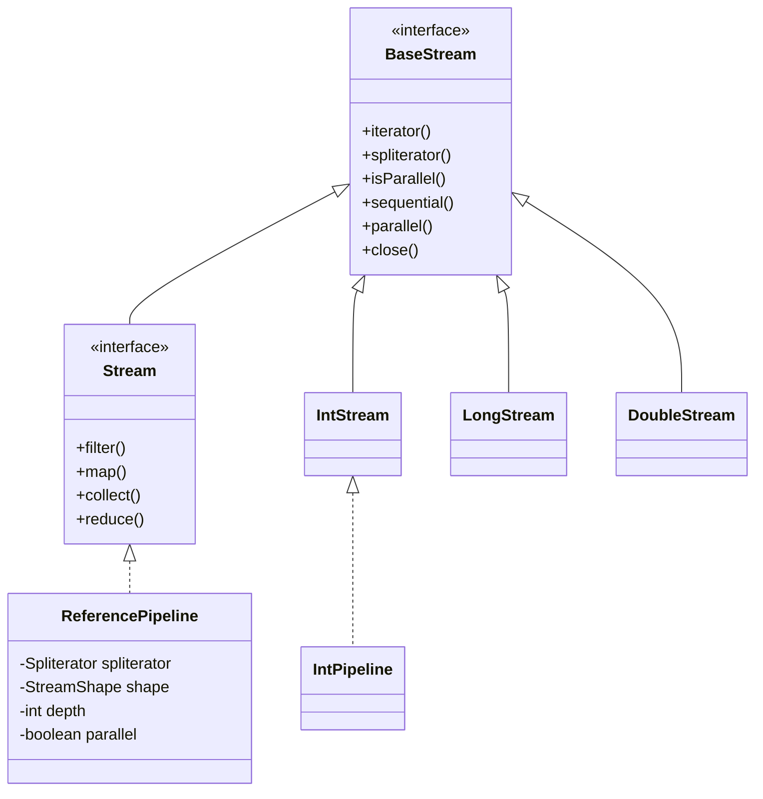
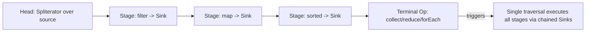
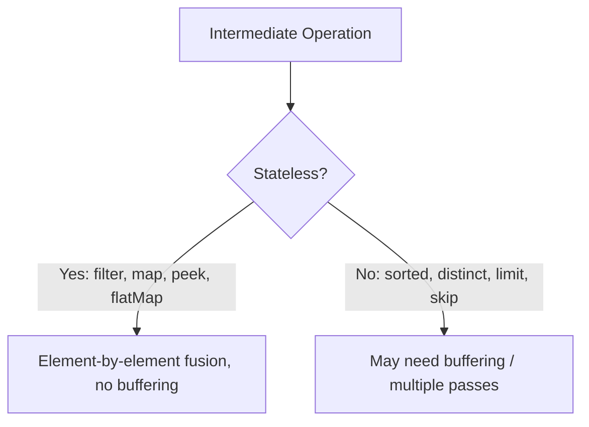

# 3. Internal Architecture of Streams

⬅ Back to [[00-Home]] | Prev: [[02-Why-Streams]] | Next: [[04-Stream-Pipeline]]

## Core Interfaces & Class Hierarchy



## The Real Implementation: `AbstractPipeline`

Internally, every stream you create (`Stream.of`, `list.stream()`, etc.) is backed by `java.util.stream.ReferencePipeline` (for object streams) or `IntPipeline` / `LongPipeline` / `DoublePipeline` (for primitives), all of which extend the package-private `AbstractPipeline`.

Three kinds of pipeline stages exist:

1. **Head** — wraps the data source (a `Spliterator`).
2. **Intermediate stages** — each `filter`/`map`/`sorted` call creates a **new pipeline stage** wrapping the previous one, storing a reference to the operation (as a `Sink`) but **not executing it yet**.
3. **Terminal stage** — triggers actual traversal.



## The `Sink` Abstraction

A `Sink<T>` is the internal interface (`java.util.stream.Sink`) representing "what to do with the next element". Each intermediate operation wraps the downstream sink:

```java
interface Sink<T> extends Consumer<T> {
    default void begin(long size) {}
    default void end() {}
    default boolean cancellationRequested() { return false; }
    void accept(T t);
}
```

When you write:
```java
list.stream().filter(p1).map(f1).forEach(consumer);
```
Internally roughly:
```java
Sink terminalSink = sink -> consumer.accept(sink);
Sink mapSink = t -> terminalSink.accept(f1.apply(t));
Sink filterSink = t -> { if (p1.test(t)) mapSink.accept(t); };
// spliterator.forEachRemaining(filterSink)
```
Each element flows through **one chain of sinks per element** — this is why fusion is possible and why intermediate ops don't create intermediate collections (see [[05-Lazy-Evaluation]]).

## Key Internal Classes to Know (Interview Gold)

| Class                                           | Role                                                                                                                                 |
| ----------------------------------------------- | ------------------------------------------------------------------------------------------------------------------------------------ |
| `Spliterator<T>`                                | Splittable iterator — source of elements, supports `tryAdvance`, `trySplit`, `estimateSize`. See [[12-Spliterator]].                 |
| `Sink<T>`                                       | Chain-of-responsibility element consumer connecting stages.                                                                          |
| `AbstractPipeline`                              | Base class managing stages, depth, flags (`SIZED`, `ORDERED`, `SORTED`, `DISTINCT`).                                                 |
| `ReferencePipeline.Head/StatelessOp/StatefulOp` | Concrete stage types — stateless (`filter`,`map`) vs stateful (`sorted`,`distinct`).                                                 |
| `PipelineHelper<P_OUT>`                         | Coordinates traversal, evaluation (sequential or parallel), and node building.                                                       |
| `Node<T>`                                       | Immutable tree-like result container used by parallel evaluation for efficient concatenation.                                        |
| `StreamOpFlag`                                  | Bit-flags describing stream properties (SIZED, ORDERED, DISTINCT, SORTED, SHORT_CIRCUIT) propagated stage to stage for optimization. |
| `ForkJoinPool.commonPool()`                     | Thread pool used by parallel streams by default. See [[11-Parallel-Streams]].                                                        |

## Stateless vs Stateful Intermediate Operations

- **Stateless**: `filter`, `map`, `peek`, `flatMap`, `unordered` — process each element independently; can be fully fused and pipelined without buffering.
- **Stateful**: `sorted`, `distinct`, `limit`, `skip` — need to see **some or all** elements before producing output; may require buffering (e.g., `sorted` must buffer everything).



## How `.collect()` Actually Works Under the Hood

`collect(Collector)` internally calls `ReduceOps.makeRef(collector)` which builds a `TerminalOp` that:
1. Uses `collector.supplier()` to create a mutable container (per thread, if parallel).
2. Feeds elements via `collector.accumulator()`.
3. For parallel streams, partial results are merged via `collector.combiner()`.
4. Applies `collector.finisher()` (identity if `IDENTITY_FINISH` characteristic is present).

See [[08-Collectors]] for the full `Collector` interface breakdown.

## Interview Soundbite

> "Streams are built as a chain of pipeline stages over a `Spliterator` source. Each intermediate operation wraps a `Sink`; nothing executes until a terminal operation walks the source through the chained sinks in a single pass (per element), which is what enables laziness, short-circuiting, and operation fusion."

Next: [[04-Stream-Pipeline]]
