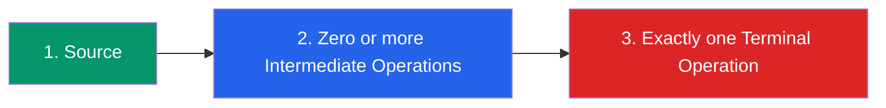
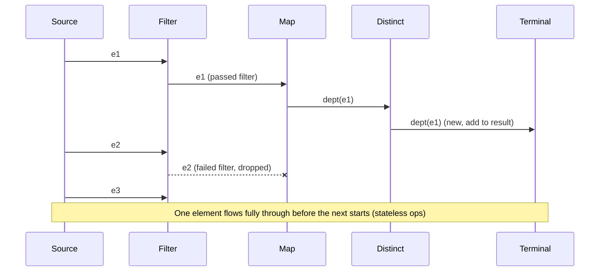

# 4. Stream Pipeline

⬅ Back to [[00-Home]] | Prev: [[03-Internal-Architecture]] | Next: [[05-Lazy-Evaluation]]

## The Three Parts of Every Pipeline



1. **Source** — a Collection, array, generator, or I/O channel producing a `Spliterator`.
2. **Intermediate Operations** — lazy, return a new `Stream`, can be chained any number of times (including zero).
3. **Terminal Operation** — eager, produces a non-stream result or side effect, and **closes** the stream.

## Example, Annotated

```java
long count = employees.stream()          // (1) source
        .filter(e -> e.getSalary() > 50000)   // (2) intermediate
        .map(Employee::getDepartment)          // (2) intermediate
        .distinct()                            // (2) intermediate (stateful)
        .count();                              // (3) terminal
```

## Pipeline Execution Model

Nothing happens at steps marked "(2)" above — Java only *records* the recipe. Execution happens **all at once** when `.count()` (or any terminal op) is invoked, and it processes the source **element by element**, pushing each element through the *entire* chain before pulling the next element (for stateless chains).



## A Stream Can Be Consumed Only Once

```java
Stream<Integer> s = Stream.of(1, 2, 3);
s.forEach(System.out::println);
s.forEach(System.out::println);   // throws IllegalStateException: stream has already been operated upon or closed
```
**Why:** A stream is a one-shot traversal cursor over a source, not a reusable data structure. To "reuse," re-create the stream from the source each time:
```java
Supplier<Stream<Integer>> streamSupplier = () -> Stream.of(1, 2, 3);
streamSupplier.get().forEach(System.out::println);
streamSupplier.get().forEach(System.out::println); // fine
```

## Short-Circuiting Operations

Some operations don't need to see the *whole* stream to produce a result:

| Type | Operations |
|---|---|
| Short-circuit intermediate | `limit(n)`, `takeWhile(predicate)` |
| Short-circuit terminal | `anyMatch`, `allMatch`, `noneMatch`, `findFirst`, `findAny` |

```java
Optional<Integer> first = Stream.iterate(1, n -> n + 1)  // infinite!
        .filter(n -> n % 7 == 0)
        .findFirst();      // terminates after finding "7" — doesn't hang forever
```
This works **only** because of laziness + short-circuiting together — see [[05-Lazy-Evaluation]].

## Pipeline Flags (SIZED, ORDERED, SORTED, DISTINCT)

The JDK propagates flags through the pipeline to optimize execution — e.g., if the source is already `SORTED` and no operation invalidates it, a subsequent `.sorted()` call becomes a **no-op**. Similarly, `.distinct()` on an already-`DISTINCT`-flagged stream is skipped.

## Building Custom, Reusable Pipelines

A common **best practice** is to encapsulate a pipeline as a function so it can be reapplied to fresh streams:

```java
static <T> Stream<T> activeAndSorted(Stream<T> input, Comparator<T> cmp, Predicate<T> isActive) {
    return input.filter(isActive).sorted(cmp);
}
```

## Interview Soundbite

> "A pipeline = source + 0..n lazy intermediate ops + exactly 1 eager terminal op. Nothing executes until the terminal op runs; then, the source is pulled element-by-element and pushed through the whole chain, enabling short-circuiting for operations like `findFirst` even over infinite streams."

Next: [[05-Lazy-Evaluation]]
