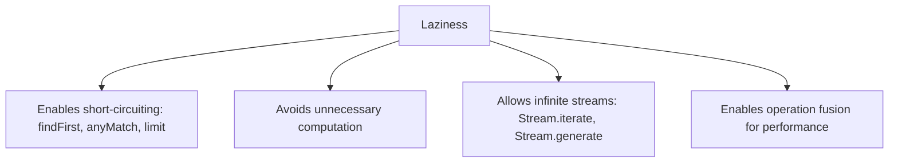

# 5. Lazy Evaluation

⬅ Back to [[00-Home]] | Prev: [[04-Stream-Pipeline]] | Next: [[06-Intermediate-Operations]]

## What "Lazy" Means Here

Intermediate operations **only build a recipe** (a chain of pipeline stages). No element is touched, no lambda is invoked, until a **terminal operation** starts pulling data.

```java
Stream<String> s = names.stream()
        .filter(n -> {
            System.out.println("filtering " + n);
            return n.startsWith("A");
        })
        .map(n -> {
            System.out.println("mapping " + n);
            return n.toUpperCase();
        });

System.out.println("Pipeline built, nothing printed yet!");
s.forEach(System.out::println); // NOW prints happen
```
Output shows **"Pipeline built..."** first — proving zero work happened before `forEach`.

## Element-at-a-Time Evaluation (Not Stage-at-a-Time)

A common misconception: people assume `filter` runs over *all* elements, then `map` runs over the (filtered) *all* elements, like SQL executing operator-by-operator. **That is wrong for streams.**

Streams evaluate **one element completely through the whole pipeline before moving to the next** (for stateless pipelines):

```java
List.of("Ann", "Bob", "Ana").stream()
    .filter(n -> { System.out.println("filter " + n); return n.startsWith("A"); })
    .map(n -> { System.out.println("map " + n); return n.toUpperCase(); })
    .forEach(n -> System.out.println("forEach " + n));
```
Output:
```
filter Ann
map Ann
forEach ANN
filter Bob
filter Ana
map Ana
forEach ANA
```
Notice: `Bob` never reaches `map` — proof of **fusion + per-element pipelining**, not batch-stage processing.

## Why Laziness Matters



1. **Short-circuiting** — `.filter(...).findFirst()` can stop after the first match, without processing the rest of a (possibly huge or infinite) source.
2. **Infinite streams become usable**:
```java
Stream.iterate(2, n -> n * 2)
      .filter(n -> n > 1000)
      .findFirst()
      .ifPresent(System.out::println); // 1024 — terminates!
```
3. **No wasted intermediate collections** — unlike chaining `List` operations (each returning a new `List`), Streams don't materialize a list after every `filter`/`map`.

## `peek()` — the Debugging Tool for Laziness

```java
long count = Stream.of(1, 2, 3, 4, 5)
        .peek(n -> System.out.println("peek: " + n))
        .filter(n -> n % 2 == 0)
        .count();
```
⚠️ **Trap:** In some JDK versions/cases, if the terminal operation doesn't need to traverse every element (e.g. `count()` on a `SIZED` stream with no filtering before it), the JVM may **skip traversal entirely**, and `peek` may not run at all! Never rely on `peek` for essential side effects — see [[18-Common-Bugs]].

## Lazy Does Not Mean "Deferred Forever"

Once a **terminal operation** is called, laziness ends — the *entire* pipeline runs synchronously (or is submitted to Fork/Join if parallel) right there. Streams are not "async" or "reactive" — for that, look at `CompletableFuture` or Reactive Streams (`Flow`), which are different abstractions.

## Interview Soundbite

> "Streams use lazy, per-element evaluation: each element travels through the full chain of stateless operations before the next element starts. This enables short-circuiting and support for infinite sources, and means intermediate operations are just recipe-builders — real work starts only when a terminal operation is invoked."

Next: [[06-Intermediate-Operations]]
