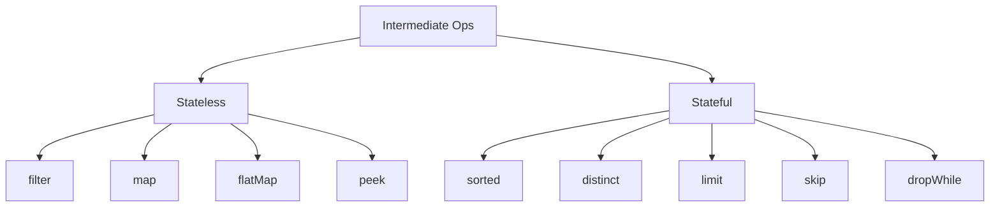

# 6. Intermediate Operations

⬅ Back to [[00-Home]] | Prev: [[05-Lazy-Evaluation]] | Next: [[07-Terminal-Operations]]

Intermediate operations transform one `Stream` into another `Stream`. They are **lazy** (see [[05-Lazy-Evaluation]]) and can be chained.

## Full Reference Table

| Operation | Signature | Stateless/Stateful | Description |
|---|---|---|---|
| `filter` | `Stream<T> filter(Predicate<T>)` | Stateless | Keep elements matching predicate |
| `map` | `Stream<R> map(Function<T,R>)` | Stateless | 1-to-1 transform |
| `mapToInt/Long/Double` | `IntStream mapToInt(ToIntFunction<T>)` | Stateless | Transform to primitive stream |
| `flatMap` | `Stream<R> flatMap(Function<T,Stream<R>>)` | Stateless | 1-to-many, flattens nested streams |
| `flatMapToInt/Long/Double` | — | Stateless | Flatten to primitive stream |
| `distinct` | `Stream<T> distinct()` | **Stateful** | Removes duplicates (uses `equals`/`hashCode`) |
| `sorted` | `Stream<T> sorted()` / `sorted(Comparator)` | **Stateful** | Sorts (natural or custom order) |
| `peek` | `Stream<T> peek(Consumer<T>)` | Stateless | Side-effect visibility, mainly for debugging |
| `limit` | `Stream<T> limit(long n)` | **Stateful**, short-circuit | Truncates to first n elements |
| `skip` | `Stream<T> skip(long n)` | **Stateful** | Discards first n elements |
| `takeWhile` (Java 9+) | `Stream<T> takeWhile(Predicate<T>)` | Short-circuit | Takes elements while predicate true, then stops |
| `dropWhile` (Java 9+) | `Stream<T> dropWhile(Predicate<T>)` | Stateful | Drops elements while predicate true, keeps the rest |
| `boxed` | `Stream<Integer> boxed()` | Stateless | Primitive stream → object stream |
| `asLongStream/asDoubleStream` | — | Stateless | Widening conversions between primitive streams |
| `unordered` | `Stream<T> unordered()` | Stateless | Hints encounter order doesn't matter (perf, esp. parallel) |

## Deep Dive: `filter`

```java
List<Integer> evens = nums.stream()
        .filter(n -> n % 2 == 0)
        .collect(Collectors.toList());
```
- Takes a `Predicate<T>`.
- Never changes element type.
- Purely stateless — can be freely reordered/fused with adjacent `map`s by the JIT/pipeline in principle (though Java doesn't do relational-style query optimization like SQL).

## Deep Dive: `map` vs `flatMap`

```java
// map: List<String> -> Stream<Integer> (lengths)
Stream<Integer> lengths = words.stream().map(String::length);

// flatMap: List<List<Integer>> -> Stream<Integer> (flattened)
Stream<Integer> flat = listOfLists.stream().flatMap(List::stream);
```
Full detail in [[10-FlatMap]].

## Deep Dive: `sorted`

```java
people.stream().sorted(); // requires Comparable
people.stream().sorted(Comparator.comparing(Person::getAge));
people.stream().sorted(Comparator.comparing(Person::getAge).thenComparing(Person::getName));
people.stream().sorted(Comparator.comparing(Person::getAge).reversed());
```
⚠️ `sorted()` is **stateful** and requires buffering the *entire* stream before emitting the first element — it cannot start emitting until it has seen everything. This defeats short-circuiting for anything chained after it unless that later op is itself designed around a fully materialized stream.

## Deep Dive: `distinct`

Relies on `equals()`/`hashCode()`. For custom objects, override both, or use `map` to a key first:
```java
people.stream()
      .collect(Collectors.toMap(Person::getId, p -> p, (a,b) -> a))
      .values();
// or, simpler for uniqueness by a key:
people.stream()
      .collect(Collectors.collectingAndThen(
          Collectors.toCollection(() -> new TreeSet<>(Comparator.comparing(Person::getId))),
          ArrayList::new));
```

## Deep Dive: `limit` & `skip` — Pagination Pattern

```java
List<Order> page2 = orders.stream()
        .sorted(Comparator.comparing(Order::getDate))
        .skip(10)   // skip page 1 (10 items)
        .limit(10)  // take page 2 (10 items)
        .toList();
```
⚠️ On **parallel streams**, `limit`/`skip` are relatively expensive because ordering must be respected (unless the stream is `unordered()`), which can force extra coordination between threads. See [[11-Parallel-Streams]] and [[15-Performance]].

## Deep Dive: `takeWhile` vs `filter` (Java 9+)

```java
List<Integer> nums = List.of(2, 4, 6, 7, 8, 10);

nums.stream().filter(n -> n % 2 == 0).toList();     // [2,4,6,8,10] — checks ALL
nums.stream().takeWhile(n -> n % 2 == 0).toList();  // [2,4,6] — STOPS at first odd (7)
nums.stream().dropWhile(n -> n % 2 == 0).toList();  // [7,8,10] — drops until first odd, then keeps rest
```
`takeWhile`/`dropWhile` are designed for **sorted or ordered data** where you want a prefix/suffix split — much more efficient than `filter` when the stream is large and short-circuiting is possible.

## Deep Dive: `peek` — Debug Only

```java
long c = stream.peek(x -> log.debug("saw {}", x)).count();
```
See the important caveat about `peek` skipping execution in [[05-Lazy-Evaluation]] and [[18-Common-Bugs]]. **Never use `peek` to mutate state or perform business logic.**

## Mermaid: Intermediate Ops Categorized



Next: [[07-Terminal-Operations]]
