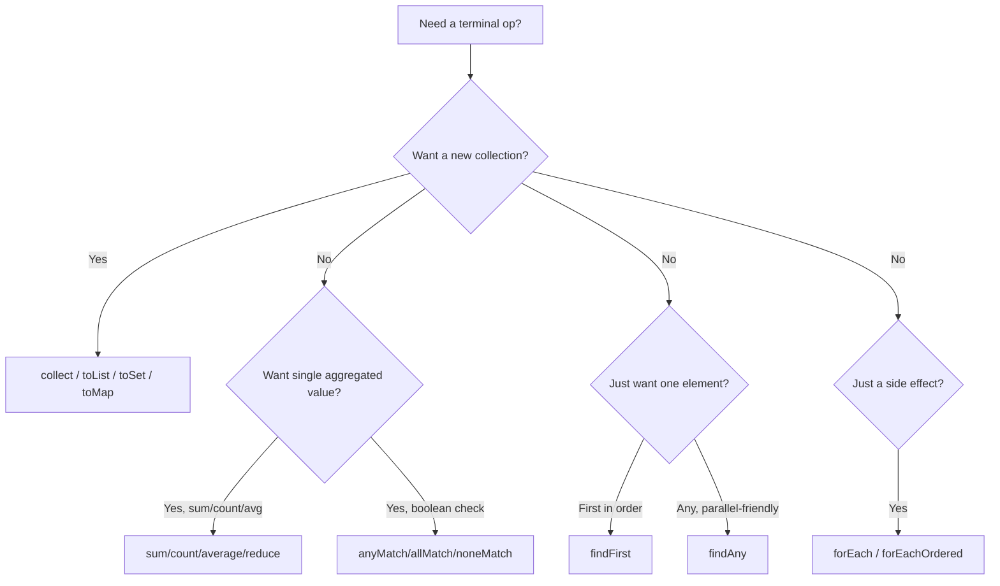

# 7. Terminal Operations

⬅ Back to [[00-Home]] | Prev: [[06-Intermediate-Operations]] | Next: [[08-Collectors]]

A terminal operation **triggers execution** of the whole pipeline and **closes the stream**. After it runs, the stream cannot be reused.

## Full Reference Table

| Operation | Returns | Short-circuit? | Notes |
|---|---|---|---|
| `forEach(Consumer)` | `void` | No | Order not guaranteed in parallel unless `forEachOrdered` |
| `forEachOrdered(Consumer)` | `void` | No | Preserves encounter order even in parallel (slower) |
| `toArray()` | `Object[]` / `T[]` | No | |
| `reduce(...)` | `Optional<T>` / `T` | No | See [[09-Reduce]] |
| `collect(Collector)` | `R` | No | See [[08-Collectors]] |
| `toList()` (Java 16+) | `List<T>` (immutable) | No | Shortcut for `collect(Collectors.toList())` |
| `count()` | `long` | No* | *can short-circuit if size is already known (`SIZED`) |
| `anyMatch(Predicate)` | `boolean` | **Yes** | Stops at first match |
| `allMatch(Predicate)` | `boolean` | **Yes** | Stops at first failure |
| `noneMatch(Predicate)` | `boolean` | **Yes** | Stops at first match (returns false) |
| `findFirst()` | `Optional<T>` | **Yes** | Deterministic — respects encounter order |
| `findAny()` | `Optional<T>` | **Yes** | Non-deterministic in parallel — may return faster |
| `min(Comparator)` | `Optional<T>` | No | Needs to see all elements |
| `max(Comparator)` | `Optional<T>` | No | Needs to see all elements |
| `sum/average/min/max` (primitive streams) | `int/long/double`/`OptionalDouble` | No | See [[13-Primitive-Streams]] |
| `iterator()` | `Iterator<T>` | No | Escape hatch back to imperative style |

## `forEach` vs `forEachOrdered`

```java
list.parallelStream().forEach(System.out::println);          // order NOT guaranteed
list.parallelStream().forEachOrdered(System.out::println);   // order guaranteed, but loses most parallel benefit
```
Use `forEach` only when order truly doesn't matter (e.g., independent side effects); otherwise use `forEachOrdered` or collect into an ordered structure.

## `anyMatch` / `allMatch` / `noneMatch` — Short-Circuit Trio

```java
boolean hasAdult = people.stream().anyMatch(p -> p.getAge() >= 18);
boolean allAdults = people.stream().allMatch(p -> p.getAge() >= 18);
boolean noneMinor = people.stream().noneMatch(p -> p.getAge() < 18);
```
⚠️ **Empty stream edge cases (classic interview trap):**
```java
Stream.<Integer>empty().anyMatch(x -> x > 0);  // false
Stream.<Integer>empty().allMatch(x -> x > 0);  // true  (vacuous truth!)
Stream.<Integer>empty().noneMatch(x -> x > 0); // true
```

## `findFirst` vs `findAny`

- `findFirst()` — always returns the **first element in encounter order**, even in parallel streams (this can force extra coordination).
- `findAny()` — returns *any* matching element; in parallel streams, this may return the result of whichever thread finished first — **faster but non-deterministic**.

```java
Optional<String> any = names.parallelStream()
        .filter(n -> n.startsWith("A"))
        .findAny();     // prefer this in parallel if order doesn't matter
```

## `reduce` — see dedicated page [[09-Reduce]]

## `collect` — see dedicated page [[08-Collectors]]

## `count()` Optimization

```java
long n = list.stream().filter(x -> x > 10).count();
```
If the stream has **no filtering/flatMap** and the source size is known (`SIZED` flag preserved), the JDK can compute `count()` in O(1) **without traversing elements at all** (e.g., `list.stream().count()` alone). Adding a `filter` before `count()` forces a real traversal since size can no longer be inferred without checking.

## Mermaid: Terminal Ops Decision Tree



## Interview Soundbite

> "Terminal operations are eager and stream-closing. `anyMatch`, `allMatch`, `noneMatch`, `findFirst`, `findAny`, and `limit` can short-circuit — they may not need to visit every element, which matters a lot for performance and for working with infinite streams."

Next: [[08-Collectors]]
