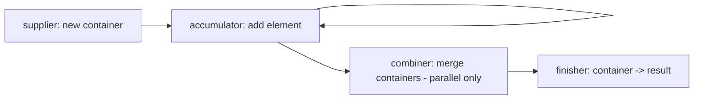
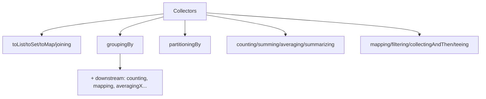

# 8. Collectors

⬅ Back to [[00-Home]] | Prev: [[07-Terminal-Operations]] | Next: [[09-Reduce]]

## The `Collector<T, A, R>` Interface

```java
public interface Collector<T, A, R> {
    Supplier<A> supplier();                          // creates new mutable container
    BiConsumer<A, T> accumulator();                   // folds an element into container
    BinaryOperator<A> combiner();                     // merges two containers (parallel)
    Function<A, R> finisher();                        // converts container -> final result
    Set<Characteristics> characteristics();           // CONCURRENT, UNORDERED, IDENTITY_FINISH
}
```
`T` = input element type, `A` = accumulator (mutable container) type, `R` = final result type.



## Most-Used `Collectors` Factory Methods

| Collector | Purpose |
|---|---|
| `toList()` | Collect to `List` (mutable, unspecified impl — usually `ArrayList`) |
| `toUnmodifiableList()` | Immutable list (Java 10+) |
| `toSet()` | Collect to `Set` (`HashSet`, no order guarantee) |
| `toCollection(supplier)` | Collect to a specific collection type, e.g. `TreeSet::new` |
| `toMap(keyFn, valFn)` | Collect to `Map`; **throws on duplicate keys** unless merge function given |
| `toMap(keyFn, valFn, mergeFn)` | Handles duplicate keys |
| `toMap(keyFn, valFn, mergeFn, mapSupplier)` | Custom map impl, e.g. `LinkedHashMap::new` |
| `joining()` / `joining(delim)` / `joining(delim, prefix, suffix)` | Concatenate strings |
| `counting()` | `long` count (often used downstream in `groupingBy`) |
| `summingInt/Long/Double(fn)` | Sum |
| `averagingInt/Long/Double(fn)` | Average |
| `summarizingInt/Long/Double(fn)` | `IntSummaryStatistics` (min, max, avg, sum, count all at once) |
| `minBy(cmp)` / `maxBy(cmp)` | `Optional<T>` |
| `groupingBy(classifier)` | `Map<K, List<T>>` |
| `groupingBy(classifier, downstream)` | `Map<K, D>` — see below |
| `groupingBy(classifier, mapFactory, downstream)` | Custom map type (e.g. `TreeMap` for sorted keys) |
| `partitioningBy(predicate)` | `Map<Boolean, List<T>>` — always exactly 2 keys |
| `partitioningBy(predicate, downstream)` | Partition + further reduce each partition |
| `reducing(...)` | General-purpose reduction as a Collector |
| `collectingAndThen(collector, finisher)` | Wrap a collector, post-process the result (e.g. make immutable) |
| `teeing(c1, c2, merger)` (Java 12+) | Run two collectors in one pass, combine results |

## `groupingBy` — The Interview Favorite

### Basic grouping
```java
Map<String, List<Employee>> byDept =
    employees.stream().collect(Collectors.groupingBy(Employee::getDepartment));
```

### Grouping + downstream collector
```java
Map<String, Long> countByDept =
    employees.stream().collect(Collectors.groupingBy(Employee::getDepartment, Collectors.counting()));

Map<String, Double> avgSalaryByDept =
    employees.stream().collect(Collectors.groupingBy(Employee::getDepartment,
                                Collectors.averagingDouble(Employee::getSalary)));

Map<String, Set<String>> namesByDept =
    employees.stream().collect(Collectors.groupingBy(Employee::getDepartment,
                                Collectors.mapping(Employee::getName, Collectors.toSet())));
```

### Multi-level grouping
```java
Map<String, Map<String, List<Employee>>> byDeptThenTitle =
    employees.stream().collect(Collectors.groupingBy(Employee::getDepartment,
                                Collectors.groupingBy(Employee::getTitle)));
```

### Sorted keys with `groupingBy`
```java
Map<String, List<Employee>> sortedByDept =
    employees.stream().collect(Collectors.groupingBy(Employee::getDepartment, TreeMap::new, Collectors.toList()));
```

## `partitioningBy` — Binary Split

```java
Map<Boolean, List<Employee>> partitioned =
    employees.stream().collect(Collectors.partitioningBy(e -> e.getSalary() > 50000));

List<Employee> highEarners = partitioned.get(true);
List<Employee> others = partitioned.get(false);
```
Unlike `groupingBy`, `partitioningBy` **always produces both `true` and `false` keys**, even if one bucket is empty.

## `toMap` — Duplicate Key Trap

```java
// Throws IllegalStateException if two employees share the same department (used as key)!
Map<String, Employee> byDept = employees.stream()
        .collect(Collectors.toMap(Employee::getDepartment, e -> e));

// Fix: supply a merge function
Map<String, Employee> highestPaidByDept = employees.stream()
        .collect(Collectors.toMap(Employee::getDepartment, e -> e,
                (e1, e2) -> e1.getSalary() > e2.getSalary() ? e1 : e2));
```

## `joining` — String Concatenation

```java
String csv = names.stream().collect(Collectors.joining(", "));
String bracketed = names.stream().collect(Collectors.joining(", ", "[", "]"));
```

## `teeing` (Java 12+) — Two Collectors, One Pass

```java
record MinMax(int min, int max) {}

MinMax result = nums.stream().collect(Collectors.teeing(
        Collectors.minBy(Integer::compareTo),
        Collectors.maxBy(Integer::compareTo),
        (min, max) -> new MinMax(min.orElseThrow(), max.orElseThrow())));
```

## `collectingAndThen` — Post-process the Result

```java
List<String> immutableList = names.stream()
        .collect(Collectors.collectingAndThen(Collectors.toList(), Collections::unmodifiableList));
```

## Writing a Custom Collector

```java
Collector<String, StringBuilder, String> customJoiner = Collector.of(
        StringBuilder::new,                       // supplier
        (sb, s) -> sb.append(s).append("|"),       // accumulator
        StringBuilder::append,                     // combiner
        sb -> sb.length() == 0 ? "" : sb.substring(0, sb.length() - 1) // finisher
);
String result = Stream.of("a", "b", "c").collect(customJoiner); // "a|b|c"
```

## Collector Characteristics

| Characteristic | Meaning |
|---|---|
| `CONCURRENT` | Accumulator can be safely called concurrently from multiple threads on the *same* container (enables single shared container in parallel, e.g. `ConcurrentHashMap`) |
| `UNORDERED` | Result doesn't depend on encounter order |
| `IDENTITY_FINISH` | Finisher is the identity function — `A` can be safely cast to `R` (allows skipping `finisher()` call) |

## Mermaid: Collectors Cheat Map



Next: [[09-Reduce]]
